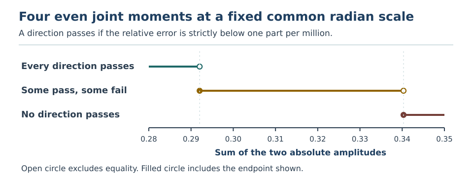
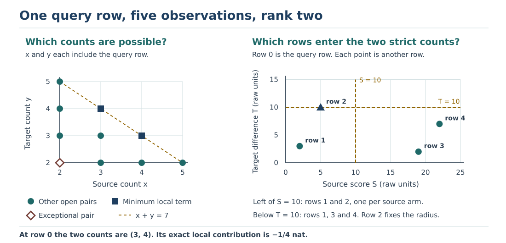

# Mathematical results guide for November 2026

**Sepehr Mahmoudian · 25 November 2026**

Which information measures come from published work, and what can pid-rs establish about their values, estimates and uses? The guide covers finite categorical inputs, angular approximation and strict neighbour counts. The angular example gives two sharp pass thresholds and the least number of moments for the full amplitude range. The robot example compares two sets of class labels for the same 47 recorded cases. The [foundation guide](MATHEMATICAL_RESULTS_GUIDE.md) and its [28-page PDF](output/pdf/mathematical-results-guide.pdf) cover nine result families.

## Reading the results

A **law** gives outcome probabilities. An **empirical law** uses relative counts. **Coverage** is the probability, over repeated original samples, that an interval contains the population value. Partial information decomposition (PID) assigns information from **sources** about a **target**. In the finite shared-exclusions method of Makkeh, Gutknecht and Wibral, each node lists one or more nonempty source sets, none containing another. The **matching event** matches all labels in at least one set. At each outcome with target value $t$ and matching event $A$, the pointwise value is $\ln[P(T=t\mid A)/P(T=t)]$. Redundancy is its probability-weighted average. Natural logarithms give **nats**. [Defining categorical paper](https://doi.org/10.1103/PhysRevE.103.032149) · [Method catalog](METHODS.md)

## Why the nominal 95% range has coverage 64/81

Draw four independent binary targets with probability $p=1/3$ of one. Both sources copy the target. Either source reveals its label, so the average information is the binary entropy

$$
H(p)=-p\ln p-(1-p)\ln(1-p),\qquad H(1/3)=\tfrac13\ln(27/4)\ \text{nats}.
$$

Set $0\ln0=0$. Each **bootstrap resample** draws four original rows with replacement. With $k$ ones it gives $H(k/4)$. For each original sample, seed 7 and block length one give 200 resamples. Sort their entropies in increasing order. Entries 5 and 194, counting from zero, give the nominal 95% range. [Derivation and software scope](FINITE_COPY_BOOTSTRAP_COVERAGE.md)

Both constant samples give $[0,0]$. Their total probability is $(1-p)^4+p^4=17/81$. Each of the other 14 ordered samples gave endpoints zero and approximately $\ln2$ nats, enclosing $H(1/3)$. The covered probability is $1-17/81=64/81$. [Exact table and stored endpoints](audit/evidence/finite-copy-bootstrap-coverage/README.md)

---

## What a fitted quantizer fixes

A **quantizer** assigns each raw observation a categorical label. A fitted quantizer depends on the training data. The map must be measurable using only the training information and its current raw input. After conditioning on training, this fixes the map. The evaluation rows must then be conditionally independent and identically distributed for the stated convergence result. Independent held-out rows are one way to meet the premise. Pooling outputs from different fitted maps leads to a different question. [Convergence theorem and conditional counterexamples](FINITE_ALPHABET_PLUGIN_CONVERGENCE.md)

Let $Q$ be the fitted map, $W$ one raw evaluation row and $P_Q$ the conditional law of $Q(W)$ given training. The categorical estimate targets the chosen quantity of $P_Q$. Nonlinearity matters. For example, if separate training outcomes select opposite constant labels for every variable, each conditional law has zero entropy. An equally weighted mixture of the two point masses has entropy $\ln 2$ nats.

The policy for out-of-range rows matters too. Write $\eta$ for the conditional probability of rejection on one row. Conditional independence gives $(1-\eta)^n$ for success on all $n$ rows. When $\eta>0$, that probability tends to zero. A declared rejection-sampling rule can target the conditional law of successful rows. Clamping is a different specified map. At identical fitted edges both policies give exactly the same labels whenever the evaluation row lies in range, including the endpoints. [Fitted-map and policy assumptions](FINITE_ALPHABET_PLUGIN_CONVERGENCE.md)

## When an absolute-value optimization clips its answer

Before and after a change of source labels, the study compares the information assigned to each node. Let $d$ be its signed change in nats. The optimizer maximizes a sum of modeled magnitudes $t\geq0$. A binary variable chooses a sign. For $|d|\leq M$, the two bounds at that sign give $t\leq|d|$ and $t\leq M-|d|$. Here $M$ is a nonnegative constant in nats. The true magnitude fits exactly when $M\geq 2|d|$.

Let source two copy a target uniform on four symbols. Sources one and three are constant. Before recoding, the only nonzero atom is $\ln4$ nats at the node whose only group is source two. Five cumulative values contain this atom. In each of their nodes, every group includes source two. A group of constant sources would match all four rows.

Recode all sources to constants. All cumulatives and atoms are then zero. Thus the only nonzero magnitude is $|d|=\ln4$. The old rule used $M=\ln4+1$ nats, so its second bound forces $t\leq1$ nat. This explains how the modeled maximum falls below $\ln4$.

In general, let $B$ be the sum of four entropies: the joint source entropy and its conditional entropy given the target, both before and after recoding. Let $L$ be the original joint source–target mutual information minus its recoded value. Then $M=B+|L|$ suffices throughout the optimization. On the 30 archived distributions $|L|<0.106$ nat, so their choice $M=B+1$ nat suffices. Exact certificates for the reported numerical maxima remain open. [Sign constraints, example and proof](audit/evidence/source-partition-sign-margin-2026-11-19.md) · [Source-partition study](audit/research/source-coupling-compression/EXPOSITION.md)

---

## Reconstructing integer counts from one byte string

A **key** contains three labeled source states and one target state. A state is an ordered array of tokens. A **canonical** encoding assigns one spelling to each admitted table. The input rows have positive integer counts, distinct keys and the specified increasing order. An encoder $E$ writes the table $T$. A reader $D$ parses a byte string $b$ that obeys the grammar. [Original input specification](claims/SX-CERTIFIED-AVERAGED-PID3-001/bindings.md)

Each state has one to 64 tokens from the specified American Standard Code for Information Interchange (ASCII) character set. The grammar admits one to 1,024 occupied rows. A count has at most 4,096 decimal digits and the total count has at most 8,192 binary digits. The complete input, including its terminal line feed, has at most four mebibytes, or 4,194,304 bytes. These are mathematical domain restrictions and file limits.

The project proof gives both identities

$$
D(E(T))=T,\qquad E(D(b))=b.
$$

Each token excludes quote and backslash, so the closing quote marks its end. A decimal count has a nonzero leading digit and a unique expansion in base ten. The remaining punctuation and fixed member order locate every array, field and row. Finally the reader verifies distinct increasing keys, the declared bounds, and the single terminating line feed. Reading equal encoded words therefore returns equal labeled integer tables. These facts concern this particular grammar. JavaScript Object Notation (JSON) allows multiple spellings for equivalent data. [Proof and reference reader](audit/research/categorical-count-table-encoding/README.md) · [JSON standard](https://www.rfc-editor.org/rfc/rfc8259)

A proper prefix precedes its longer state. For example, `["A"]` comes before `["A","A"]` in the required table order. Comparing these arrays after encoding instead compares a closing bracket with a comma. The comma has the smaller ASCII value, so this byte comparison reverses the intended order.

For the separate finite check, each of the four state positions takes one of three values: `["A"]`, `["A","A"]` or `["AA"]`. This gives $3^4=81$ keys. A table uses one or two distinct keys, and each count is 1, 9 or 10. The number of labeled tables is

$$
81\cdot 3+\binom{81}{2}\cdot 3^2=29{,}403.
$$

All 29,403 emitted words were distinct and the tested readers recovered the corresponding tables. Prefixes and the transition from one decimal digit to two are both exercised. The written two-sided argument applies to the specified positive-input language. The examples cover neither all input bytes nor all field values. The full three-source certificate additionally requires an output schema and its scientific correspondence. [Certificate obligations](claims/SX-CERTIFIED-AVERAGED-PID3-001/obligations.md)

---

## What the 22 checked count statements establish

There are three named sources. The source and target labels can have arbitrary types with decidable equality. The counts sum over a finite set of row indices. Each index has a natural-number weight, three source labels and a target label. Choose any reference index (the key) and a family of source collections. The **source event** holds at a row when all sources in at least one collection match their labels at the key. A Boolean disjunction of these conjunctions tests the same event. [Formal definitions, declarations and replay](audit/research/three-source-alphabet-counts/README.md)

Write $N$ for the total weight, $U$ for the source-event weight, $T$ for the target-match weight and $V$ for the weight of their intersection. These symbols denote counts on this page. Nonnegative weights and event inclusion give

$$
V\le U\le N,\qquad V\le T\le N.
$$

If the family is nonempty and the key belongs to the summed index set, its row contributes its own weight to $V$. A positive weight at that key therefore makes all four counts positive. Lean is a system for checking formal proofs. Stock Lean 4.34.1 compiled and replayed 22 theorem types about counts, order and the Boolean representation. The replay loaded compiled imports. Loading them did not repeat every inference in each imported proof. The definition comparison covered nine pairs and one auxiliary definition. Paper correspondence, Rust and floating-point refinement, the original Lean 4.33 protocol and human review remain open. [Exact checked scope](audit/research/three-source-alphabet-counts/README.md)

A separate proof checks both assertions in the archived count test W02. The first is the literal true. The second denies that exactly 18 of the 128 families of the seven possible branches are valid **and** that 18 listed codes are distinct. Both conditions hold, so the second assertion is false on every assignment. The test omits the separate check that every listed code represents a valid family. [Count, source and checked proof](audit/research/three-source-w02/README.md)

## Rust implementation and computational cost

The bootstrap entry point is `experimental::pipelines::block_bootstrap`. The study enabled the Cargo feature `experimental-pipelines` and disabled default features. Each replicate calls the stable categorical function `discrete_sxpid2_averaged`. The driver evaluated the statistic on 3,200 four-row replicates across 16 ordered samples. Fitted-quantizer cost includes fitting and applying the map before computing the categorical functional. The reference byte reader is written in Python, and the arbitrary-alphabet statements are Lean proofs. The source-partition optimizer is an exploratory offline Python calculation. These proofs and finite observations provide no production latency or sampling-calibration guarantee. The reports give exact inputs, limits and source routes. [Copy-study cost](FINITE_COPY_BOOTSTRAP_COVERAGE.md) · [Engineering cost reference](RUST_IMPLEMENTATION_AND_COST.md)

---

## When rounding changes a normalized degree

Mutual information measures how much observing sources reduces uncertainty about a target on average. Let $m$ be the number of sources and $J>0$ their joint mutual information with the target, in nats. The average degree of redundancy sums the mutual information from each source alone and divides by $J$. The average degree of vulnerability sums the losses in joint information when each source is removed and divides by $J$. For one common finite distribution, including an empirical one, both degrees lie in $[0,m]$. Using the whole source tuple as target gives the two source-only entropy ratios when the joint entropy is positive. Binary64 is the 64-bit floating-point format in the IEEE 754 standard. It stores one sign bit and 11 exponent bits. A normal value has 53 bits of precision. Rounding each exact mutual information once to its nearest binary64 value, with ties to even, preserves order and nonnegativity, though $J$ can round to zero. A limit above the numerical floor can still round to it. Separately fitted estimates can violate the bounds. [Defining equations](https://arxiv.org/abs/2504.15779v1)

Three marginal inputs of $1/16$ nat and $J=10/16$ nats give the exact redundancy degree $3/10$. Earlier Rust code returned the next binary64 value above its nearest representation. The corrected functions round the ratio and its original-unit numerator independently. On a 64-bit target, each fixed accumulator array has 34 words and work grows linearly with $m$. Across 184 fixed calls, the earlier code differed on 41 reports. The corrected code matched all seven fields on every call. These calls test supplied numbers. A population law realizes the worked inputs. Exact finite-table mutual information in nats is zero or irrational, although one table can reproduce all the once-rounded inputs. [Arithmetic, examples and Rust cost](audit/research/normalized-shannon-arithmetic/README.md) · [Hosted observations](audit/evidence/normalized-shannon-reports-2026-11-20/receipt.json) · [Integer-exponential proof](https://doi.org/10.3931/e-rara-101019)

## What six three-source certificates establish

The six tables are the negative, unit and weighted cases, the negative case after relabeling or source permutation, and the unit case after doubling its counts. Each table has two to five occupied rows. Dividing their counts by the total gives its empirical distribution. The decomposition uses the 18 nonempty families of pairwise incomparable nonempty source subsets. One family asks whether source two or source three matches the row. A family’s cumulative value includes contributions from all families below it in the shared-exclusions order. Subtracting those contributions gives its atom. Each cumulative value and atom has informative, misinformative and signed net components. For all 648 named coordinates (108 per table), a second calculation recovered the exact rational product $Q$ and enclosed its value $\ln(Q)/N$ in the reported interval, where $N$ is the total count. Every nonzero such coordinate is irrational in nats. Each interval was at most $2^{-160}$ nats wide.

In the negative case, the atom for a match on source two or three has $Q=9/16$ and signed value $\ln(9/16)/3$ nats. The weighted table has a constant target and all 36 net values are zero. The transformation and constant-target checks covered 360 relations. Direct event comparisons grow quadratically in the occupied row count. Product and logarithm costs also depend on bit length and precision. The producer declared heap plans of 42,212,880 to 42,611,592 bytes for these six tables. The general construction and verification obligation (D1) and complete source custody (P1) remain open. [Tables, exact values, resource bounds and scope](audit/research/three-source-six-certificate-observations/README.md)

---

## What four field lemmas and 65 fixed solver queries establish

A categorical state table lists occupied rows and their positive integer counts. To obtain the empirical law, divide each count by the total count. An average weights each occupied row by this fraction. The input has three named source states and one target state. A state contains a sequence of text tokens. A token contains 1 to 128 bytes from a 66-character alphabet. The file places a quotation mark before and after each token.

For this field, the project defined a reader and writer in Lean. The stock checker verified four statements about the token. The reader consumes the exact written token and leaves every following byte in place. A successful read returns only an admitted token and its exact following bytes. The read therefore has an exact inverse on these words, and its split is unique. For the bytes spelling a quoted letter A followed by a comma, the reader returns A and leaves the comma. The enclosing row grammar still has to read that comma. A separate check tested all 256 individual byte values. Ten complete input and certificate pairs passed their finite checks. The general claim that the full certificate program accepts exactly the right files remains open. [Four statements and complete examples](audit/research/categorical-state-token/README.md) · [Illustrated token report](output/pdf/categorical-state-token.pdf)

A second study asks whether the premises of 22 earlier logical checks actually have examples. A **premise** is an assumption put into a logical statement before its conclusion. A **solver** tests whether given conditions can hold together. The 65 fixed assignments made the recorded premises true in 44 cases and false in 21. Three premises were the constant true and could not fail. In one four-cell example the total count is 10. Six observations match the source event, five match both the event and the target, nine match the target, and the chosen cell has count two. A stock solver reproduced all 65 original responses. Four additional inputs check a second example and three changes to it. This tests the assumptions on listed inputs. The original statements and their proof records have their own scope. [Source assumptions, false inputs and complete solver record](audit/formal/three-source-original-premises/README.md)

---

## Published methods and the results established in pid-rs

**25 November 2026.** Sepehr Mahmoudian describes the following results for their stated probability laws. Makkeh, Gutknecht and Wibral (MGW) defined the finite categorical shared-exclusions measure. An informative value measures how surprising a source match is. Its misinformative counterpart uses the probability of that match given the target. Their difference is signed. A **cumulative value** includes all contributions at and below a node. Its **atom** is what remains after subtracting the atoms strictly below it. Averaging weights each supported complete row by its probability. A supported row has positive joint probability. [MGW, version 5](https://arxiv.org/abs/2002.03356v5)

### Continuity when a category appears or disappears

MGW supplied the source events, the ordered nodes and the signs of the two component atoms. The pid-rs proof compares any two laws on one fixed finite alphabet, even when a cell has positive mass in only one law. It bounds changes in every averaged cumulative and atom, for all three components.

The proof separates probability that appears or disappears from changes on the shared support. At small total variation distance $d$, half the sum of absolute cell-probability differences, the worst change can have order $d\ln(1/d)$. A constructed signed atom attains leading coefficient two. The bound concerns averages. A local logarithm can diverge at a disappearing state. Selected supporting inequalities have Lean proofs. The complete bound is a written derivation. [Assumptions, proof and sharp examples](SUPPORT_CHANGE_TOLERANT_AVERAGED_SXPID_CONTINUITY.md)

### Exact signs from a supplied two-source count table

MGW supplied the information coordinates. Logarithm rules turn products into sums, and the finite lattice gives integer coefficients. The project connects an actual two-source count function to all 24 averaged coordinates. They cover four nodes, two kinds of value and three components.

For total count $N>0$, each value is $\ln(Q)/N$ for a specified positive rational $Q$. Comparing $Q$ with one decides the sign, including exact cancellation. A Lean proof starts with supplied counts. A finite enumeration found 16 nontrivial exact zeros among 308,856 tested coordinates with at most eight rows on a binary alphabet. Reading raw bytes, Rust rounding and population inference need separate evidence. [Count-to-atom proof](audit/formal/TWO_SOURCE_SXPID_COUNT_ATOM_BRIDGE.md) · [Exact-product search](audit/formal/EXACT_LOG_PRODUCT_SXPID2_ASSURANCE.md)

---

### Approaching an atom with a finite row experiment

MGW defined the population atom. The project designed a statistic that takes one fresh categorical reference row followed by $h$ independent rows from the same law. Each complete row contains every source and the target. Its increments use source matches, target matches and their arrival ranks. The **prefix** consists of the rows seen so far. For a fixed node on a finite alphabet, the statistic's expectation approaches the signed atom as $h$ grows. For example, let $q_z$ be the probability that a new row matches the source event and target of a supported reference $z$. If all $q_z$ have a justified lower bound $0<\eta\le1$, the error in the mean is at most $(1-\eta)^{h+1}/[(h+1)\eta]$. Observed frequencies alone do not establish that floor.

The derivative of the finite expectation uses the classical probability-score rule and includes the score of the reference row as well as the comparison rows. Here a row's score is its probability derivative divided by its probability. The derivative assumptions include locally fixed positive support. Three local Lean targets address the mean, five the finite-horizon error and eleven the derivative study. A short-prefix mean can have the wrong sign. These bounds give neither the sampling error of an observed block nor the performance of a learner. [Mean experiment](audit/formal/lean-prefix-mgw-mean/EXPOSITION.current.md) · [Finite-horizon bounds](audit/formal/lean-prefix-mgw-bias/EXPOSITION.md) · [Derivative and sources](audit/research/finite-prefix-mgw-gradient/EXPOSITION.md)

### Equal synergy and unequal gains in prediction

MGW defined the signed synergy atom. Shannon conditional mutual information (CMI) measures the information about a target added by a second observation given the first. For an ideal probability forecast, it equals the reduction in expected logarithmic loss, the negative log probability assigned to the label that occurs. The project compares the two quantities in one law. Let $A,B,U$ be independent fair bits, take the target $(A,B)$ and keep $A$ as the first source. Adding either $U$ or $B$ gives signed MGW synergy $\ln(4/3)$ nats. The respective CMIs are zero and $\ln 2$.

For a target that includes a copy of source one, the project derives the local synergy from the source law alone. If $a$ and $c$ are the two observed marginal probabilities and $j>0$ is their joint probability, it equals $\ln(ac/[j(a+c-j)])$. The fixed-world and target-copy packages have 21 and 11 local formal targets. On a later office recording, adding carbon dioxide to a fitted light predictor worsened mean log loss from 0.047443 to 0.050762 nats. That recording illustrates the need to evaluate the actual predictor. [Matched finite laws](audit/evidence/mgw-fixed-world-added-information-2026-09-09.md) · [Target-copy identity](audit/evidence/finite-target-copy-mgw-synergy.md) · [Office comparison](audit/evidence/real-occupancy-sensors-example-2026-09-08.md)

---

### How recoding sources redistributes signed atoms

MGW supplies the atoms. Meilă's **variation of information** is the sum of the two conditional entropies of one labeling given the other. The project couples two equally indexed finite source tuples and their common target in one joint law. It bounds the sum of absolute changes in signed averaged atoms by a weighted sum of these entropy distances over source subsets. With three sources the weights are 22 for each singleton or pair and one for the full triple. Matching only the two source histograms does not supply the required coupling with the target.

For a direct check, let $L$ be the old joint mutual information minus the new one. Let $R$ be the total magnitude of the negative old-minus-new atom differences. The sum of absolute changes is $L+2R$, so a small change in total information can accompany redistribution. A separate lower bound uses the seven changes in subset mutual information. Its proof includes 48 exact dual certificates showing the bound obtainable from these linear data. The 30 archived numerical maxima still lack individual exact certificates. A bound on redistribution does not measure forecasting performance. [Meilă's distance](https://doi.org/10.1145/1102351.1102424) · [Project bounds and exact certificates](audit/research/source-coupling-compression/EXPOSITION.md)

### From dependent observations to a bound on averaged atoms

Janson's concentration proof supplies a factor determined by the sizes of groups of independent observations. The project applies it first to frequencies of complete categorical rows and then to the MGW continuity bounds. Fix the groups before observing outcomes. Every row must have the same joint law, and complete rows within each group must be mutually independent. Dependence across groups is allowed. If group $a$ has $n_a$ rows, set $V=(\sum_a\sqrt{n_a})^2$. For $n$ rows, an alphabet of $K\ge2$ cells and a positive threshold $e$, the probability that the sum of absolute cell-frequency errors reaches $e$ is at most

$$
\min\{1,(2^K-2)\exp[-n^2e^2/(2V)]\}.
$$

Ten independent fair bits give eight overlapping windows of length three. Starting the windows in three residue classes gives independent rows within groups of sizes 3, 3 and 2. Exact enumeration covers all 1,024 bit strings. A serial sensor recording needs its own justification for such a grouping. The finite-alphabet bound can exceed one before applying the trivial probability cap. [Janson's concentration result](https://doi.org/10.1002/rsa.20008) · [Project transfer and window calculation](DEPENDENCY_COLORED_SXPID_CONCENTRATION.md)

---

### Five positions account for a third categorical source

MGW provided the lattice inversion and proved that informative and misinformative atoms are separately nonnegative. The project identifies the five positions in the full 18-node lattice outside the lower set of the first-pair node. Four use a single source group. The possibilities are $\{3\}$, $\{1,3\}$, $\{2,3\}$ or $\{1,2,3\}$. The fifth accepts a match on either $\{1,3\}$ or $\{2,3\}$. Subtracting the first-pair cumulative from the full cumulative cancels the other thirteen positions. Let $A=H(S_3\mid S_1,S_2)$ be the remaining uncertainty in source three after observing the first pair, and let $B=H(S_3\mid S_1,S_2,T)$ also condition on the target. The informative and misinformative averages on those five positions sum to $A$ and $B$.

Their signed sum is $A-B$, the added CMI. The sum of absolute averaged signed values lies between $A-B$ and $A+B$. If the first pair determines source three on positive support, all five local component pairs vanish. Zero added CMI alone does not give that conclusion. The project proof is an exact finite argument about one law. [Five positions, proof and counterexample](output/RESEARCH_NOTES_2026_10_10.md)

### A continuous angular reference with a relative error bound

Ehrlich and coauthors defined continuous shared exclusions from sums of densities. The project chose a four-angle population law and bounded its averaged three-source top atom. In radians, let $L=2\pi$ and use product Lebesgue measure. For angles $s_1,s_2,s_3,t$ on the circle, the joint density is

$$
p(s_1,s_2,s_3,t)=L^{-4}[1+a\cos(t-s_1)+b\cos(t-s_1-s_2-s_3)].
$$

For real $a,b$ with $r=|a|+|b|<1$ it is positive and normalized. The sources are independent and uniform, and the target is uniform. When source two is integrated out, the joint density of the retained sources and target keeps the first cosine. At $b=0$ and $a\ne0$ the extra sources give zero conditional information beyond source one, although the top atom is positive. The project proves that the top atom is at least $a^2/8+b^2/4$. For $0<r\le1/2$, eight even moments of the joint term give relative truncation error at most $1/1{,}253{,}376$. At the origin the absolute truncation error is zero and relative error is undefined. The hand derivation and exact rational checks concern this law and gauge. Parameter fits, estimator error and a general continuous implementation require other evidence. [Ehrlich et al., version 3](https://arxiv.org/abs/2311.06373v3) · [Derivation and rational checks](audit/archive/angular-relative-bound-20261005/ARCHIVE.md)

The project also asks how large the radius can be when only **four even moments** are used. Let $J$ be the mutual information between all sources and the target. Seven proper nodes enter the top-atom formula. Each has only pair branches. If a fraction $w$ of its branches contain source one, write $R(w)$ for its averaged value. The top atom is $J-R(1)-R(2/3)+2R(1/2)$. The approximation keeps these three proper terms exact and replaces only $J$.

For every direction through $r=583/2048$, with $r>0$, the four-moment error is below one part per million. The point $a=1197/4096$, $b=0$ exceeds it. An exact scan of 2,048 radii gave these two bounds, separated by $31/4096$. [First four-moment study](audit/research/angular-four-moment-radius/EXPOSITION.md) · [Report PDF](output/pdf/angular-four-moment-radius.pdf) · [Exact certificate](audit/research/angular-four-moment-radius/certificate.json)

Let $M$ be a positive integer. Keep the first $M$ even moments of the joint term. The proof shows that only the two first-harmonic directions $(a,b)=(r,0),(-r,0)$ give the largest relative error at each $0<r<1$. This largest error increases strictly with radius. With four moments it reaches one part per million at one radius, about 0.29203860877613. Below it every direction passes the strict test. At the threshold only the two first-harmonic directions reach equality. Above it those two directions fail. The population proof uses exact proper terms and no sampled angles. [Extremum proof](audit/research/angular-truncation-extremum/EXPOSITION.md) · [Report PDF](output/pdf/angular-truncation-extremum.pdf) · [Root certificate](audit/research/angular-truncation-extremum/certificate.json)

---

### How many terms suffice when the density can reach zero?

In the four-angle law above, the radius is $r=|a|+|b|$. At $r=1$ the density can reach zero. A zero requires each cosine to equal $-1$ for a positive coefficient and $+1$ for a negative coefficient. A uniform phase reaches each specified extreme with probability zero. The population average weights a logarithm by its density. For a density factor $z$ between zero and two, $z\log z$ tends to zero as $z$ decreases to zero. The proper terms also have integrable weighted logarithms. The proof therefore gives the averaged top atom on the whole boundary. Its value at the origin is zero, where a relative error has no denominator.

For $0<r\le1$, only $(a,b)=(\pm r,0)$ give the largest relative error at fixed $r$. That error increases with $r$. Thus testing the first axis at $r=1$ decides whether a chosen number of moments is enough at every radius and direction. Let $H$ be its exact top atom there and $T_M$ the omitted joint tail in nats after $M$ even moments. The signed excess $T_M-10^{-6}H$ is negative exactly when the strict test passes. At $M=7{,}277$ it is strictly positive. At $M=7{,}278$ it is strictly negative. All tails decrease with $M$. Hence **7,278 is the least order** that gives relative truncation error below one part per million throughout the nonzero diamond. This result assumes exact proper terms. It gives a mathematical reference for an implementation. Sampling error and rounding need separate bounds. [Unit-amplitude proof](audit/research/angular-unit-boundary/EXPOSITION.md) · [Numerical certificate](audit/research/angular-unit-boundary/certificate.json) · [Illustrated report](output/pdf/angular-unit-boundary.pdf)

Four moments also give a useful pair of test inputs. At $(0.30,0)$ the error exceeds one part per million. At $(0,0.30)$ it falls below that limit. The earlier sufficient bound showed that from $0.39$ through $1$ all directions fail. The next page gives the smaller threshold where this failure first holds in all directions. These cases concern known population laws in a common radian scale. [Recompute both directions](audit/research/angular-unit-boundary/replay.py)

---

### Where four even moments pass and fail

Keep all three proper-source integrals exact in the four-angle law. For amplitudes $a,b$ put $r=|a|+|b|$. A direction fixes $|a|/r$ for $r>0$. The test is strict. The omitted joint tail divided by the exact top atom must be below one part per million. For every positive finite number of even moments this error increases on each fixed direction. The minimum over all directions increases as well. The proof bounds the radial growth of the positive atom and compares it with the growth of the omitted tail.

The first threshold lies between $0.292038608776134$ and $0.292038608776135$. Up to this threshold, excluding both zero and the threshold, every direction passes. From the first threshold up to the second threshold, including the first and excluding the second, some directions pass and some fail. The second threshold lies between $0.340315168725$ and $0.340315168726$. From the second threshold through one, all directions fail. At zero the relative error is undefined. Above one the proposed density can be negative. Exact rational interval calculations and a separate polynomial root count certify the second bracket. Thus a simulated system at radius 0.33 can change the decision by changing the two amplitudes. At 0.35 no direction meets the tolerance. [Derivation and three exact checks](audit/research/angular-ray-monotonicity/EXPOSITION.md) · [Nine-page report](output/pdf/angular-ray-monotonicity.pdf)

A separate numerical check selected integer amplitude indices before converting their values to the 64-bit floating-point format. It covered 2,244 pairs for an atom lower bound and 1,860 for an eight-moment remainder bound. The earlier floating-point filter omitted eight pairs on the boundary of radius 0.90. The finite sums do not certify quadrature accuracy between tested points. [Selection rule, signed margins and worked inputs](audit/research/angular-quadrature-grid/EXPOSITION.md) · [Grid figure and report](output/pdf/angular-quadrature-grid.pdf)

---

### Plug-in convergence for categorical data and a frozen transform

A **plug-in estimate** replaces a probability in the formula by its empirical frequency. MGW supplied one categorical decomposition and Williams and Beer defined the distinct minimum-information decomposition. Classical large-sample laws supply frequency convergence for independent identically distributed rows or for strictly stationary ergodic rows. The project establishes a common finite-alphabet contract. If every approximating law stays within the population support and its cell probabilities converge, the supported pointwise coordinates and their averages converge simultaneously. Eventually every positive population cell appears.

For a fitted quantizer, condition on training and keep the map fixed during evaluation. The target is the resulting categorical law. Repeating one random fair bit indefinitely gives a stationary process whose empirical table is always a point mass. This limit result does not supply finite-sample interval coverage. [Williams and Beer, version 1](https://arxiv.org/abs/1004.2515v1) · [Project convergence theorem and frozen-map premises](FINITE_ALPHABET_PLUGIN_CONVERGENCE.md)

### A report that keeps one true sensor reading

MGW described the event that at least one source statement is true. It identifies the set of states compatible with such a report. A forecast also needs a rule for how the report arose. In the project's exact binary game the target equals source one and a report preserves at least one true field. Each of the two matching source pairs has probability $9/20$ and each differing pair $1/20$. The fair constant forecast minimizes the worst permitted expected log loss, attaining $\ln 2$ nats. The forecast conditioned on the compatible set has worst-case loss $0.9\ln(19/9)+0.1\ln 11$, which exceeds $\ln 2$. With a known channel uniform among each state's three allowed reports, the same conditional forecast instead minimizes ordinary expected loss.

A separate simulation injected faults into two office recordings. When told the correct fault count, the forecast based on compatible states won 39 of 40 point comparisons against five baselines under random or stuck faults. Eight difference intervals included zero. In all four worst-case conditions the constant prior had lower loss. These were injected faults on previously examined recordings. [Finite game and reporting channel](output/RESEARCH_NOTES_2026_10_10.md) · [Office simulation, baselines and limits](audit/research/fault-tolerant-shared-exclusions/EXPOSITION.md)

---

### Force and torque signs in five recorded robot tasks

The donors call the five learning problems LP1 to LP5. The instrument measures force and torque along three axes. Here axial means along its $z$ axis. Each task maps 15 axial force and torque samples to two least-squares slope signs. The target is its recorded class. There are 463 task records and 251 distinct complete sensor traces. LP2 and LP3 reuse the same 47 transfer cases. Their empirical source pairs give the same informative MGW redundancy. The two targets give different signed redundancies. In LP4, torque adds 0.038614 nat given force. Force adds 0.017518 nat given torque. Collision is the most frequent class at each occupied sign pair. The class prior, force alone, torque alone and both signs each give 72 correct labels in 117 records. Both conditional gains are positive in all five tasks. The signed force-unique atom in LP4 and torque-unique atom in LP5 are negative. In LP5, two labels occur on identical measurements. Performance on new trials needs a separate test. [Original experiment, p. 386](https://doi.org/10.1007/978-1-4615-5725-8_23) · [Trace comparison](audit/research/robot-wrist-slope-signs/trace-provenance.json) · [UCI dataset](https://doi.org/10.24432/C5M89N) · [Robot study](audit/research/robot-wrist-slope-signs/EXPOSITION.md) · [Report PDF](output/pdf/robot-wrist-slope-signs.pdf) · [Exact certificate](audit/research/robot-wrist-slope-signs/certificate.json)

**One pair of source signs.** In the 47 transfer records, 24 have a negative force slope, 18 have a negative torque slope, and nine have both. Thus $24+18-9=33$ records match at least one negative sign. This pair contributes $(9/47)\ln(47/33)$ nats to the informative redundancy. All five occupied sign pairs together give 0.284314 nat in either task. Subtracting the mean misinformative part uses each task's target. The resulting signed redundancies are 0.063624 nat for robot behaviour in LP2 and 0.014394 nat for part position in LP3. [Source-marginal factorization](SXPID3_SOURCE_MARGINAL_AND_BOUNDED_AUDIT.md)

**What repeat measurements permit.** Joining the LP2 and LP4 files in order reproduces 163 of the 164 LP5 traces. Position 37 differs in 24 of its 90 integers. Within LP5, one group of identical traces has two different labels. Even a rule that memorises every complete trace and chooses its most frequent class can give at most 163 correct labels on this table. An estimate for new physical trials needs a test set where records from a common trial stay together. [Donor task comparison and limits](audit/research/robot-wrist-slope-signs/EXPOSITION.md)

**Computation.** The default categorical Rust routes evaluate empirical MGW for two to four sources with machine counts and binary64 logarithms. The exact-count proofs, prefix experiments and angular bound have their own inputs and evidence. The angular endpoint checks run offline with exact bounds. The public Rust API has no continuous three-source evaluator for it. These studies give no measured Rust speed or floating-point guarantee. [Rust APIs and cost](RUST_IMPLEMENTATION_AND_COST.md)

Model assistance supported source comparison, drafting and checking. Cite Sepehr Mahmoudian (2026), *Mathematical results guide for November 2026*, with the exact repository commit or release. [Software citation](CITATION.cff)

---

### Which neighbours enter a local information estimate?

Consider $n$ real sample rows and an integer rank $1\le k<n$. Measure all differences from one row, the anchor. The scalar mutual information estimator of Kraskov and coauthors uses the absolute source and target differences. The continuous shared-exclusions estimator of Ehrlich and coauthors uses the smaller of two absolute source differences and a separate target difference. Each construction uses the larger of its source and target distances to find the joint radius. Assume that the $k$th joint distance is positive and belongs to exactly one neighbour.

Write $x$ and $y$ for one plus the numbers of other rows with source or target distance strictly below the radius. In either construction the possible pairs are exactly the integers with $k\le x,y\le n$ and $x+y\le n+k$. Every admitted pair except $(k,k)$ occurs on an open set, which means it persists under sufficiently small changes to all coordinates. At the exceptional pair, two absolute coordinate differences are equal. For signed differences that are distinct up to sign, each such equality gives at most two proper hyperplanes. Their finite union has zero probability when all sample coordinates have a joint density. Independent rows from any common density give positive probability to each open pair.

For three rows at rank one, the smallest local contribution is $-1/2$ nat. Its smallest possible mean over all three anchors is $-1/3$ nat. For one fixed five-row two-source example the exact mean is $1/4$ nat. The Rust report gave 0.25000000000000017 nat. The five Lean declarations cover integer distance triples. The real-coordinate and sample-mean proofs are separate written arguments. A count test alone does not identify the two population functionals. [Construction, open sets, sample means and exact examples](audit/research/strict-neighbour-count-geometry/README.md) · [Illustrated report](output/pdf/strict-neighbour-count-geometry.pdf) · [KSG estimator](https://doi.org/10.1103/PhysRevE.69.066138) · [Continuous shared exclusions](https://doi.org/10.1103/PhysRevE.110.014115)
