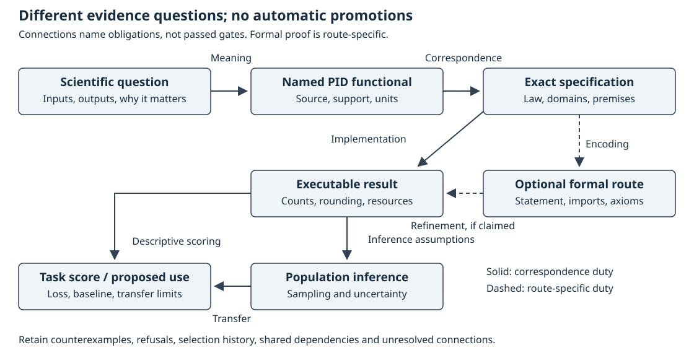

# AI-assisted research: process, evidence and limits

Sepehr Mahmoudian · 10 October 2026.

This is a project-defined process report, not a new partial information
decomposition (PID) theorem or a claim
that this workflow outperforms another research system. Useful current
guidance is in the [reader contract](RESEARCH_READER_AND_VERIFICATION_CONTRACT.md).
Its predecessor [PDF in output](output/pdf/research-reader-contract-v2-draft/STATUS.md)
is an **UNQUALIFIED FAILED-BUILD DRAFT**. Qualified PDFs for the current
contract and this report remain open; neither is represented by that draft.

## Question and scientific objects

The question is whether artificial intelligence (AI) can help derive, challenge and explain correct,
useful shared-exclusions results while making their remaining gaps visible.
Correct mathematics, correct computation and useful decisions are separate
outcomes. A persuasive manuscript is not evidence for any of them.

The categorical lane uses Makkeh–Gutknecht–Wibral's (MGW) finite event-logical
functional; the continuous lane uses Ehrlich et al.'s distinct density-based
functional. Quantization changes the quantity being studied. Natural-log
information values are in nats. Population support and sampling conditions
must be declared, not inferred from a finite recording. The
[results guide](MATHEMATICAL_RESULTS_GUIDE.md#1-reading-conventions-and-semantic-firewall)
links both defining publications and explains these boundaries.

## Actual strategy, not an idealized history

AI is used for candidate derivation, source inspection, counterexamples,
code and arithmetic review, and exposition. For decisive claims, a route
freezes its first derivation before exposure to another candidate. Later
critique is explicitly exposed. The integrator checks the cited evidence
and records objections and dispositions. Shared models, libraries, data,
parsers and custody routes remain shared dependencies.

Ten proposed routes are ten alternatives, not ten executed candidates.
Fifty questions applied by one reviewer are one review with fifty questions,
not fifty independent confirmations. Model algebra is not human verification.
No new human-verification receipt is supplied by this report. Unknown model
training exposure and missing campaign-wide attempt counts remain unknown.

Why use this strategy? Independent-first reconstruction can expose a shared
mistake before discussion aligns the answers; adversarial review targets
the surviving argument. This is a rationale, not a measured causal benefit.
Direct algebra, a known library theorem, exact enumeration, ordinary tests,
a solver, a simpler non-PID analysis and no change remain real alternatives.

## Which evidence supports which conclusion?

A **correspondence edge** is the justified connection between two stages,
not merely a hyperlink between their files. Each edge needs its own premises
and evidence. A formal theorem can be correct while encoding the wrong
scientific quantity; a correct quantity can be estimated badly; an accurate
estimate can add nothing to a decision.

The figure is a reading map, not a mandatory pipeline or a claim that its
connections have passed. Exploratory computation need not start with a new
formal proof; descriptive task scoring need not assert population inference. Exact
finite laws need no independent and identically distributed (IID) sampling
assumption to be mathematical objects. Population
inference needs a separate sampling model; temporally adjacent rows and
overlapping date slices are not automatically independent repetitions.
The current stock-Lean promotion hold remains applicable.

## Checked examples and negative findings

These examples are observations of existing work, not a new experimental
campaign. Complete private receipts remain in durable local custody; the
table states their limits rather than implying public end-to-end replay.
SMT means satisfiability modulo theories: symbolic statements checked here by
the Z3 solver. Python optimization is a control-test mode here, not permission
to skip validation or alter mathematical tool settings.

| Existing case | What was checked or corrected | What remains unproved |
|---|---|---|
| [Assertion-removal false green](audit/evidence/research-process-observations-20261010.md#arithmetic-and-symbolic-checks) | A wrong-target mutation of an older arithmetic helper fails normally but prints success under Python optimization, which removes its assertions. Preserve the original and mutant; reject that success as validation. | No general claim about all Python checkers or formal tools. |
| [Explicit finite helper](audit/evidence/research-process-observations-20261010.md#arithmetic-and-symbolic-checks) | The successor uses explicit refusal predicates. Root replayed 2,226 exact finite checks and two domain refusals in normal and optimized modes; both valid runs exit 0. The wrong-target control exits 2 in both modes, removing that particular observed false green. | Integral identities, the supplied atom lower bound and population claims are not checked by that helper. |
| [Valid wrong targets](audit/formal/lean-sx-dnf-order/judge-v3/WrongTargets.lean) | Five declarations compile but their exports are rejected by retained [target-type controls](audit/evidence/dnf-order-formal-verification-2026-09-05/runs/v3-controls-normal.json). A valid proof need not solve the requested problem. | Historical execution is not fresh qualification of the currently held toolchain. |
| [Conditional symbolic algebra](audit/evidence/research-process-observations-20261010.md#arithmetic-and-symbolic-checks) | Five encoded implications and five premise-breaking satisfiable controls were replayed with unchanged stock Z3 4.16.0. Parser error followed by a later success token is refused. | Stock-solver outcomes are trusted here, not independently checked proof certificates. Imported analytic premises, source correspondence, Rust refinement and calibration remain separate. |
| [PDF predecessor](output/pdf/research-reader-contract-v2-draft/STATUS.md) | Three TeX passes succeeded, but the declared raw-log comparison failed. Equal PDF bytes and readable pages did not overrule it. The failure remains visible in output. | Qualified production, independent rebuild and current-source projection remain open. |
| [Occupancy exploration](audit/evidence/research-process-observations-20261010.md#occupancy-selection) | Each displayed family-specific minimum is over eight fixed subsets on the same exposed law. All scores and active-day losing comparisons are retained. | No inaccessible confirmation, causal sensor benefit, forecasting or deployment result. |

For the occupancy case, two official collections produce three target reports,
48 target/family/subset rule instances and 224 primary scores on 14 overlapping
laws. These are different counting units, not 224 independent trials. Additional
daily summaries repeat evaluations rather than add models. The executed route
fits encodings and classifier probability tables from training rows; that does not turn
exposed minima into unbiased confirmation. Campaign-wide candidate history
is incomplete. These are same-row classifications using categorical MGW,
not angular-law fits or future occupancy forecasts. MGW and Shannon quantities
use each evaluation empirical law, not those classifier tables. On 10 January
2018 the original-count full histogram loses to the empty model: mean log losses
1.21944 versus 0.92962 nats, despite favorable pooled values 0.24649 versus
0.49250. That day includes both occupied and empty rows, not occupied-only
scoring. No population uncertainty or deployment conclusion follows.

The useful correction is therefore not simply more reviews. It is explicit
accounting: what was selected, which evidence was reused, which defect a
check can detect, and what its passing result cannot establish. The
[existing audit protocol](PID_MATHEMATICAL_AUDIT_PROTOCOL.md), claim packets
and negative records remain authoritative in their own scopes.

## What transfers from recent research systems?

Only the following bounded process lessons are retained or adapted. None
caused the earlier angular derivation or established a pid-rs efficiency gain.

| Primary source | Useful lesson in this context | Boundary |
|---|---|---|
| [IdeaScientist v1](https://arxiv.org/html/2610.04074v1) | Search for a mechanism that addresses one exact missing step, then check its premises. | Proposal ratings, citation overlap and a retrieval cutoff do not establish correctness, novelty or unknown training exposure. |
| [ScientistOne v1](https://arxiv.org/html/2605.26340v1#A1.SS1.SSS0.Px3) | Link claims to their actual evidence and retain a concrete violation even when most model judges miss it. | Its Case 3 reports a violation flagged by only one of five judges. A majority is not an absence-of-defect proof. |
| [ScientistTwo v1](https://arxiv.org/html/2609.19644v1#S3.SS2) | Cheap exploratory screening can help choose a future test; ablation must answer the declared task question. | Reused benchmark feedback is development, not untouched confirmation. Embedded-appendix reading is incomplete here; no complete-paper or empirical-replay claim. |
| [AlphaProof Nexus author v2](https://arxiv.org/html/2605.22763v2#S3) | Expose exact unresolved propositions and detect a helper that merely hides the original theorem. Compare a direct library route before adding search machinery. | Main-method text was reviewed, not the complete proof appendix or inaccessible journal version. A compiling sketch with placeholders is not a proof. |

The [Science publication link](https://www.science.org/doi/10.1126/science.aej2213)
identifies the supplied journal article; it is not evidence that its inaccessible
full text was reviewed. Author-version comparison does not establish journal
equivalence. Failed retrieval and rejected transfers remain recorded.

## What is new here, and how could improvement be measured?

The present addition is a context-specific reader and evidence contract:
local symbol meanings, candidate-pool accounting, actual review lenses,
unresolved proof dependencies and separate evidence edges. It composes and
clarifies existing project safeguards. It is not a scientific-priority claim,
a new general agent architecture, or demonstrated superiority over the papers.

A future improvement claim needs a predeclared comparison against the
nearest simpler workflow on the same frozen problems. Record all attempts,
including invalid and valid-unselected outputs, and distinguish equal
allocations from measured use. Measure correct defect detection and false
refusal on independently constructed controls, completed exact obligations,
and total cost. Keep confirmation inaccessible to candidate selection and
state the independent sampling unit. Disclosure of the plan is not execution
or a guarantee of independence. No such controlled comparison is reported here.

Trust is strongest for the narrow exact predicates actually checked. Trust
is lower where semantic correspondence, empirical confirmation or tool
qualification remains open. SxPID3 Programs A–E, the original finite
obligations, hyperbolic qualification, certified evaluation and justified
real-world gains remain open. The useful next work is to close these exact
gaps, not improve a reviewer score.
