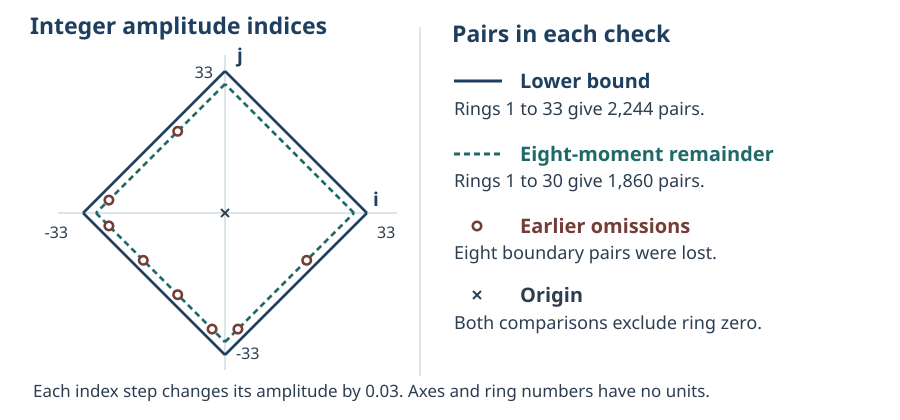

# A finite grid check for angular information

**Sepehr Mahmoudian · 2026 · Numerical study**

[Standalone PDF](../../../output/pdf/angular-quadrature-grid.pdf) · [Calculation](quadrature.py) · [Numerical result](quadrature-grid.json) · [Check the result](verify.py)

<!-- body -->
## Which inputs did the calculation cover?

A program checks two inequalities for a model of three angular sensors and one target angle. Which amplitudes does it actually test? An earlier test compared rounded amplitudes with a decimal limit. It omitted eight pairs on the limit. An invalid numerical value could also leave a success message. This report gives the integer selection rule, both signed margins and a way to reproduce each result. A developer can use the worked inputs to test a population calculation before using sensor data.

### Terms, units and symbols

An *angle* is a position on a circle, measured in radians. A *phase* is an angle that enters a cosine. An *amplitude* is its dimensionless coefficient. A *probability density* gives probability per unit volume. An *average* uses the indicated probability measure. *Quadrature* replaces an integral by a weighted sum at specified points. An *even moment* is the average of an even power. Natural logarithms give information in *nats*.

A *partial information decomposition* assigns parts of the information that sources give about a target. One part is an *atom*. The *top atom* is the part left at the full source set after removing the parts already present below it. This study uses continuous shared exclusions as defined by Ehrlich and coauthors, with one fixed scale for all three sources. [Ehrlich et al., version 3, §§III.1–III.2](https://arxiv.org/html/2311.06373v3#S3.SS2) · [Version of record](https://doi.org/10.1103/PhysRevE.110.014115)

Use $s_1,s_2,s_3$ for the source angles and $t$ for the target. Each angle ranges over one full turn of length $L=2\pi$. Use $a,b$ for the two real amplitudes and $r=|a|+|b|$ for their radius. Let $E_0$ mean an average under four independent uniform angles. The actual population has a different density. Define the two phases and the density multiplier by
$$
v=t-s_1,\qquad u=t-s_1-s_2-s_3\pmod L,\qquad Y=a\cos v+b\cos u,\qquad X=1+Y.
$$
The population density relative to ordinary angular volume is $X/L^4$. Fixing $s_1,s_2$, one recovers $t=v+s_1$ and $s_3=v-u-s_2$. This change preserves volume, so $v,u$ are independent uniform phases under $E_0$. Hence $E_0X=1$. The calculation uses $0<r<1$, so $1-r\le X\le1+r$ and all logarithms below exist. Integration over $t$ gives independent uniform sources. Integration over the sources gives a uniform target. No rows are sampled, fitted, selected or held out.

<!-- page -->
## What the two inequalities say

Write $J=E_0[X\log X]$ for the information between the full source tuple and the target. The joint density divided by the product of their marginal densities is $X$. For a proper branch, a nonempty subset smaller than the full source set, one omitted source removes the second cosine. The first cosine survives if the branch contains source 1. For $0\le w\le1$, define
$$
R_a(w)=E_0[(1+a\cos v)\log(1+wa\cos v)].
$$
Here $w$ is the fraction of selected maximal proper pairs that contain source 1. The three individual pairs of sources have weights $1,1,0$. The three pairwise overlaps in their lower atoms have weights $1,1/2,1/2$. The triple overlap has weight $2/3$. Removing the individual contributions, adding their overlaps and removing the triple overlap gives the exact top atom
$$
A=J-R_a(1)-R_a(2/3)+2R_a(1/2).
$$

The first inequality is $A\ge a^2/8+b^2/4$. To obtain its first term, differentiate $R_a$ with respect to $w$ and pair each cosine with its negative. With $C=\cos v$ this gives
$$
R_a'(w)=a^2(1-w)E_0[C^2/(1-a^2w^2C^2)]\ge a^2(1-w)/2.
$$
The second derivative is $-a^2 E_0[(1+aC)C^2/(1+awC)^2]\le0$. The denominators stay positive for $|a|<1$. Integrate the first bound from zero to $1/2$ to get $R_a(1/2)\ge3a^2/16$. Concavity and $R_a(0)=0$ give $R_a(1/2)\ge(3/4)R_a(2/3)$. Their combination gives $2R_a(1/2)-R_a(2/3)\ge a^2/8$.

For a positive integer $m$, define $q_m=1/[2m(2m-1)]$. The log series for $(1+Y)\log(1+Y)$ has linear term $Y$ and coefficient $(-1)^n/[n(n-1)]$ at degree $n\ge2$. The simultaneous phase shift by $\pi$ on both axes reverses $Y$, so odd moments vanish. Since $|Y|\le r<1$, the series can be averaged term by term. In the even moments, a term with an odd power of either cosine averages to zero. All surviving coefficients and even powers are nonnegative. Removing $R_a(1)=J(a,0)$ leaves the term $b^2 E_0[\cos^2 u]/2=b^2/4$ and other nonnegative terms. This proves the first inequality.

Let $J_8=\sum_{m=1}^{8}q_m E_0[Y^{2m}]$. The error in $A$ equals $J-J_8$ when only $J$ is truncated. For $m\ge9$ we have $q_m\le1/(18\cdot17)$ and $E_0[Y^{2m}]\le r^{2m}$. Summing the geometric series gives the second inequality
$$
0\le J-J_8\le r^{18}/[18\cdot17(1-r^2)].
$$
The proof uses the population average. The finite sums below check the lower bound on the atom and the upper bound on the remainder. [Full derivation and unit boundary](../angular-unit-boundary/EXPOSITION.md)

<!-- page -->
## Build both grids before rounding

Let $i,j$ be integers from $-33$ through $33$. Set $a=3i/100$, $b=3j/100$. Ring $k$ consists of the pairs with $|i|+|j|=k$. Use rings 1 through 33 for the lower bound and 1 through 30 for the remainder. On ring $k>0$ the four axis endpoints occur once. The $k-1$ interior splits of $k$ into two positive integers each have four sign choices. The ring therefore has $4+4(k-1)=4k$ pairs. Through integer ring $K$ there are $\sum_{k=1}^K4k=2K(K+1)$ pairs.

At $i=-27$, $j=3$, the exact amplitudes are $-0.81$ and $0.09$, so the exact radius is $0.90$. The earlier construction used 67 equally spaced binary64 numbers from $-0.99$ to $0.99$. Binary64 is the 64-bit floating-point format used here. With the recorded version of NumPy, the Python package for numerical arrays, its second coordinate was $0.09000000000000008$. The computed sum was $0.9000000000000001$, outside the earlier filter. That filter took 1,852 pairs. Selecting integer rings before division takes all 1,860 and adds exactly the eight marked points. The origin belongs to neither test because both sides there are exactly zero. [Omitted index pairs](historical-grid.json)

<!-- page -->
## Evaluate and interpret the finite sums

Set $N=2048$. For integers $h,\ell=0,\ldots,N-1$, the program evaluates $v_h=2\pi h/N$ and $u_\ell=2\pi\ell/N$. Write $\widehat{J}$ for the arithmetic mean of $X\log X$ over all $N^2$ phase pairs and $\widehat J_8$ for its eight-moment approximation on those same pairs. For $\widehat R_a(w)$ use the $N$ values of $v$ alone. Form $\widehat A$ from these sums using the expression for $A$. The hat denotes a finite grid value. Every phase point has equal integration weight. The factor $X$ supplies the population weight inside the joint expression.

For each selected pair, subtract $a^2/8+b^2/4$ from $\widehat A$. Separately subtract $\widehat J-\widehat J_8$ from $r^{18}/[18\cdot17(1-r^2)]$. A positive margin satisfies its numerical comparison. A margin below $-10^{-15}$ nats fails. Empty comparison sets and nonfinite margins fail as well.

| Comparison | Pairs | Index of smallest margin | Smallest observed margin in nats |
|---|---:|---:|---:|
| Atom lower bound | 2,244 | $(0,1)$ | $2.53200969535\times10^{-8}$ |
| Remainder bound | 1,860 | $(-4,0)$ | $-1.20547888072\times10^{-17}$ |

The second margin is negative. Its magnitude is below the stated absolute tolerance. The calculation gives no certified bound on its own quadrature or floating-point error. Use the analytic inequalities for real amplitudes between grid points. At $r=1$ the geometric remainder has a zero denominator. A separate weighted-integral argument covers that endpoint. [Endpoint proof](../angular-unit-boundary/EXPOSITION.md) · [Finite output](quadrature-grid.json)

### Worked inputs

Take $a=b=1/4$. These are additional check values outside the amplitude grid. The lower bound is $1/128+1/64=3/128$ nats. The quadrature gives $\widehat A=0.02584179903$ nats. The error after eight moments is about $5.25\times10^{-10}$ nats. At $r=1/2$ the geometric limit is $1/60{,}162{,}048$ nats. With $a=1/2,b=0$, the same radius gives $\widehat A=0.03823356579$ nats and a tail near $2.86\times10^{-9}$ nats. The additional information the last two sources give about the target given source 1 is $J-R_a(1)$. It is exactly zero in the second case. It is about $0.01628958$ nats in the first. A sensor simulation can use this change to check how a joint interaction enters the calculation. No measured sensor performance or ranking of placement strategies follows.

<!-- page -->
## Rust implementation and computational cost

The project supplies this population calculation in Python with NumPy. The release has no dedicated Rust programming interface or feature gate for this grid. The experimental continuous shared-exclusions estimator in Rust takes sample rows and makes a separate support assumption. Estimator output on observations would address a different input problem. The two angular amplitudes specify the full distribution here. There is no data preprocessing, fitted model, resampling, statistical interval or training cost. [Rust methods and availability](../../../METHODS.md) · [Defining paper](https://doi.org/10.1103/PhysRevE.110.014115)

For $P$ amplitude pairs, the full joint evaluation uses order $PN^2$ arithmetic operations. For $M$ retained even powers on $P_t$ tail pairs, the polynomial evaluation adds order $P_t M N^2$ operations. Here $P=2244$, $P_t=1860$ and $M=8$. The program works with 64 phase rows at a time, which limits its working arrays to order $64N$ numbers. Each pair still uses all $N^2$ phase values. To evaluate the polynomial, start with its last coefficient, multiply by $Y^2$, add the next coefficient, and repeat. A final multiplication by $Y^2$ gives the sum through degree 16. This is Horner's rule.

Two complete offline executions on a 64-bit Arm computer with macOS 26.5.1 used CPython 3.14.9 and NumPy 2.4.6. They took 62.93 and 56.42 seconds. The largest sampled resident memory of each process group was 49,463,296 and 53,903,360 bytes, respectively. Each execution used one numerical thread. The process group had a memory limit of one gibibyte (1,073,741,824 bytes) and a time limit of 1,800 seconds. Exceeding the time or memory limit interrupted the job. Only a completed run with successful process exit and valid output counted. These measurements concern this numerical check.

The reader rebuilds both integer rosters by whole rings. Its default mode compares every field with the published record. The fresh mode repeats the full calculation with local NumPy and compares every field with that new result. Both modes reject 16 altered records in the self-test.

1. Run `python3 quadrature.py > current-grid.json`.
2. Check the published record with `python3 -I -S -B verify.py --self-test`.
3. Check your result with `python3 -I -B verify.py current-grid.json --fresh --self-test`.
4. Reconstruct the earlier filter with `python3 -O -I -B verify.py --historical`.

A model-assisted review examined the selection rule and both program exits after the inequalities were known. The project contribution is the grid repair, its explanations and the executable comparison. No human scientific review or application benchmark accompanies this result. Cite Sepehr Mahmoudian (2026), *A finite grid check for angular information*, with the exact repository commit or release. [Software citation](../../../CITATION.cff) · [Source and test program](quadrature.py)
