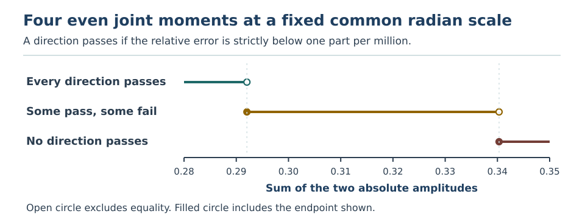

# When four angular moments suffice

**Sepehr Mahmoudian · 25 November 2026**

[Download the searchable report](../../../output/pdf/angular-ray-monotonicity.pdf) · [Proof inputs and reproduction](EVIDENCE.md) · [Software citation](../../../CITATION.cff)

<!-- body -->
## At what amplitude does the last direction fail?

A developer can test a continuous information calculation on a population with a known density. Suppose the developer retains only four terms in one series and evaluates the other terms exactly. The population has two adjustable cosine amplitudes. There are two different questions. When does *every* choice of their relative sizes give the required accuracy? When can *some* choice still give that accuracy?

The first guarantee ends near **0.292039** total amplitude. The last passing choice disappears between **0.340315168725 and 0.340315168726**. This study proves that the relative error grows along each fixed direction for every finite positive number of retained terms. For four terms the change from a mixed decision to universal failure occurs once. The tolerance is strictly less than one part per million.

### Terms and symbols

A *source* is an observed variable, and a *target* is the variable about which information is measured. The *top atom* is the contribution left at the full source set after the continuous shared-exclusions decomposition assigns the lower contributions. An *average* here is an integral against the assigned population density. A *harmonic* here is a cosine of an angle. An *amplitude* multiplies that cosine. All angles use the same radian scale. A *moment* is the average of a power. A *direction* fixes the shares of the sum of the two absolute amplitudes. Natural logarithms give units called nats. [Ehrlich et al., version 3, Sections III.1–III.2 and Appendix B](https://arxiv.org/html/2311.06373v3) · [Defining paper](https://doi.org/10.1103/PhysRevE.110.014115)

Let $a,b$ denote the two real amplitudes, $r=|a|+|b|$ their sum in absolute value and $x=|a|/r$, $y=1-x$ their shares for $r>0$. Let $A$ be the exact atom, $J$ the joint information from all three sources and $T_M$ the positive tail omitted from $J$ after $M$ even moments. Here $M$ is a positive integer. The relative error is $Q_M=T_M/A$. Unlike $T_M$ and $A$, the ratio has no units. One part per million is $10^{-6}$. [Earlier exact worst direction](https://github.com/sepahead/pid-rs/blob/ef705d1ed3410fd9fbbf4920cb4643f6a5140a2f/audit/research/angular-truncation-extremum/EXPOSITION.md)

<!-- page -->
## The distribution and the exact atom

The three scalar source angles are $s_1,s_2,s_3$. The scalar target is $t$. Each lies on a circle of length $2\pi$. Define $v=t-s_1$ and $u=t-s_1-s_2-s_3$, with both differences taken modulo $2\pi$. Let $E_0$ denote integration under the product of four uniform angular probability measures. Under this integration measure $v,u$ are independent and uniform. In fact, hold $s_1,s_2$ fixed, set $t=v+s_1$, $s_3=v-u-s_2$, and observe that the linear change on the torus has determinant of magnitude one.

Write $C=\cos v$, $D=\cos u$ and $X=1+aC+bD$. The actual population weighs $E_0$ by $X$. Its mean weight is one. For $0\le r\le1$, $X$ is nonnegative. At $r=1$ its zeros have uniform probability zero. Use $0\log0=0$ in the population integral $J(a,b)=E_0[X\log X]$. For $r>1$ the function is negative on an open set of phases, so there is no assigned probability density there. Shifting either independent phase by half a turn changes its cosine's sign and leaves the integral unchanged.

For $0\le w\le1$ put $R_a(w)=E_0[(1+aC)\log(1+awC)]$. A proper branch omits at least one source, which removes the term in $b$. The term in $a$ remains only for branches that contain source 1. The maximal proper branches are the three source pairs. For their individual contributions the fractions containing source 1 are $1,1,0$. For their three pairwise intersections the fractions are $1,1/2,1/2$. For their triple intersection the fraction is $2/3$. Subtract the individual contributions from $J$, add their pairwise intersections and subtract the triple intersection. The result is

$$
A=J(a,b)-J(a,0)+H(|a|),\qquad H(s)=2R_s(1/2)-R_s(2/3).
$$

All branches use equal source neighbourhood scales. The earlier unit-boundary proof bounds $A\ge a^2/8+b^2/4>0$ when $r>0$. For $0\le w<1$, differentiation gives $R_s'(w)\ge s^2(1-w)/2$, where the prime here is with respect to $w$. Concavity in $w$ gives $R_s(1/2)\ge3R_s(2/3)/4$, hence $H(s)\ge s^2/8$. The nonnegative even terms in $J(a,b)-J(a,0)$ include $b^2/4$. Bounded convergence of the weighted logarithms extends this inequality to one. No local logarithmic value at a zero of the joint density enters the result. [Full integral and boundary argument](https://github.com/sepahead/pid-rs/blob/a6680cb824a3e1774cff06f9b6e4d1e8ec584056/audit/research/angular-unit-boundary/EXPOSITION.md)

<!-- page -->
## Why every fixed direction gets worse as amplitude increases

For an integer $j\ge1$, let $c_j=\binom{2j}{j}/4^j$, $k_j=c_j/[2j(2j-1)]$ and $h_j=2(2j+1)4^{-j}-(j+1)(4/9)^j$. Define

$$
B_j=\sum_{i=0}^j\binom ji^2 x^{2i}y^{2(j-i)},\qquad C_j=B_j-(1-h_j)x^{2j}.
$$

Expansion of $X\log X$ and integration of the two independent phases remove all odd moments. The even cosine moments are $c_j$. The identity $\binom{2j}{2i}c_i c_{j-i}=c_j\binom ji^2$ gives the joint coefficient $k_jB_j$. Expansion of the proper terms gives the coefficient $k_jh_j$ for $H$. Thus $A=\sum_{j\ge1}k_j C_jr^{2j}$ and $T_M=\sum_{j>M}k_jB_jr^{2j}$. The final section derives the coefficients and checks convergence at a zero of the density. The earlier study gives the full unit-boundary calculation. [Coefficients at fixed source grouping](https://github.com/sepahead/pid-rs/blob/a6680cb824a3e1774cff06f9b6e4d1e8ec584056/audit/research/angular-unit-boundary/EXPOSITION.md)

The binomial recurrence replaces each probability by a weighted average of two neighbouring probabilities. Convexity of the square and summation give $B_j\le B_1=x^2+y^2$. We have $h_1=11/18$, $h_2=7/216$ and $h_j<0$ for $j\ge3$. For the last sign compare $2(2j+1)4^{-j}$ with $(j+1)(4/9)^j$. Their ratio is less than $4(9/16)^j<1$ for $j\ge3$. Consequently $C_j\le B_1$ and $C_1=y^2+(11/18)x^2\ge(11/18)B_1$. A signed $C_j$ can be negative. The proof uses its upper bound.

A prime now denotes a radial derivative at fixed $x$. The series may be differentiated inside the unit radius. The term of order four cancels in $4A-rA'$. Since $k_1=1/4$ and $r^{2j}\le r^2$,

$$
4A-rA'\ge r^2 B_1\left[\frac{11}{36}-\sum_{j\ge3}(2j-4)k_j\right].
$$

On the unit pure axis $\sum k_j=1-\log 2$. To see this, put $c_0=1$ and use $k_j=c_{j-1}/(4j^2)$. Integrate $\sum c_i z^i=(1-z)^{-1/2}$, divide by $z$ and integrate again from zero to one. This gives $\tfrac12\int_0^1(1+\sqrt{1-z})^{-1}dz$. Put $q=\sqrt{1-z}$, so $dz=-2q\,dq$. Reversing the endpoints gives $\int_0^1 q/(1+q)\,dq=1-\log2$. Integrating the same series once gives $\sum 2j k_j=1$. Thus the sum starting at three is $4\log2-5/2$. Since $1+7/10+(7/10)^2/2+(7/10)^3/6=12013/6000>2$, we have $\log2<7/10$. The bracket exceeds $1/180$.

<!-- page -->
## Why there is exactly one last passing radius

All terms of $T_M$ are positive, including terms beyond its first term. Therefore $rT'_M/T_M>2(M+1)\ge4$. The previous page gives $rA'/A<4$. Subtract the two logarithmic derivatives. It follows that $Q_M$ increases strictly on $0<r<1$. For any interior radius, insert one larger interior radius and take a limit to one. The ratio remains strictly larger at one. At zero both the atom and the absolute tail vanish and the relative error is undefined.

One can quantify this result. Since $B_1\ge1/2$, we have $4A-rA'>r^2/360$. Also $A\le J\le r^2(1-\log2)<r^2/3$. The first inequality follows because $1-h_j$ is positive. For the last, the positive series $\log2=2(1/3+1/(3^3\cdot3)+\cdots)$ gives $\log2>2/3$. The radial logarithmic slope $rQ'_M/Q_M$ thus exceeds $2M-2+1/120$. This lower bound suffices; its sharp value is a separate question.

For each $r>0$ the minimum of $Q_M(r,x)$ over $x\in[0,1]$ exists. Continuity of the integrals and positivity of $A$ give continuity on each compact positive radial interval times the full direction interval. Hence this minimum depends continuously on $r$. If $r_2>r_1>0$, use a minimizing direction at $r_2$. Its error there exceeds its error at $r_1$, which is at least the minimum at $r_1$. Thus the minimum is strictly increasing. A strict sign on each side of the tolerance will identify a unique crossing, even if the direction that attains the minimum changes.

Take $M=4$, $e=10^{-6}$ and $F=T_4-eA$. Negative $F$ passes. At $r=0.30$ one pure axis passes and the other fails. The preceding interior study put the all-direction pass threshold between $0.292038608776134$ and $0.292038608776135$. At that smaller threshold at least one direction attains equality and fails the strict test. The threshold studied here is the radius at which the *last* passing direction reaches equality. The following exact checks fix it to an interval of width $10^{-12}$.

<!-- page -->
## Exact signs on an entire interval of directions

Set $N=24$ and retain orders $j=1,\ldots,N$ in $F$. Write $P_r(x)$ for this polynomial. Its coefficient inside $k_jr^{2j}$ is $(\mathbf 1_{j>4}-e)B_j+e(1-h_j)x^{2j}$; the indicator is one when $j>4$ and zero otherwise. The degree is at most 48. For $j>N$, the coefficient is positive and at most $1+2e$. Here $0<B_j\le1$ and $0<1-h_j\le3$. For the latter bound write $h_j=2f_j(1/2)-f_j(2/3)$ with $f_j(w)=w^{2j-1}[2j-(2j-1)w]$, increasing from zero to one. As $k_j$ decreases, the positive remainder is bounded by $(1+2e)k_{25}r^{50}/(1-r^2)$.

**A passing direction.** Set $r=0.340315168725$ and $x=21787956/10^8$. Direct rational evaluation bounds the full $10^{24}F$ between $-86236$ and $-86235$ in scaled nats. Thus this particular direction passes.

**All directions fail.** At $r=0.340315168726$, expand $P_r$ in the Bernstein basis $\binom{48}{i}x^i(1-x)^{48-i}$ for $i=0,\ldots,48$. The basis functions are nonnegative and sum to one, so the smallest coefficient is a lower bound. Multiply each term $x^{2i}(1-x)^{2j-2i}$ by $(x+(1-x))^{48-2j}=1$ to express all terms in this degree. Repeatedly average adjacent coefficients at the midpoint. The first and last entries in successive rows are the coefficients on the left and right halves. This follows from successive linear interpolations of the polynomial. Subdivide any interval whose smallest coefficient does not yet give a strict positive lower bound. Seventeen intervals with disjoint interiors cover the complete unit interval. The smallest of the 17 lower bounds exceeds $330477\times10^{-24}$ nats. The omitted remainder is positive. [Bernstein's probability basis](https://www.mathnet.ru/eng/khmo107) · [Exact rational calculation](bernstein.py) · [Every subinterval](bernstein-result.json)

A second calculation uses signed coefficients in ordinary powers. Map each interval affinely to $[-1,1]$. Subtract the absolute values of all its nonconstant coefficients from its constant coefficient. The result bounds the polynomial from below on that interval. Forty-four intervals give strictly positive lower bounds, and their endpoints again cover the complete direction domain. Both methods use the same population and sign test. [Second calculation](power.py) · [Complete record](power-result.json)

<!-- page -->
## A third check counts polynomial roots

A separate calculation uses the first 18 moments. At the lower amplitude, the same passing direction gives $-86262 \le 10^{24}F \le -86092$ in scaled nats. This enclosure includes the omitted tail. Its width is larger because the sum ends at order 18. At the upper amplitude the sum gives a degree-36 polynomial. It is a lower bound for $F$ because all later terms are positive.

A root is a direction where this polynomial is zero. To count its roots, start with the polynomial and its derivative. Divide each successive pair and take the negative of the remainder for the next term. Stop at the last nonzero term. This list is called a *Sturm sequence*. At each endpoint, omit any zeros and count the changes of sign between neighbouring terms. If the endpoints are not roots, the first count minus the second gives the number of distinct roots inside. To see the sign rule when the polynomial has only simple roots, observe that the neighbours of an intermediate zero have opposite signs. Their total number of sign changes stays fixed as the zero is crossed. At a root of the first polynomial, its sign changes from opposite to equal to the sign of its derivative. The count then falls by one. The final nonzero constant rules out a common root with the derivative. [Sturm, original proof, Sections 1–4](https://doi.org/10.1007/978-3-7643-7990-2_29)

For example, take $9x^2-9x+2$. The next terms are $18x-9$ and $1/4$. At zero the signs are positive, negative, positive. At one they are all positive. The decrease from two changes to zero finds two roots, $1/3$ and $2/3$.

For the angular polynomial, the sequence has degrees 36 down to zero. Both endpoint values of the polynomial are positive. Each endpoint gives 18 sign changes. The polynomial has no root in the interval, so it stays positive. All directions therefore fail the strict tolerance at the upper amplitude. [Exact root calculation](sturm_crossing.py) · [Endpoint signs and results](expected.json) · [Complete calculation](STURM-SOURCE.md)

<!-- page -->
## Which decision applies to an angular simulation?

**Figure 1.** The horizontal coordinate gives total amplitude. The vertical entries name the three decisions. The first marker gives the end of the all-direction pass guarantee. The second marks the end of the existence of a passing direction. The plotted scale covers part of the admissible domain. Every direction continues to fail from the second marker through one. At the two thresholds, equality fails the strict tolerance.

For a synthetic three-angle sensor system with the assigned fourth angle as target, a total amplitude of $0.33$ leaves a design choice. Some directions pass and some fail. At $0.35$ no change of relative amplitudes can achieve the tolerance with four moments. If the design must handle every admissible nonzero amplitude and all directions, the separate unit-boundary result instead requires at least 7,278 terms with the proper integrals exact. These are different computational specifications. They give test cases for a population evaluator. Fitting amplitudes from physical observations would add estimation and model errors.

<!-- page -->
## Rust implementation and computational cost

The population calculation takes two real amplitude parameters in a fixed gauge. There are no data rows, finite alphabets, occupied sample cells, training steps, resampling or sensor measurements. The three exact checks use Python integers and rational numbers. Each interval in the two subdivision checks stores 49 coefficients. Splitting a degree-$d$ Bernstein polynomial costs $O(d^2)$ rational operations; the cost of each operation depends on integer bit length. The Taylor procedure also uses a quadratic number of coefficient operations per interval. The two actual calculations visited 17 and 44 terminal intervals, with maximum depths 16 and 19. Both stop on an unresolved interval if their depth or work cap is reached. The third check stores 37 polynomials. Its largest coefficient needs 53,842 bits. These checks have fixed inputs and run offline. No Rust function or execution time is reported for them. The experimental Rust function for the separately sampled continuous redundancy estimator uses the feature `experimental-continuous`. It estimates another object and never serves as a reference value here. [Rust implementation and cost](../../../RUST_IMPLEMENTATION_AND_COST.md)

The contribution is the all-order radial theorem and the exact direction-wide decision for this population and tolerance. Two model-assisted derivations used the same underlying population, coefficient identities and host. The selected numerical interval came from an exploratory floating-point calculation; three subsequent sign calculations use exact arithmetic. The root-count implementation was prepared separately with the two inputs and target signs known. No human scientific review, general estimator calibration, sharp growth constant, unique minimizing direction or priority ruling is claimed. Cite Sepehr Mahmoudian (2026), *When four angular moments suffice*, with the exact repository commit or release. [Software citation](../../../CITATION.cff)

<!-- page -->
## Deriving the coefficients and checking the boundary

For a single uniform angle $v$, set $C=\cos v$. Let $\iota$ denote the imaginary unit, with $\iota^2=-1$. From $\cos v=(e^{\iota v}+e^{-\iota v})/2$, integration over one full turn removes every nonconstant exponential. Thus $E_0 C^{2i}=\binom{2i}{i}/4^i=c_i$ and every odd power has zero mean. For $|z|<1$ the logarithm series gives
$$
(1+z)\log(1+z)=z+\sum_{q\ge2}\frac{(-1)^q z^q}{q(q-1)}.
$$
For $z=aC+bD$ the two cosines are independent under $E_0$. In the term of order $2j$, only an even number $2i$ of factors in $aC$ can remain. Its expectation equals
$$
\sum_{i=0}^j \binom{2j}{2i}c_i c_{j-i} a^{2i} b^{2(j-i)}
 =c_j r^{2j}\sum_{i=0}^j \binom ji^2 x^{2i}y^{2(j-i)}.
$$
Division by $2j(2j-1)$ gives $k_jr^{2j}B_j$. Absolute convergence on every strictly interior compact radius interval permits the termwise operations.

For the proper terms, multiply the log series in $awC$ by $1+aC$. At order $a^{2j}$ its two surviving coefficients are
$$
-\frac{c_j w^{2j}}{2j}+\frac{c_j w^{2j-1}}{2j-1}=k_j w^{2j-1}[2j-(2j-1)w].
$$
This gives $f_j(w)$ above and $h_j=2f_j(1/2)-f_j(2/3)$. Substitution in $A=J(a,b)-J(a,0)+H(|a|)$ gives the stated signed coefficient $C_j$.

For $0\le w<1$, the denominator $1+awC$ is bounded below by $1-w>0$. Differentiation in $w$ and pairing $C$ with $-C$ give $R'_a(w)=a^2(1-w)E_0[C^2/(1-a^2w^2C^2)]\ge a^2(1-w)/2$. A second derivative is $-a^2 E_0[(1+aC) C^2/(1+awC)^2]\le0$. Integration gives $R_a(1/2)\ge3a^2/16$ and concavity gives $R_a(1/2)\ge3R_a(2/3)/4$. Hence $2R_a(1/2)-R_a(2/3)\ge(2/3)R_a(1/2)\ge a^2/8$.

At the unit boundary $X\log X$ with value zero at zero is bounded and continuous. For a proper term put $P=1+aC$ and $B=1-w+wP$. If $0<P\le1$ then $P\le B\le1$ and $|P\log B|\le-P\log P$. If $1\le P\le2$, then $|P\log B|\le2\log2$. These integrable bounds extend the population averages to the unit boundary by bounded convergence. Since $B_j\le1$, $|h_j|\le2$ and $\sum k_j<\infty$, the series also extend continuously to that boundary. This argument uses weighted means throughout.
