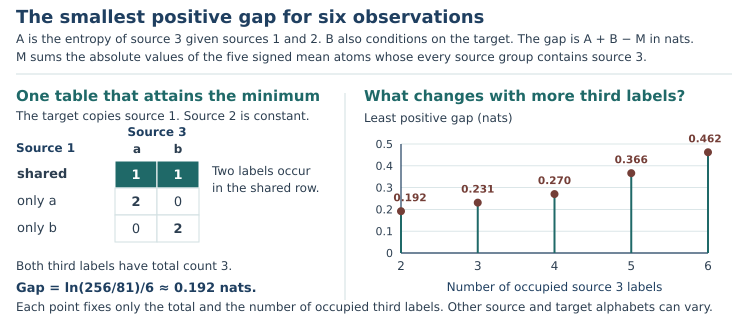
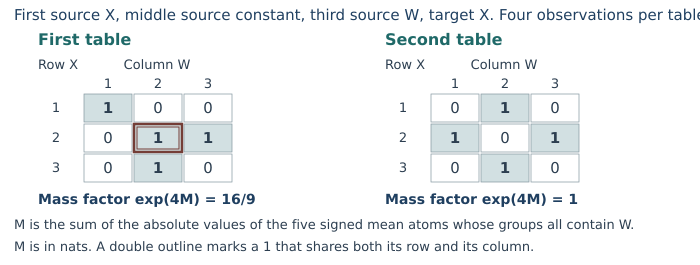

# When a third-source information bound is attained

Sepehr Mahmoudian, 2026. Cite this title with the author, year and exact repository commit or release. [Software citation](../../../CITATION.cff)

<!-- body -->

## How much room is there below the upper bound?

Three categorical sources describe a target. A previous calculation gave an upper bound on how much signed information can move through five positions in their decomposition. Under which distributions is the bound an equality? If the probabilities come from integer counts, what is the smallest possible positive gap?

**Terms and symbols.** A *source* takes a value from a finite set of labels. The *target* is the variable whose information is described. A *distribution* assigns nonnegative probabilities to joint label tuples that sum to one. Its *support* consists of the tuples with positive probability. An *atom* is an individual contribution obtained by subtracting lower contributions in the order defined on the next page. A *mean atom* weights each local atom by its joint probability. A *nat* uses the natural logarithm. Conditional entropy is the mean negative logarithm of the conditional probability of the observed value. We use the finite categorical shared-exclusions decomposition of Makkeh, Gutknecht and Wibral. [Defining paper, sections II and IV](https://arxiv.org/abs/2002.03356v5)

Write $S_1,S_2,S_3$ for the three sources and $T$ for the target. Let $A=H(S_3\mid S_1,S_2)$ and $B=H(S_3\mid S_1,S_2,T)$. Every source group in each of the five selected positions includes source 3. Let $M$ be the sum of the absolute values of their five signed mean atoms. Define the gap $G=A+B-M$ in nats.

The first result concerns every finite joint distribution. The equality $G=0$ holds exactly when $B=0$. Thus the table must determine source 3 once the first two sources and the target are known. The second result gives the least positive $G$ at each observation count $N\geq2$ and each number $\ell$ of occupied third labels with $2\leq\ell\leq N$. The bound holds for every finite choice of the other sources and target. A table attains it when their alphabets can be chosen for the construction. If they are fixed in advance, the minimum can be larger. A single occupied third label admits no positive gap. With six observations and two occupied third labels the construction attains about 0.192 nats.

The older note gave the entropy budget and a family approaching its upper bound across growing alphabets. The equality criterion, the finite-count minimum and its attaining tables below are project derivations from the published categorical functional. Their use here does not establish scientific priority. [Earlier research note and scope](../../archive/shared-exclusions-research-findings-20261001/ARCHIVE.md)

<!-- page -->

## From source agreement to the five atoms

Fix a supported tuple $z=(s_1,s_2,s_3,t)$. A *group* is a nonempty subset of the source indices. A group agrees with $z$ when every source in it takes its reference value. A node $\alpha$ is a nonempty family of groups with no member strictly containing another. Such a family is called an *antichain*. Its event $D_\alpha$ is agreement on at least one member. For example, $D_{\{3\}\{12\}}$ means that source 3 agrees or sources 1 and 2 both agree. Braces separate groups. Digits within braces name one group.

The order $\beta\preceq\alpha$ means that each group of $\alpha$ contains a group of $\beta$. At $z$, the two cumulative components are

$$
r_z^+(\alpha)=-\ln P(D_\alpha),\qquad
r_z^-(\alpha)=-\ln P(D_\alpha\mid T=t).
$$

Each event contains the reference source tuple and has positive probability under either distribution. To obtain each local atom $\pi_z^\pm(\alpha)$, subtract the atoms at all strictly lower nodes from its cumulative. This finite recursion is called Möbius inversion. The published categorical theorem gives $\pi_z^+\geq0$ and $\pi_z^-\geq0$. These components can differ in either direction. [Makkeh, Gutknecht and Wibral, theorem IV.3](https://doi.org/10.1103/PhysRevE.103.032149) [Order and its interpretation](https://arxiv.org/abs/2008.09535v2)

Let $P_\beta$ and $Q_\beta$ be the means of the informative and misinformative components. Their difference is the signed mean. A node is at or below $\{12\}$ when it has a group contained in the first two sources. For the other nodes, each group contains 3. The possible groups are $3,13,23,123$. Only 13 and 23 are incomparable. This gives exactly five nodes

$$
K=\{\{3\},\{13\},\{23\},\{13\}\{23\},\{123\}\}.
$$

Subtracting the reconstruction at $\{12\}$ from that at $\{123\}$ leaves exactly these five positions. The unconditional difference at $z$ is $-\ln P(s_3\mid s_1,s_2)$. The conditional difference adds $T=t$ to the conditioning. After weighting by $P(z)$ the two sums are $A$ and $B$. For any nonnegative $p,q$, $p+q-|p-q|=2\min(p,q)$. Thus

$$
G=A+B-\sum_{\beta\in K}|P_\beta-Q_\beta|
  =2\sum_{\beta\in K}\min(P_\beta,Q_\beta).
$$

<!-- page -->

## Exact equality on a finite distribution

If $B=0$, the five nonnegative $Q_\beta$ sum to zero. Hence each is zero and $G=0$.

Conversely, suppose $B>0$. Then there is a positive-probability group of outcomes with fixed $(s_1,s_2,t)$ and at least two distinct third labels $a,b$. Choose one reference with label $a$. Let $E_3$ be the event of agreement on the third label and $E_{12}$ the event of agreement on the first two sources.

The node $\{3\}$ has one greatest strict lower node, $\{3\}\{12\}$. To see this, any node strictly below $\{3\}$ contains the singleton group 3 and at least one other group. Minimality of its groups forces that other group to be contained in 12. Therefore it is at or below $\{3\}\{12\}$. Subtracting just these two cumulative values accounts for every lower atom exactly once. The two local components at $\{3\}$ are

$$
\pi_z^+(\{3\})=\ln\!\left(1+\frac{P(E_{12}\setminus E_3)}{P(E_3)}\right),\qquad
\pi_z^-(\{3\})=\ln\!\left(1+
\frac{P((E_{12}\setminus E_3)\mid T=t)}{P(E_3\mid T=t)}\right).
$$

The other third label $b$ occurs with the same first two values and target. Its row gives positive mass to both numerators. The denominators are positive at the reference row. Both local components are strictly positive. The reference itself has positive probability and all other local terms are nonnegative. Both averaged components at this position are positive. Its single contribution to $G$ proves $G>0$.

No source independence, equal row weights or sampling model is needed for this equivalence. For instance, let the first two sources be constant, let the target be a fair bit, and let source 3 copy that bit. Then $A=\ln 2$ while $B=G=0$. Dropping the target from the condition would give the wrong conclusion. Likewise, replacing a varying first or second source by a constant can change the answer.

<!-- page -->

## The smallest positive gap for integer counts

Suppose each row has a nonnegative integer count. Divide it by the positive total $N$ to obtain its probability. Let $\ell$ count the occupied third labels. If $\ell=1$, then $B=0$. In all other feasible cases $2\leq\ell\leq N$. Define

$$
s=N-\ell+2,\qquad u_*=\lfloor s/2\rfloor,\qquad v_*=\lceil s/2\rceil .
$$

Every count table with $B>0$ obeys $G\geq G_{\min}(N,\ell)$ for every finite choice of the other alphabets. If only $N,\ell$ are fixed, the construction on the next page attains

$$
G_{\min}(N,\ell)=\frac{2}{N}\ln\!\left[
  \left(1+\frac{1}{u_*}\right)\left(1+\frac{1}{v_*}\right)\right].
$$

Take the two conflicting rows from the preceding proof. Let $a,b$ be their two distinct third labels. Write $c,d$ for the two positive cell counts and $u,v$ for the total counts of labels $a,b$. Different labels can have equal counts. At the first row, the unconditional numerator in the singleton atom includes all $d$ observations and the marginal denominator is $u$ on the same count scale. The conditional numerator also includes all $d$, and its denominator uses at most $u$ of the observations. Hence this row contributes at least $(c/N)\ln(1+d/u)$ to each mean component. The other row contributes at least $(d/N)\ln(1+c/v)$. Nonnegativity of all remaining local components gives

$$
G\geq\frac{2}{N}\bigl[c\ln(1+d/u)+d\ln(1+c/v)\bigr]
  \geq\frac{2}{N}\ln\bigl[(1+1/u)(1+1/v)\bigr].
$$

The other $\ell-2$ third labels each use at least one observation, so $u+v\leq s$. Increasing either denominator decreases the expression. For fixed sum $s$, the product equals $1+(s+1)/(uv)$. Its minimum occurs where the integer product $uv$ is largest. Moving one unit from the larger number to the smaller increases $uv$ whenever the two differ by at least two. This gives the balanced pair $u_*,v_*$. If only $N$ is fixed, the minimum over all choices with $B>0$ occurs at $\ell=2$. Extra unused category names play no role.

<!-- page -->

## A table attaining the bound for every feasible pair

Assign third-label counts $u_*,v_*$ to the first two labels. Give one count to each other occupied label. Keep $S_2$ constant and set $T=S_1$. Make one value of $S_1$ contain exactly two observations, one of each of the first two third labels. For each third label with a positive count left, give its remaining observations a separate value of $S_1$. All those groups are pure in source 3.

The single group of size two gives $A=B=(2/N)\ln 2$. In that group the informative singleton-third atom has local values $\ln(1+1/u_*)$ and $\ln(1+1/v_*)$. Every pure group contributes zero to this atom. In the conditional component, $E_{12}$ is sure given the target, because source 1 equals the target and source 2 is constant. Thus its singleton-third mean equals $H(S_3\mid T)=B$. All four remaining $Q_\beta$ vanish by nonnegativity. Since $1+1/u_*$ and $1+1/v_*$ are at most two, the informative singleton mean is at most $B$. Twice this informative mean gives the displayed minimum. This includes $N=\ell=2$ and $N=\ell>2$.

For $N=6$ and $\ell=2$, the four occupied joint counts are $1,1,2,2$. The exponential of six times the singleton-third informative mean is $16/9$ and the conditional factor is 4. The signed factor there is $4/9$. The joint first-and-third signed factor is $9/4$. The other three factors are one. The absolute mass has factor $(9/4)^2$. Consequently $G=\ln(256/81)/6\simeq0.191788$ nats. Each marker fixes only the total and the number of occupied third labels. The other source and target alphabets can vary. The table supplies a synthetic software check.

If $S_1,S_2,T$ each have one possible value, all signed atoms vanish and $G=2H(S_3)$. At $N=4$ and $\ell=2$ the possible labelled counts are $(1,3),(2,2),(3,1)$. Their smallest gap is $2H(1/4,3/4)=\tfrac12\ln(256/27)$ nats. It exceeds $G_{\min}(4,2)=\tfrac12\ln(9/4)$. The middle split has two different labels with equal counts.

<!-- page -->

## Why conditional positivity implies unconditional positivity

A stronger property holds at each node, before averaging. It uses only the support of the two distributions and the order of their events. Fix a reference tuple $z$, and let $\rho$ be either the source distribution or the source distribution given the reference target value. Write $P_\rho$ for probability under this distribution. Let $S(y)$ be the indices at which a source tuple $y$ agrees with the reference. An antichain event $D_\alpha$ holds if some member of $\alpha$ is contained in $S(y)$.

Because the reference has positive probability, $P_\rho(D_\alpha)>0$. The convergent expansion of its surprise is

$$
-\ln P_\rho(D_\alpha)=\sum_{k=1}^{\infty}\frac{P_\rho(D_\alpha^c)^k}{k}.
$$

Consider an ordered list of $k$ artificial independent draws from $\rho$. Its product probability contributes to the numerator power exactly when every draw misses $D_\alpha$. A list containing a draw that agrees on every source contributes zero at every node. For each remaining list $y_1,\ldots,y_k$, let $I$ be the family of index sets contained in some agreement set. Explicitly,

$$
I=\{J\subseteq\{1,2,3\}: J\subseteq S(y_i)\text{ for some }1\leq i\leq k\}.
$$

This family is closed under taking subsets. Its complement in the family of all source-index sets is nonempty and upward-closed. The unique minimal members of that complement form an antichain $\beta$. The empty subset belongs to $I$. Thus all members of $\beta$ are nonempty.

Every draw misses $D_\alpha$ exactly when every member of $\alpha$ is outside $I$. Equivalently, $\beta\preceq\alpha$. Group nonnegative terms of the series by this uniquely determined $\beta$. Summing the resulting weights over $\beta\preceq\alpha$ recovers every cumulative, so the weight at $\beta$ is precisely its local atom. The list construction uses independent *auxiliary* draws inside the formula. It places no sampling-independence condition on the supplied count table.

A positive conditional atom requires at least one list of positive conditional probability. Every tuple in that list also has positive unconditional probability. Its agreement sets and assigned $\beta$ are unchanged. Therefore an informative atom is positive wherever the paired misinformative atom is positive. This property passes to means over supported reference rows. The same argument works with any finite positive number of categorical sources. The five-node entropy formula above specifically uses three.

The reverse implication fails when the target reveals a nonconstant third source and the first two are constant. Conditional surprise is zero, while the informative singleton-third term is positive. The same example rules out requiring the misinformative component to be at least the informative component. The opposite size ordering can also fail. With independent fair $S_1,S_3$, constant $S_2$ and $T=S_1$, the singleton-third signed mean is $-\ln(4/3)$ nats. Here the informative component is smaller than the misinformative one.

<!-- page -->

## How the gap can tend to zero as an alphabet grows

The word *sharp* can describe a supremum even when every finite member has a positive gap. Take uniform $X$ on $L$ labels, independent of a finite pair $W=(U,V)$. Put $S_1=X$, make $S_2$ constant, and use $S_3=W$, $T=(X,U)$. Let $p_w$ be an occupied pair probability and let $m$ count the occupied pairs. Then $A=H(W)$, $B=H(V\mid U)$ and $\Delta=A-B=H(U)$. At reference $w$, agreement on $X$ or $W$ has mass $g_w=p_w+(1-p_w)/L$ and conditional mass one. Its mean signed information is $r=-\sum_w p_w\ln g_w$.

Removing a constant second source from any group leaves the same agreement event. A node containing the singleton second group has the sure event and zero cumulative values. At every other node, remove source 2 and remove groups containing other groups. A two-source antichain lies below the original node exactly when it lies below this reduced node. Embedding the two-source atoms and putting zero at the other nodes therefore recovers all original cumulative values. The finite inversion is unique. Only the singleton third and the joint first-and-third signed means can survive outside the first pair. The first is $\Delta-r$. Their sum is $\Delta$, so the other is $r$. It follows that

$$
M=r+|\Delta-r|,\qquad G=2\min(B,A-r),\qquad
A-r=\sum_w p_w\ln\!\left[1+\frac{1/p_w-1}{L}\right].
$$

Concavity of the logarithm gives $G\leq 2\ln[1+(m-1)/L]$. Constant $U$ and uniform $V$ on $m$ labels attain this **upper** bound on $G$ at every positive $m,L$. With fixed $m=2$ it tends to zero. With $m=L$ it tends to $2\ln 2$. Keeping the pair distribution fixed as $L$ grows, or requiring $m/L\to0$, suffices for convergence to zero. Pairwise independence among $X,U,V$ is insufficient for the original event calculation. For independent fair $X,U$ with $V$ their exclusive OR, every pair of variables is independent but $(U,V)$ determines $X$.

The positive integer-count minimum and this family concern different questions. Over unrestricted positive real weights there is no fixed positive gap even with two occupied third labels. With constant first two sources and target, give one third label probability $\varepsilon\in(0,1)$ and the other $1-\varepsilon$. All signed means are zero, so the gap is twice binary entropy and tends to zero with $\varepsilon$.

<!-- page -->

## Two tables with the same Shannon entropies

Can a table of entropies tell us the absolute signed mass $M$? Take $S_1=X$, let $S_2$ be constant, set $S_3=W$, and let the target copy the first source, $T=X$. In each of the following count matrices the rows are labels of $X$ and the columns are labels of $W$. Each 1 represents one of four equally weighted observations. Each 0 is an unoccupied pair. The figure also gives the exponential of four times the absolute mass $M$ in nats.

Makkeh, Gutknecht and Wibral already found a negative noisy-source unique mean and an equal positive joint-only mean for a binary copied target. Their RndErr uses the four-cell distribution of Finn and Lizier. The September project report already gives the two-source formula and computes the same four cells. Here we locate its terms in the three-source order and compare two tables with the same entropies. [Earlier two-source identity and worked example](https://github.com/sepahead/pid-rs/blob/6a9f087be84bc21a89ff51e7da8e626e6883d73e/audit/evidence/finite-target-copy-mgw-synergy.md) · [Makkeh, Gutknecht and Wibral, §VI.C and Table III](https://arxiv.org/pdf/2002.03356v5#page=11) · [Finn and Lizier, §5.4](https://doi.org/10.3390/e20040297)

Both row and column totals are $(1,2,1)$. Thus $H(X)=H(W)=\tfrac32\ln 2$ nats. Each joint table has four cells of probability $1/4$, so $H(X,W)=2\ln 2$ nats. A constant adds no entropy. Adding a copy of a variable already present also leaves the entropy unchanged. These facts give identical entropies for all 16 subsets of $(S_1,S_2,S_3,T)$, including the empty set. In particular, $A=B=H(W\mid X)=\tfrac12\ln2$. Given $X$, the target is known. Conditional mutual information $I(W;T\mid X)$ and the error of the rule that returns $X$ are both zero.

The question changes when the quantity of interest is the sum of the absolute signed means. The figure marks a difference between the two observed sets of occupied cells. Only the central cell of the first table shares both of its labels with another cell.

<!-- page -->

## From match counts to signed mass

For any occupied cell, let $u$ be the probability that a new observation matches its row or its column. This event is certain given the target row. Its mean signed shared information is $R=-\sum p\ln u$, where $p$ is the cell probability. For the first table, the four values of $4u$ are $1,2,2,3$ in increasing order. Their product is 12, so $R=\tfrac14\ln(4^4/12)=\tfrac14\ln(64/3)$. For the second table they are $2,2,2,2$, so $R=\ln2$. Mutual information $I(X;W)=H(X)+H(W)-H(X,W)$ equals $\ln2$ in both cases. As the next page shows, only two of the five signed means can be nonzero. Their values are $R-I(X;W)$ and its negative.

| Quantity in nats | First table | Second table |
|---|---:|---:|
| Absolute mass $M=2\lvert R-I(X;W)\rvert$ | $\tfrac12\ln(4/3)$ | $0$ |
| Gap $G=A+B-M$ | $\tfrac12\ln3$ | $\ln2$ |

At $N=4,\ell=3$, the first gap equals the strict lower bound proved above. The second gap reaches $A+B$. A prediction score and the complete Shannon entropy table therefore agree while the signed decomposition gives opposite endpoints for this mass. The incidence of the observed labels distinguishes the examples. [Two exact count records](independent/copy-target/PAIRED-COUNTS.json) [Comparison with simpler quantities](independent/copy-target/SIGNIFICANCE.md)

For a two-source decomposition with nonnegative mean atoms and the usual information identities, the contribution unique to $W$ and the joint-only contribution sum to $I(W;T\mid X)$. Both must be zero for this copied target. Here the two signed means can have opposite signs and cancel. A prediction question can use the observed error directly. The signed mass answers how much cancellation occurs under this particular definition. [Earlier examples with the same entropy diagrams](https://doi.org/10.3390/e19100531) [Deterministic target and source dependencies](https://doi.org/10.3390/e20030169)

<!-- page -->

## A support test when the target copies the first source

Keep $S_1=X$, $S_2$ constant, $S_3=W$ and $T=X$. The joint law of $X,W$ can be any finite categorical distribution. At an occupied cell $(x,w)$ let $p=P(X=x,W=w)$, $r=P(X=x)$ and $c=P(W=w)$. Their match union has mass $u=r+c-p$. Write $R_{xw}=-\ln u$ and $i_{xw}=\ln[p/(rc)]$. They are the local shared information and the local mutual information. All four probabilities in these logarithms are positive.

For $X$ and $W$ the signed cumulative values are $R_{xw}$ for the shared node, $-\ln r$ for $X$ alone, $i_{xw}$ for $W$ alone, and $-\ln r$ for the joint observation. Subtracting the lower contributions gives the four atoms $R_{xw}$, $-\ln r-R_{xw}$, $i_{xw}-R_{xw}$ and $R_{xw}-i_{xw}$, respectively. With a constant middle source, any family containing its singleton has the sure event and zero signed cumulative. Removing 2 from the groups of each other family leaves its match event and its lower two-source positions unchanged. Up to four signed atoms can be nonzero. The other fourteen are zero. At each of the 18 rules, sum the atoms at or below that rule to recover its signed cumulative. The $W$-only position $\{3\}$ and the joint-only position $\{13\}$ are the only ones among the five selected positions that can contribute to $M$.

The September report treats a target containing the first source and an arbitrary residual. Its equation (19) gives $rc-p(r+c-p)=(r-p)(c-p)\geq0$ for each occupied cell. Here the residual is constant. Consequently the last two atoms are opposites at every cell, with $R_{xw}-i_{xw}\geq0$. The five signed means always sum to zero. The sum of their absolute values is

$$
M=2\sum_{(x,w):p>0}p\ln\!\left(\frac{rc}{p(r+c-p)}\right).
$$

Each summand is nonnegative. It vanishes exactly when $r=p$ or $c=p$. Thus every one of the five means vanishes, equivalently $M=0$, exactly when each occupied cell is alone in its row or in its column. In the first example the central cell shares both its row and its column with another cell. In the second every occupied cell has at least one exclusive margin. Both tests can be made directly from counts. Calculating the size of a positive mass also requires the probabilities.

A separate application uses the direction of axial force and torque in 117 robot-wrist records. The target copies force and the middle source stays constant. All four sign pairs occur, so the two opposite mean atoms are nonzero. Force alone gives the target exactly. [Measured application](../robot-wrist-copied-target/README.md) · [Full derivation](independent/copy-target/COPY-TARGET.md) · [Support checks](independent/copy-target/COPY-SUPPORT.json)

<!-- page -->

## Rust implementation and computational cost

The stable Rust routine `pid_core::stable::categorical::discrete_sxpid3_averaged` takes four categorical matrices with the same observation count. Each full matrix row defines a category of its variable. It computes mean atoms for the empirical distribution. The default build includes this route. Its budget-aware variants bound work and allocation, and one accepts a cancellation token. Its finite-precision outputs and numerical policy are separate from the exact rational certificate used here. This study provides a Python reference for the gap. No release timing was measured for the Rust routine. [Rust source](../../../crates/pid-core/src/sxpid.rs) [Engineering cost reference](../../../RUST_IMPLEMENTATION_AND_COST.md)

The Python reference reads finite categorical tuples with nonnegative integer counts, discards zero-count cells and requires a positive total. It forms each agreement union as a finite set and inverts all 18 nodes. For $R$ occupied joint rows and three fixed sources, direct agreement scans take order $R^2$ row comparisons. Holding both local components for every node takes order $18R$ rational values. The time and memory for rational arithmetic also depend on the bit lengths of the counts, exponents and intermediate products. The scalar bound uses only $N,\ell$ once these counts are known. Its count-cleared rational factor uses a fixed number of integer arithmetic operations. Neither calculation trains a model or resamples the rows.

The complete labelled binary census used all 16, 136 and 816 nonempty count tables of totals 1, 2 and 3, respectively. Among them, 0, 8 and 128 had $B>0$. The procedure also checked 123 attaining tables, covering every $2\leq\ell\leq N\leq16$ and three additional cases at $N=25$. Signed comparisons used exact rational products. The helper checks each local support prediction against all 18 nonnegative rational arguments. The registered census and attaining tables account for 125,208 local component checks. An independently written inclusion–exclusion implementation also compared 125,892 local and 39,528 averaged component values across 1,098 invocations including seven overlapping controls. These counts are bounded execution results under shared definitions.

The study also provides a support test for the copied target. After duplicate cells are combined, two passes through the occupied cells count and test their row and column entries. With expected constant-time dictionary access, the work is linear in the number of occupied cells. The extra counters are linear in the number of occupied rows plus columns. The zero-mass test needs no logarithms. [Support calculation](independent/copy-target/copy_support.py)

The scientific run finished in less than 0.61 seconds in ordinary Python and less than 0.67 seconds in optimized Python on an Apple M4 Max with Python 3.15. The largest measured child-process memory reading across those two runs was below 20 million bytes. Both runs used the same offline count tables and an external 90-second deadline. The alternative comparison took less than 1.5 seconds per mode. No real-time limit, biological inference, kernel proof or implementation refinement follows from these measurements. [Reference code](verify.py) [Exact results](RESULT.json) [Fixed-alphabet calculation](alphabet_scope.py)

If a sensor study asks only whether the third sensor adds target information after the first two, conditional mutual information answers that question directly. If a study instead checks how the five signed categorical atoms add in absolute value, a reported positive gap smaller than the applicable minimum cannot come from that exact count table. Check the input counts, occupied labels, conditioning variables, rounding and the order of averaging. A claim about control or prediction performance also requires a measured task outcome. These designated distributions provide arithmetic checks for such analyses.

Sepehr Mahmoudian (2026), *When a third-source information bound is attained*. Include the exact source commit or release. Model assistance contributed to the derivations, code and critical checks. The reviews share the design and primary defining source. [Evidence and reproduction](EVIDENCE.md) [Software citation](../../../CITATION.cff)
