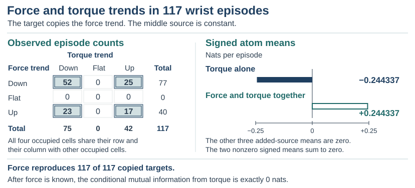

# When a robot wrist signal is also the target

Sepehr Mahmoudian, 26 November 2026. Cite the author, title, year and exact repository commit or release. [Printable report](../../../output/pdf/robot-wrist-copied-target.pdf) · [Software citation](../../../CITATION.cff)

<!-- body -->
## Can a zero conditional gain justify skipping five signed outputs?

A robot wrist recorded force and torque while the robot approached a position to release a part. Take the direction of change in axial force as the first input, hold the second input constant, and take the direction of change in axial torque as the third input. Make the target an exact software copy of the first input. Force then gives the target in all 117 records. Does this perfect readout allow an evaluator to set every contribution that requires torque to zero? [Original dataset](https://doi.org/10.24432/C5M89N) · [Experimental account](https://doi.org/10.1007/978-1-4615-5725-8_23)

Makkeh, Gutknecht and Wibral had already shown why the shortcut can fail. In their binary RndErr example, the target copies the first source. The noisy source has negative unique information and an equal positive contribution from observing both sources together. Finn and Lizier supplied the example distribution. [Makkeh, Gutknecht and Wibral, §VI.C and Table III](https://arxiv.org/pdf/2002.03356v5#page=11) · [Finn and Lizier, §5.4](https://doi.org/10.3390/e20040297)

For the 117 wrist records, the two means have magnitude 0.244336967851845 nats per episode. The other three are zero. The September project report already gave the two-source synergy formula when the target contains a copy of source 1. It evaluated the same binary example. Here a constant middle source puts the calculation on five of 18 positions. Four observed force–torque counts test it. The target here is the supplied force signal. The donor’s failure diagnoses define a separate prediction task. [Earlier two-source identity and worked example](https://github.com/sepahead/pid-rs/blob/6a9f087be84bc21a89ff51e7da8e626e6883d73e/audit/evidence/finite-target-copy-mgw-synergy.md) · [Finite support test](../categorical-third-source-budget-sharpness/independent/copy-target/COPY-TARGET.md)

**Terms and symbols.** A *source* is an input label. An *episode* is one labelled record with 15 measurement times. A *categorical distribution* gives a probability to each combination of labels. Here each record receives equal weight. Its *support* is the set of combinations with positive count. A *source rule* says which input labels of an episode must match a reference episode. A partial information decomposition assigns to each rule an *atom*, the part left after accounting for the lower rules. In this measure, a signed atom can be positive or negative. A *nat* is the information unit obtained from the natural logarithm, written $\ln$. [Source rules and their order](https://doi.org/10.1098/rspa.2021.0110)

Let $X$ be the force trend, $W$ the torque trend and $T=X$ the copied target. Conditional mutual information $I(W;T\mid X)$ measures how much knowing torque changes the target distribution when force is known. Here both conditional target distributions put probability one on the same answer. Thus $I(W;T\mid X)=0$ exactly. A rule that outputs $X$ also makes zero classification errors. Neither calculation requires a partial information decomposition. The decomposition is needed to determine the signed contributions that can cancel in this zero total.

<!-- page -->
## From six measured channels to four occupied cells

The University of California, Irvine repository names this task LP4. The donor lists 15 regularly spaced samples over a 315-millisecond window. Each sample records three force components and three torque components in the donor's coordinate frame. We use the third and sixth channels, the axial force and axial torque. The file gives no independent trial identifiers. The 117 records include 116 distinct six-channel traces. Records 25 and 45 have identical readings. We retain both as the donor supplied them. [Dataset and channel order](https://archive.ics.uci.edu/dataset/138/robot+execution+failures) · [Earlier exact trace comparison](../robot-wrist-slope-signs/EXPOSITION.md)

Write $y_i$ for one channel reading at time index $i$, where $i$ runs from 0 to 14. The slope of a least-squares line in index time has the sign of $\sum_{i=0}^{14}(i-7)y_i$. Its denominator $\sum_{i=0}^{14}(i-7)^2$ is positive. Code each sign as down, flat or up. Neither measured channel has a flat trend in these records. This is the project’s fitted-slope sign. In the donor chapter, Equation 23.3 gives an upward trend when the first five readings average less than the last five and a downward trend otherwise. [Donor’s definition, p. 382](https://doi.org/10.1007/978-1-4615-5725-8_23) The original labels normal, collision and obstruction delimit the records. Summing the three donor class counts in each sign cell gives the same four counts used below. [Original class-by-sign table](../robot-wrist-slope-signs/EXPOSITION.md) · [Four counts independently read from the original measurements](checked/support-ordinary.json)

**Reading the figure.** Each double-outlined cell contains episodes and shares its row with a second occupied cell and its column with a third. This support pattern forces cancellation in the named decomposition. The horizontal bars use the same scale and share a zero. Their opposite signs explain how the conditional information can be zero.

<!-- page -->
## Why the two contributions cancel

Consider finite force and torque labels under the stated copied target and constant middle source. In an occupied cell let $m$ be its count, $a$ its force row total, $b$ its torque column total and $N$ the number of episodes. Write $p=m/N$, $r=a/N$ and $c=b/N$. The event that force or torque matches this reference cell has probability $u=r+c-p$. Given $T=x$, the force always matches, so the conditional event probability is one. The signed shared information of this event is $-\ln u$. The signed information from torque alone is $\ln[p/(rc)]$. Subtracting the shared term leaves the torque-only atom $-\ln g$, where
$$
g=\frac{rc}{p(r+c-p)}=\frac{ab}{m(a+b-m)}.
$$

Force alone and the force–torque pair both give $-\ln r$ about $T=x$. Subtracting their lower contributions therefore gives $+\ln g$ at the joint force–torque atom. In the three-source order a group that also requires the constant middle source has the same event as the group with that requirement removed. A rule offering the middle source alone always matches and its signed information is zero. The September two-source formula allows the target to contain the first source and a residual coordinate. Here the middle source is constant and the target is exactly force. Only four positions in the full order can have a nonzero signed atom. The other fourteen signed atoms are zero. At each of the 18 rules its signed cumulative value is the sum of the atoms at or below that rule. Of the five added-source atoms, only torque alone and force together with torque can be nonzero. [Full order and proof](../categorical-third-source-budget-sharpness/independent/copy-target/COPY-TARGET.md)

Equation (19) of the September report gives the count identity $ab-m(a+b-m)=(a-m)(b-m)$ after multiplication by $N^2$. Both factors on the right are nonnegative. Therefore $g$ exceeds one exactly when a second occupied cell shares its row and a third shares its column. A cell alone in either one gives $g=1$. If any cell meets both conditions its positive count makes the mean magnitude strictly positive. For these source and target roles the five means always sum to zero. They all vanish individually exactly when every occupied cell stands alone in its row or its column.

For example, the 52 down/down records are among 77 with force down and 75 with torque down. Their union contains $77+75-52=100$ records. The corresponding factor is $77\cdot75/(52\cdot100)=231/208$. Define $Q=\prod g^m$ with one factor for each occupied cell. For the other three cells the factors in the figure's row order are $1617/1175$, $750/529$ and $336/221$. Their exponents are 25, 23 and 17. Thus the common magnitude is $h=(\ln Q)/117$. All signs and zeros follow from exact rational products. The reported decimals are rounded. [Exact factors and products](checked/support-ordinary.json)

<!-- page -->
## Which five outputs the shortcut would erase

The three sources are numbered 1 for force, 2 for the constant and 3 for torque. A group requires all named sources to match. A rule with two groups accepts either match. In each of the five positions below, every group contains source 3. The hexadecimal identifiers are stable names in the saved exact results. The *atom product* for a mean $s$ is $\exp(Ns)$. A product of one gives a zero mean.

| Source rule | Identifier | Signed atom product | Mean in nats per episode |
|---|---|---:|---:|
| Torque alone | 04 | $1/Q$ | $-h$ |
| Force and torque together | 05 | $Q$ | $+h$ |
| Constant and torque together | 06 | $1$ | $0$ |
| Either of the preceding two joint groups | 05+06 | $1$ | $0$ |
| All three sources together | 07 | $1$ | $0$ |

The sum of the five signed means is zero. The sum of their absolute values is $2h=0.488673935703691$ nats per episode after rounding. This order of operations first averages each signed atom over the 117 episodes, then takes its absolute value. The prediction problem has a simpler answer. Giving probability one to the observed force sign incurs zero logarithmic loss on its copy. Adding torque cannot improve that score. A decomposition with nonnegative mean atoms and the same five-position sum must give zero at each of the five positions. Williams and Beer's categorical minimum-specific-information measure is one such comparator. Its allocation and the signed shared-exclusions allocation answer different questions. [Williams and Beer](https://arxiv.org/abs/1004.2515v1) · [Deterministic target–source dependencies](https://doi.org/10.3390/e20030169)

This application tests an estimator's proposed zero shortcut on one measured count table. It yields no estimate of failure prevalence, the cost of removing a wrist sensor, or performance on future episodes. The target was chosen after earlier work on these measurements. The duplicated trace, unknown trial dependence, and the use of a software-defined target preclude a claim about independent failures. The older study retains the donor's class as target. Its best empirical class prediction in LP4 was correct on 72 of 117 records. The 117 perfect copies here concern a different outcome. [Original task comparison](../robot-wrist-slope-signs/EXPOSITION.md)

<!-- page -->
## Rust implementation and computational cost

The stable Rust library supplies the three-source averaged categorical shared-exclusions call and the Williams–Beer call. Their names are **discrete_sxpid3_averaged** and **imin_pid3**. Both accept four row-aligned categorical matrices. Here each matrix has 117 rows and one column. The columns are force, a constant, torque and copied force. Their respective numbers of observed labels are 2, 1, 2 and 2. Library inputs use equality of label codes. The measured calls used a build with default features disabled. The budget and cancellation variants of the shared-exclusions call support explicit resource limits. [Shared exclusions](https://github.com/sepahead/pid-rs/blob/6a9f087be84bc21a89ff51e7da8e626e6883d73e/crates/pid-core/src/sxpid.rs) · [Williams–Beer implementation](https://github.com/sepahead/pid-rs/blob/6a9f087be84bc21a89ff51e7da8e626e6883d73e/crates/pid-core/src/discrete_pid.rs)

The measured program returns binary64, the 64-bit binary floating-point format. Each entry below is a mean in nats per episode. The separate exact reference bounds the logarithms of the four rational factors by a series with a proved remainder. The comparison allowed an absolute error of $10^{-12}$ nat at each of the ten named outputs. All ten passed. [Measured Rust result and controls](rust/README.md)

| Source rule | Shared exclusions, measured | Williams–Beer, measured |
|---|---:|---:|
| 04 | $-0.244336967851845388$ | $+0$ |
| 05 | $+0.244336967851845305$ | $+0$ |
| 06 | $+0$ | $+0$ |
| 05+06 | $-1.82665\times10^{-17}$ | $+0$ |
| 07 | $+5.93068\times10^{-18}$ | $+0$ |

Two of the three exact shared-exclusions zeros returned small residuals of opposite signs. The largest absolute error among all ten results was less than $1.20\times10^{-16}$ nat, at rule 04. The client rejected a 116-row input and a target column that failed the copy condition. The separate checker also rejected a missing rule, a swapped rule, a nonfinite value and two hypotheses that erase or reverse an atom. These controls distinguish a wrong scientific output from rounding at zero.

One client was compiled against the already-built library. Linking and compiling this client took 0.578 seconds on one Apple silicon host. The two invocations of the same binary took 0.295 and 0.009 seconds, including input, startup and reporting for both methods. They returned identical binary words. These are single-run observations for four occupied tuples and the 18-rule categorical order. They do not measure isolated estimator latency or qualify a real-time wrist controller.

<!-- page -->
## Reproduce the measured and exact results

The exact Python reference reads 1,755 measurement rows and holds four occupied sign pairs. Once the sign table is available, two scans over the occupied cells find all margins and test the support. Constructing $Q$ also requires integer powers whose size grows with multiplicity. The separate full evaluation builds 18 rule events on each occupied cell. It computes informative, misinformative and signed products for both cumulatives and atoms, giving 108 results. For $d$ occupied cells its event scans use order $18d^2$ cell comparisons at three fixed sources. Each inversion can compare all pairs of 18 rules. The two programs store the small label table, exact numerators and denominators, and the original archive and parsed measurements. There is no training or resampling. [Direct support calculation](source_counts.py) · [Full event and inversion calculation](check_lattice.py)

For one archive, on one Apple silicon host with Python 3.15.0, the two complete program invocations took 0.037 and 0.054 seconds in ordinary mode, and 0.058 and 0.065 seconds in optimized mode. Each includes interpreter startup and the program's own controls. The observed maximum child resident memory was about 30.4 million bytes. These are measurements of the offline Python checks. Exact rationals decide signs and zeros. The full program also verifies all 18 informative-to-misinformative quotients, rebuilds every cumulative from its atoms, and compares inversion before and after combining the occupied cells. [Scientific evidence and reproduction commands](EVIDENCE.md)

Download the [original UCI ZIP file](https://archive.ics.uci.edu/static/public/138/robot+execution+failures.zip) as **robot.zip**. From the study directory run the following. Both runs read the original measurements and retain the zero counts in the derived sign table.

~~~
python3 -I -S -B replay.py robot.zip --self-test
python3 -I -S -B -O replay.py robot.zip --self-test
~~~

The data are from L. Seabra Lopes and L. M. Camarinha-Matos (1998), *Robot Execution Failures*, under Creative Commons Attribution 4.0. The published RndErr example supplies the earlier cancellation. The support criterion follows from the earlier factorization once its two-source terms are located in the five positions. The project also gives two tables with equal entropies for all 16 subsets and the present test on measured wrist signals. Model assistance supported the mathematical review, implementation and publication. The readers share the same donor measurements and defining measure. No independent human or institutional validation is recorded. Cite Sepehr Mahmoudian, *When a robot wrist signal is also the target* (2026), with the exact commit or release. [Earlier example and exact comparison](../categorical-third-source-budget-sharpness/independent/copy-target/PRIOR-EXAMPLE.md) · [Data and licence](https://doi.org/10.24432/C5M89N) · [Software citation](../../../CITATION.cff)
