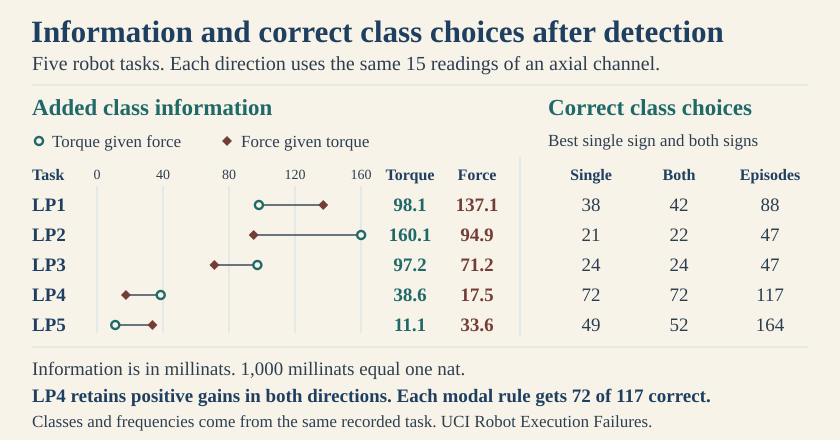

# Two axial trends and five robot outcomes

**Sepehr Mahmoudian · 23 November 2026**

[Standalone PDF](../../../output/pdf/robot-wrist-slope-signs.pdf) · [Exact certificate](certificate.json) · [All numerical intervals](results.json)

<!-- body -->
**Research question.** After a robot event has been detected, does the trend in axial torque change what the recorded axial force trend tells us about the event class? Does force add information to torque? The two directions reduce class uncertainty in all five recorded tasks. The reduction sometimes leaves every class decision unchanged.

**Terms and symbols.** An *episode* is one recorded window of 15 readings. A *class* is the outcome label for one task. $F$ and $Q$ denote negative, zero or positive trends in axial force and torque. $Y$ is the class. An *empirical law* assigns a probability through the frequency in one recorded table. *Entropy* measures uncertainty in $Y$. *Mutual information* (MI) measures the reduction from observing a sign. *Conditional mutual information* (CMI) measures the further reduction in this uncertainty after observing another sign. A *nat* uses natural logarithms. Partial information decomposition (PID) allocates the joint information to signed components, called *atoms*, under a specified redundancy rule. [UCI donor description](https://archive.ics.uci.edu/ml/machine-learning-databases/robotfailure-mld/robotfailure.data.html) · [Shannon, 1948](https://doi.org/10.1002/j.1538-7305.1948.tb01338.x) · [Makkeh, Gutknecht and Wibral, 2021](https://arxiv.org/abs/2002.03356v5)



The figure compares changes in class probabilities with changes in the most frequent class. Both summaries use the same episodes. Each task retains its original labels.

<!-- page -->
## From wrist measurements to five finite laws

Luis Seabra Lopes and Luis M. Camarinha-Matos donated five robot learning problems. The reported window lasts 315 milliseconds, starts immediately after detection, and contains 15 regularly spaced readings. Each reading gives six integers in the order $F_x,F_y,F_z,T_x,T_y,T_z$. One complete episode contributes one observation of the two signs and the donor class. The study uses $F_z$ and $T_z$ in the recorded instrument coordinates. The other four channels are checked for integer form and omitted from the sign summaries. [Original donor description and class definitions](https://archive.ics.uci.edu/ml/machine-learning-databases/robotfailure-mld/robotfailure.data.html)

For a channel whose ordered readings are $x_1,\ldots,x_{15}$, define its trend sign by

$$
D(x)=\sum_{i=1}^{15}(i-8)x_i,\qquad \mathrm{sign}\,D(x)\in\{-1,0,1\}.
$$

The least-squares line with an intercept has slope $D(x)/280$ per sample index. A positive constant sample spacing preserves the sign in elapsed time. An exact zero includes a varying trace whose weighted changes cancel. No smoothing, tolerance, replacement of missing readings, deduplication or feature tuning enters the table. A change of units with positive scale preserves the sign. Rotation of the coordinate frame can change it. The records do not give a calibrated physical rate.

LP1 records the approach to a grasp, LP2 the transfer of a part, LP3 its position after a transfer failure, LP4 the approach to an ungrasp, and LP5 motion with a part.

| Task | Episodes | Class and count in donor order | Occupied |
| ------ | -------- | ------------------------------------------------------ | --------- |
| LP1 | 88 | normal 21, collision 17, front collision 16, obstruction 34 | 15 / 36 |
| LP2 | 47 | normal 20, front collision 6, back collision 7, collision to the right 5, collision to the left 9 | 19 / 45 |
| LP3 | 47 | ok 20, slightly moved 9, moved 15, lost 3 | 15 / 36 |
| LP4 | 117 | normal 24, collision 72, obstruction 21 | 12 / 27 |
| LP5 | 164 | normal 44, bottom collision 26, bottom obstruction 21, collision in part 47, collision in tool 26 | 21 / 45 |

Here the fractions give occupied triple cells divided by the full $3\times3\times K$ alphabet, where $K$ is the number of classes in that task. The donor's summarized percentages are rounded. The integer counts above come from the original labels. LP3 concerns the **position of the part after a transfer failure**. Its label “ok” has the donor's task-specific meaning.

<!-- page -->
## The full recorded class distributions

Each cell below lists integer class counts given a sign pair. The class order is the order on the previous page. To get the conditional class distribution, divide an occupied vector by the sum of its entries. To get joint probabilities, divide by the total for that task. An all-zero vector describes an unobserved pair. Such a pair could occur in another recording.

| F, Q | LP1 | LP2 | LP3 | LP4 | LP5 |
| --- | --- | --- | --- | --- | --- |
| −, − | 3, 2, 6, 9 | 2, 2, 2, 1, 2 | 2, 2, 3, 2 | 12, 33, 7 | 14, 12, 7, 20, 8 |
| −, 0 | 0, 0, 0, 0 | 0, 0, 0, 0, 0 | 0, 0, 0, 0 | 0, 0, 0 | 0, 0, 0, 0, 0 |
| −, + | 7, 6, 10, 6 | 9, 2, 3, 0, 1 | 9, 3, 3, 0 | 2, 15, 8 | 11, 7, 8, 10, 4 |
| 0, − | 0, 0, 0, 0 | 0, 0, 0, 0, 0 | 0, 0, 0, 0 | 0, 0, 0 | 0, 0, 0, 0, 0 |
| 0, 0 | 0, 0, 0, 0 | 0, 0, 0, 0, 0 | 0, 0, 0, 0 | 0, 0, 0 | 0, 0, 0, 0, 0 |
| 0, + | 0, 0, 0, 0 | 1, 0, 0, 0, 0 | 1, 0, 0, 0 | 0, 0, 0 | 1, 0, 0, 0, 0 |
| +, − | 6, 5, 0, 11 | 2, 1, 1, 4, 1 | 2, 2, 5, 0 | 8, 11, 4 | 10, 4, 4, 7, 7 |
| +, 0 | 4, 0, 0, 0 | 0, 0, 0, 0, 0 | 0, 0, 0, 0 | 0, 0, 0 | 0, 0, 0, 0, 0 |
| +, + | 1, 4, 0, 8 | 6, 1, 1, 0, 5 | 6, 2, 4, 1 | 2, 13, 2 | 8, 3, 2, 10, 7 |

**Worked example.** In LP4 the class order is normal, collision, obstruction. With both trends negative, the counts are 12, 33 and 7, so the empirical collision probability is $33/52$. With both trends positive, it is $13/17$. For mixed signs the counts are $(2,15,8)$ and $(8,11,4)$. Collision is the most frequent class at all four occupied sign pairs. Its total is 72 out of 117. Information can change even when the optimal equal-cost label stays the same.

Exactly zero force slopes occur in one episode each of LP2, LP3 and LP5. Exactly zero torque slopes occur in four LP1 episodes. LP2 and LP3 have the same nine source-pair marginal counts, in row order $9,0,15,0,0,1,9,0,13$. The two tasks have different labels. The equal margins alone cannot identify common physical encounters. The 463 episode records therefore supply five separately described empirical laws. [Exact counts](certificate.json)

For each conditioning choice, average the class entropy of its occupied states using their empirical frequencies. These are the results in nats.

| Task | $H(Y\mid F)$ | $H(Y\mid Q)$ | $H(Y\mid F,Q)$ |
| --- | --- | --- | --- |
| LP1 | 1.214072 | 1.253052 | 1.115934 |
| LP2 | 1.389517 | 1.324370 | 1.229438 |
| LP3 | 1.186375 | 1.160343 | 1.089190 |
| LP4 | 0.928148 | 0.907052 | 0.889534 |
| LP5 | 1.534193 | 1.556733 | 1.523123 |

<!-- page -->
## Which information does a second sign add?

Let $n$ be one task's episode count and $n_{fqy}$ the count at signs $f,q$ and class $y$. Omitting subscripts means summing over them. The row weight is $n_{fqy}/n$. For class counts $n_y$, the target entropy is $H(Y)=-\sum_{y:n_y>0}(n_y/n)\ln(n_y/n)$. Conditional entropy averages that expression over the conditioning states. Write $I_F=H(Y)-H(Y\mid F)$, $I_Q=H(Y)-H(Y\mid Q)$ and $I_{FQ}=H(Y)-H(Y\mid F,Q)$. In nats, the torque and force gains are

$$
I(Q;Y\mid F)=I_{FQ}-I_F,\qquad I(F;Y\mid Q)=I_{FQ}-I_Q.
$$

| Task | $H(Y)$ | $I_F$ | $I_Q$ | $I_{FQ}$ | Add $Q$ | Add $F$ |
| --------- | -------------- | -------------- | -------------- | -------------- | -------------- | -------------- |
| LP1 | 1.336913 | 0.122841 | 0.083861 | 0.220980 | 0.098138 | 0.137119 |
| LP2 | 1.464854 | 0.075337 | 0.140484 | 0.235416 | 0.160079 | 0.094932 |
| LP3 | 1.220227 | 0.033853 | 0.059885 | 0.131038 | 0.097185 | 0.071153 |
| LP4 | 0.932018 | 0.003870 | 0.024966 | 0.042484 | 0.038614 | 0.017518 |
| LP5 | 1.558298 | 0.024105 | 0.001564 | 0.035175 | 0.011070 | 0.033611 |

The table rounds values to six decimal places. Every gain has a strictly positive exact sign. The logarithmic loss for a forecast assigns the observed class the loss $-\ln p(y)$, where $p(y)$ is its forecast probability. With the empirical probabilities as forecasts, each gain is the exact reduction in average logarithmic loss on that known table. A predictive probability for a new trial needs a fitting and evaluation design.

**The equal-cost decision comparison.** For a predictor state $x$, the best label maximizes the count $n_{xy}$. The correct count is $\sum_{x:n_x>0}\max_y n_{xy}$. With no signs, use the most frequent label in the whole task. A displayed tie uses the first listed donor class. Tied choices give the same correct count.

| Task | Prior | Force | Torque | Both | Episodes |
| --- | --- | --- | --- | --- | --- |
| LP1 | 34 | 35 | 38 | 42 | 88 |
| LP2 | 20 | 20 | 21 | 22 | 47 |
| LP3 | 20 | 21 | 24 | 24 | 47 |
| LP4 | 72 | 72 | 72 | 72 | 117 |
| LP5 | 47 | 49 | 47 | 52 | 164 |

LP2 has one tied joint-sign state. LP5 has one tied torque-only state. The other reported predictor groups have no ties. In LP3 the full table matches the stronger torque-only count. In LP4 the prior-only, force-only, torque-only and two-sign counts all equal 72. The loss function changes what constitutes an improvement.

<!-- page -->
## Four signed shared-exclusion atoms

For a supported triple, the union of all episodes matching force sign $f$ **or** torque sign $q$ has size $u=n_f+n_q-n_{fq}$. Its class-$y$ subset has size $u_y=n_{fy}+n_{qy}-n_{fqy}$. The categorical construction of Makkeh, Gutknecht and Wibral (MGW) measures the local change from the prior class probability to its probability conditional on this union. Its empirical signed redundancy $R$ in nats and the three residual atoms are

$$
\begin{aligned}
R&=\sum_{n_{fqy}>0}\frac{n_{fqy}}n
       \ln\frac{n u_y}{n_y u},\\
U_F&=I_F-R,\qquad U_Q=I_Q-R,\\
S&=I_{FQ}-I_F-I_Q+R.
\end{aligned}
$$

$U_F$ and $U_Q$ are signed net unique atoms. $S$ is signed synergy. Their sum with $R$ reconstructs the joint mutual information. Under this rule the torque gain is $U_Q+S$ and the force gain is $U_F+S$. On an occupied triple, both union counts and all log denominators are positive. Empty triples contribute zero. The defining paper uses bits; natural logarithms give the same construction in nats. [MGW, equations 7–8](https://arxiv.org/abs/2002.03356v5)

| Task | Redundancy $R$ | Unique $U_F$ | Unique $U_Q$ | Synergy $S$ |
| --- | --- | --- | --- | --- |
| LP1 | 0.053148 | 0.069693 | 0.030712 | 0.067426 |
| LP2 | 0.063624 | 0.011713 | 0.076860 | 0.083219 |
| LP3 | 0.014394 | 0.019458 | 0.045490 | 0.051695 |
| LP4 | 0.004286 | −0.000415 | 0.020680 | 0.017934 |
| LP5 | 0.002369 | 0.021736 | −0.000804 | 0.011875 |

LP4 has strictly negative force-unique information, between $-0.000415318$ and $-0.000415317$ nat. LP5 has strictly negative torque-unique information, between $-0.000804411$ and $-0.000804410$ nat. Positive synergy in both tasks keeps the corresponding conditional gain positive. A unique atom and a conditional gain therefore answer different questions on these same counts.

To reconstruct a local term, take the LP4 collision example with both signs negative. Of 117 episodes, 77 match the force sign, 75 match the torque sign, and 52 match both. Their union contains 100 episodes, including 59 collisions. The local ratio is $(59/100)/(72/117)=767/800$. Its logarithm is negative even though the averaged $R$ is positive. [Exact signed products](certificate.json)

<!-- page -->
## Reproduce the exact arithmetic

For each reported value $V$, the certificate stores the positive rational $e^{nV}$ as a sorted list of prime exponents. Negative powers are denominator factors. The empty list represents one and fixes $V=0$. Comparing the rational with one fixes the sign exactly, including when decimal rounding is too coarse to decide. Every entropy, MI, CMI and atom carries an outward upper and lower endpoint in units of $10^{-9}$ nat in the numerical results. These bounds measure arithmetic rounding for the fixed table. [Certificate](certificate.json) · [All 65 signed enclosures](results.json)

To enclose $\ln p$ for a prime $p$, write $p=2^k x$ with $1\le x<2$. For $z=(x-1)/(x+1)$ sum $2z^{2j+1}/(2j+1)$ for $j=0,\ldots,31$. The remaining positive sum is at most $2z^{65}/[65(1-z^2)]$. Apply the same rule to $\ln 2$ and round prime bounds out at $10^{-18}$. Multiply by signed prime exponents, add them, divide by $n$ and round endpoints outward to nanonats.

From the study directory use Python 3.10 or later. The first command rebuilds every information value and modal count from the published integer table. The second downloads the hash-bound original UCI archive into memory and independently reconstructs the signs from the 15 readings. To use an existing archive, replace the download option with `--archive PATH`.

```text
python3 -I -B replay.py --self-test
python3 -I -B replay.py --fetch --self-test
```

The reader requires each of the five named data members and checks its size and SHA-256. All other ZIP members stay unused, including the donor's historical executable. The code and source commitments are portable. The complete original archive SHA-256 is available in the source index. UCI distributes the underlying dataset under Creative Commons Attribution 4.0. Derived frequencies and numerical summaries accompany the study; the original episodes remain at UCI. [Replay program](replay.py) · [Source and member digests](sources.json) · [Dataset and licence](https://doi.org/10.24432/C5M89N)

**What the checks establish.** One registered generator ran with read-only data and a single writable certificate. Two locally separated readers reconstructed every field before seeing each other's output. One factored local ratios from counts; the other computed entropy products and counted each union directly across episodes. Both obtained the same 5,764-byte certificate, including 189 cells, 65 exact log products and 20 modal counts. The three roles shared one administrator, data source, mathematical specification and runtime. AI assistance supported candidate preparation, checking and editorial review. A local computational check of these quantities supplies no independent human review or new-trial calibration.

<!-- page -->
## Rust implementation and computational cost

The default-feature production entry point `discrete_sxpid2` in the stable categorical module takes source and target matrices of labels. For this input each matrix has one column and $n$ rows. The public Rust routine returns categorical MGW terms in nats using binary64. The exact Python reference supplies the count products and enclosures for this study. No Rust run or all-input Rust refinement was part of this check. [Categorical Rust source](../../../crates/pid-core/src/sxpid.rs) · [Rust implementation and cost guide](../../../RUST_IMPLEMENTATION_AND_COST.md)

The transformation reads $15\times6$ integers per episode. Its cost grows linearly in the number of episodes. Each dense task table has $9K$ cells for $K$ from three to five classes, with $n$ from 47 to 164. The primary reader stores parsed sign tuples and counts, then factors positive integers no larger than $n$. The separate recipient uses order $n^2$ row comparisons to construct the unions directly. The cost of exact integer products also depends on the lengths of their numerators and denominators. The replay stops on malformed input, an unknown class, the wrong length, a source-hash mismatch or a certificate disagreement. The registered run limited each scientific process to one CPU, 256 MiB of address space and 120 seconds. No classifier was trained and there was no resampling.

On the registered single-CPU aarch64 Linux guest with Alpine 3.23.4 and CPython 3.12.13, the generator completed all five tasks in 0.069 s elapsed including process launch; its recorded peak was 15,268 KiB. The primary and recipient scientific loops took 0.022 s and 0.024 s, with process peaks of 16,160 and 17,060 KiB. These measurements concern this offline exact workload. No production Rust throughput or online latency was measured.

**Application boundary.** This repository contribution applies established information measures to a fixed pair of axial signs. The donor examined other feature transformations in its earlier classifier work. The resulting comparison can show how a conditional distribution, equal-cost decisions and a named allocation of information differ after a recorded event. The donor description leaves the sampling frame, trial groups, class adjudication, detector input, coordinate calibration and cross-task incident linkage open. Same-table counts can overstate performance on new episodes. No analysis here establishes population prevalence, an effect of removing a physical sensor, early warning, or a continuous-estimator result. Testing those questions would require independent acquisition groups, a declared loss or intervention and held-out episodes gathered under that protocol.

**Citation.** Sepehr Mahmoudian (2026), *Two axial trends and five robot outcomes*. Include the exact repository commit or release. Cite Luis Seabra Lopes and Luis M. Camarinha-Matos, *Robot Execution Failures* (1998), DOI 10.24432/C5M89N, and Abdullah Makkeh, Aaron J. Gutknecht and Michael Wibral (2021), *Introducing a differentiable measure of pointwise shared information*, separately. [Software citation](../../../CITATION.cff) · [Dataset](https://doi.org/10.24432/C5M89N) · [Defining method](https://doi.org/10.1103/PhysRevE.103.032149)
