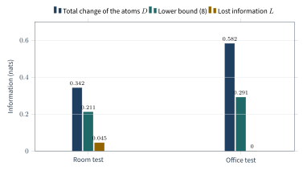
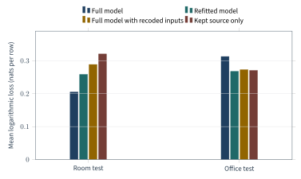
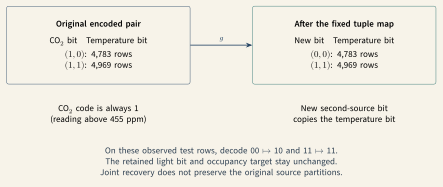

# Source partitions and shared-exclusions information

Sepehr Mahmoudian · 24 October 2026, revised 31 October 2026

Development report. The derivations are written by hand and checked by exact rational
computation or, where stated, in binary64 arithmetic. Z3 checked the event and linear algebra,
not the complete probability theorems. No new Lean proof was accepted for this report. Priority,
calibration, deployment benefit and a complete three-source certificate are not claimed.

## Revision of 31 October 2026

This revision takes in the results of a dated [addendum](ADDENDUM-2026-10-30.md). The addendum
followed an AI-agent review of 28 October 2026 and its
[adjudication record](../../evidence/math-stats-review-adjudication-2026-10-30.md). No number of
the first version changes.

- The identity $D=L+2R$ holds for every recoding, not only for deterministic ones (Section 3).
- A closed form gives the best lower bound from the seven changes of mutual information, with a
  proof and 48 exact dual certificates (Section 3). It is larger than the first lower bound on six
  office distributions.
- The upper bound (1) has a form that uses the target (Section 2). The nonnegative informative
  and misinformative atoms give an exploratory refinement of the range bound (Section 7).
- Section 7 explains how to read the recorded-data results. The evaluation days differ from the
  training days, 205 of the 445 score records are computed on training rows, a refitted model
  changes its smoothing as well as its inputs, and several cells are sparse. Section 7 also
  reports a third upper bound that the study saved.
- The report uses the standard terms of the [pid-rs terminology list](../../../TERMINOLOGY.md).
  For example, *distribution* replaces the earlier *law*, and *redundancy value* replaces
  *cumulative*.
- Section 10 corrects the status statement. The report is on the main branch of the repository;
  the scientific questions that Section 8 lists stay open.

The addendum remains the dated record of these changes and of two repaired replay scripts.

## 1. Question, definitions and assumptions

**Question.** A code can change how sources are represented, for example by merging two rare
values of a sensor pair, while the information about the target stays almost the same. How much
can the partial information decomposition of the sources change then, and which quantities that
are cheap to compute give bounds on this change?

**Why it matters.** Partial information decomposition (PID) splits the information that several
sources carry about a target into atoms: information that is redundant, unique to one source or
synergistic. A recoding can keep the predictive information and still move information between
atoms. An analysis that attributes information to sources then gives a different answer after
the recoding. Bounds on the change tell an analyst, before the atoms are computed, how much a
recoding can change the attribution at most, and when it must change it.

**Object.** The decomposition is the categorical shared-exclusions PID of Makkeh, Gutknecht and
Wibral (MGW), [arXiv:2002.03356v5](https://arxiv.org/abs/2002.03356v5). All logarithms are
natural, so every information value is in nats; the defining paper uses bits. The recoding keeps
every source index and the complete redundancy lattice of the original sources. Signed atoms can
be negative. This is not the continuous shared-exclusions PID of Ehrlich et al., and no result
transfers to another redundancy measure.

**Assumptions.** All variables are categorical with finitely many values. A distribution is a set
of nonnegative probabilities that sum to one; zero probabilities are allowed. A calculation for a
given distribution needs no Gaussian model, no independent rows, no stationarity and no positive
lower bound on the probabilities. A statement about a population from observed rows needs a
separate sampling model, which this report does not supply.

### Terms

| Term | Meaning |
|-----|---------------|
| Source, target | The input variables $S=(S_1,\ldots,S_r)$ and the variable $T$ that they inform about. |
| Recoding | A new representation $S'=(S_1',\ldots,S_r')$ of the sources with the same source indices. A deterministic recoding is a function $S'=f(S)$. |
| Coupling | One joint distribution of $(S,S',T)$ whose marginals are the given distributions of $(S,T)$ and $(S',T)$. |
| Collection, antichain | A collection is a nonempty set of source indices. An antichain is a nonempty family of collections, none of which contains another; its members are its branches. |
| Redundancy lattice | The antichains, ordered as by Williams and Beer (2010): $\beta\preceq\alpha$ when every branch of $\alpha$ contains a branch of $\beta$. Three sources give 18 nodes. |
| Redundancy value | The MGW shared-exclusions redundancy at a node, in nats: the informative part minus the misinformative part. It can be negative. |
| Atom | Möbius inversion on the lattice turns the redundancy values into atoms. Each redundancy value is the sum of the atoms at and below its node. |
| Informative and misinformative atoms | The atoms of the informative part and of the misinformative part. MGW Theorem IV.3 proves that they are never negative. A signed atom is their difference. |
| Total change of the atoms | $D=\sum_\alpha\lvert\Delta_\alpha\rvert$, where $\Delta_\alpha$ is the old signed atom minus the new one at node $\alpha$. |
| Variation of information | $V_B=H(S_B'\mid S_B)+H(S_B\mid S_B')$, a distance between two partitions of the outcomes (Section 2). |
| Tail mass | The fraction of rows whose recoded pair is not one of the two pairs that the code keeps. |

### Symbols

| Symbol | Meaning and domain |
|-----|---------------|
| $r,[r],i$ | Number of sources ($r\ge1$), the index set $\lbrace1,\ldots,r\rbrace$, one index |
| $S,S',T$ | Old and new source vectors and the common finite target |
| $P$ | A coupling of $(S,S',T)$ |
| $B,S_B$ | A collection $B\subseteq[r]$ and the subvector $(S_i)_{i\in B}$ |
| $\alpha,\beta,\mathcal L$ | Antichains (nodes) and the redundancy lattice of the $r$ sources |
| $E_\beta^S(s)$ | Source event of node $\beta$ at the reference outcome $s$ |
| $G_\beta,C_\beta,\Pi_\alpha$ | Mean event surprise, redundancy value and signed atom, in nats |
| $U_{\alpha\beta}$ | Entry of the Möbius matrix: row of atom $\alpha$, column of redundancy value $\beta$ |
| $H,I$ | Shannon entropy and (conditional) mutual information, in nats |
| $V_B,w_B$ | Variation of information of collection $B$ and its integer weight |
| $\Delta_\alpha,D$ | Old minus new signed atom, and the total change of the atoms, in nats |
| $L_B,L$ | Change of the mutual information of $S_B$, and of the whole vector $S$, with $T$ |

### Information facts that the proofs use

Let $A$ and $B$ be any finite variables; in this paragraph $B$ is not a collection. The entropy is
$H(A)=-\sum_{a:P(a)>0}P(a)\ln P(a)$. The conditional entropy $H(A\mid B)$ is the average, over the
values $b$ with positive probability, of the entropy of $P(A\mid B=b)$. The mutual information is
$I(A;T)=H(T)-H(T\mid A)$. Outcomes of zero probability are left out of every sum, which is the
convention $0\ln0=0$. Every logarithm that is evaluated has a positive argument.

The proofs use two facts. The chain rule $H(A,B)=H(B)+H(A\mid B)$ follows by expanding conditional
probabilities. The inequality $H(A\mid B,T)\le H(A\mid B)$ holds because the difference is a
conditional mutual information, an average of sums $\sum p\ln(p/q)$ in which $q$ is the product of
the conditional marginals. For $x>0$, $-\ln x\ge1-x$, so
$\sum p\ln(p/q)\ge\sum_{p>0}(p-q)\ge0$. Neither fact assumes that the sources are independent.

## 2. Main upper bound

The coupling must have *both* given marginals, $P(S,T)$ and $P(S',T)$. A matching of the two source
histograms that ignores the target is not enough. For each collection $B$, the variation of
information

$$
V_B=H(S_B'\mid S_B)+H(S_B\mid S_B')
$$

measures how much the partition of the outcomes by the values of $S_B'$ differs from the partition
by the values of $S_B$ under the coupling; see
[Meilă (2005)](https://doi.org/10.1145/1102351.1102424). It does not use the target, and it is not
a distance between the marginal histograms.

Let $U$ be the Möbius matrix of the lattice (Proof 5 below). Set

$$
c_\beta=\sum_\alpha\lvert U_{\alpha\beta}\rvert,\qquad
w_B=\sum_{\beta:B\in\beta}c_\beta,\qquad
D=\sum_\alpha\lvert\Pi_\alpha(S;T)-\Pi_\alpha(S';T)\rvert.
$$

Here $B\in\beta$ means that $B$ is a branch of $\beta$. Then

$$
\boxed{D\le\sum_{\varnothing\ne B\subseteq[r]}w_BV_B.}\qquad(1)
$$

For three sources the exact coefficients give

$$
\boxed{D\le22\sum_{|B|\in\lbrace1,2\rbrace}V_B+V_{\lbrace1,2,3\rbrace}
       \le67\sum_{i=1}^3V_{\lbrace i\rbrace}.}\qquad(2)
$$

The bound needs no positivity of any atoms, no factor for the number of target values and no lower
bound on the cell probabilities. Its coefficients grow with the size of the lattice, and the
entropy terms can grow with the number of source values. It depends on the number of sources and
is not optimal.

### Proof 1: the event functional

For a source value $s$ with $P(s)>0$, define the source event and the mean event surprise

$$
E_\beta^S(s)=\bigcup_{B\in\beta}\lbrace u:u_i=s_i\text{ for all }i\in B\rbrace,\qquad
G_\beta(S)=\sum_{s:P(s)>0}P(s)\bigl[-\ln P(E_\beta^S(s))\bigr].
$$

An outcome $u$ is in the event when it agrees with $s$ on every index of at least one branch. The
event contains the reference outcome $s$, so its probability is positive; so is its conditional
probability given $T=t$ when $P(s,t)>0$. Define $G_\beta(S\mid T)$ by computing the same functional
in each target stratum $T=t$ with $P(T=t)>0$ and averaging with weights $P(T=t)$. Expanding the
MGW logarithmic ratio gives

$$
C_\beta(S;T)=G_\beta(S)-G_\beta(S\mid T).\qquad(3)
$$

The first term is the informative part and the second the misinformative part. The first sums over
the target values; the second keeps the weights of the joint distribution of sources and target.

### Proof 2: nested unions

Take $m$ pairs of events $C_j\subseteq D_j$ with $P(C_j)>0$, where $j=1,\ldots,m$ labels
branches. Write $c_j=P(C_j)$, $d_j=P(D_j)$, $c=P(\bigcup_jC_j)$ and $d=P(\bigcup_jD_j)$. The set
difference of the two unions lies in the union of the differences $D_j\setminus C_j$, so the union
bound gives

$$
d-c\le\sum_j(d_j-c_j).
$$

Because $c\ge c_j>0$,

$$
\frac dc\le1+\sum_j\frac{d_j-c_j}{c}
 \le1+\sum_j\left(\frac{d_j}{c_j}-1\right)
 \le\prod_j\frac{d_j}{c_j}.\qquad(4)
$$

For the last step expand the product of the factors $1+a_j$, where $a_j=d_j/c_j-1\ge0$; the cross
terms that the sum leaves out are nonnegative. Thus $0\le\ln(d/c)\le\sum_j\ln(d_j/c_j)$. The
branches may overlap or depend on each other.

### Proof 3: deterministic refinement

Let a fine vector $F$ be coarsened coordinate by coordinate to $A$, with the same source indices:
each $A_i$ is a function of $F_i$. At a value $f$ with $P(f)>0$, write $a$ for its coarse value. For
a branch $B$, put $C_B=\lbrace F_B=f_B\rbrace\subseteq D_B=\lbrace A_B=a_B\rbrace$. Apply (4), take logarithms and average
over $f$:

$$
0\le G_\beta(F)-G_\beta(A)
 \le\sum_{B\in\beta}H(F_B\mid A_B).\qquad(5)
$$

Indeed, the mean logarithmic ratio of one branch is

$$
\sum_fP(f)\ln\frac{P(A_B=a_B)}{P(F_B=f_B)}
=\sum_{f_B}P(f_B)\bigl[-\ln P(F_B=f_B\mid A_B=a_B)\bigr].
$$

The coordinates outside $B$ sum out, and because $A_B$ is a function of $F_B$, the ratio inside the
logarithm is a conditional probability. The right side is the conditional entropy
$H(F_B\mid A_B)$.

Repeat the argument in each target stratum $T=t$ with positive probability and average over $t$.
The increase of the misinformative part lies between zero and
$\sum_{B\in\beta}H(F_B\mid A_B,T)$, which is no larger than the bound in (5). No ratio is formed in
a stratum of zero probability.

### Proof 4: a common refinement

Put $Z_i=(S_i,S_i')$ at each source index $i$. The paired vector $Z$ still has $r$ sources, and it
coarsens coordinate by coordinate both to $S$ and to $S'$. Set

$$
a_\beta=\sum_{B\in\beta}H(S_B'\mid S_B),\qquad
b_\beta=\sum_{B\in\beta}H(S_B\mid S_B').
$$

By (5) with $F=Z$ and $A=S$, the increase $G_\beta(Z)-G_\beta(S)$ lies in $[0,a_\beta]$, because
$H(Z_B\mid S_B)=H(S_B'\mid S_B)$; so does the increase of the misinformative part. By (3), the change
$C_\beta(Z;T)-C_\beta(S;T)$ is the difference of these two numbers. Two numbers in the same interval
differ by at most its length, so the absolute value of the change is at most $a_\beta$; there is no
extra factor two. The same argument with $S'$ gives $b_\beta$, so

$$
|C_\beta(S;T)-C_\beta(S';T)|
 \le a_\beta+b_\beta=\sum_{B\in\beta}V_B.\qquad(6)
$$

Only conditional Shannon entropies were used; no monotonicity of the signed decomposition was
assumed.

**A form that uses the target.** The proof gives slightly more. Write
$a_{\beta,T}=\sum_{B\in\beta}H(S_B'\mid S_B,T)$ and $b_{\beta,T}=\sum_{B\in\beta}H(S_B\mid S_B',T)$.
From $S$ to $Z$ the informative part rises by some $u\in[0,a_\beta]$ and the misinformative part by
some $u_T\in[0,a_{\beta,T}]$. From $S'$ to $Z$ they rise by some $v\in[0,b_\beta]$ and
$v_T\in[0,b_{\beta,T}]$. The difference $C_\beta(S;T)-C_\beta(S';T)$ equals
$(v-v_T)-(u-u_T)$, so it lies in the interval $[-a_\beta-b_{\beta,T},\ b_\beta+a_{\beta,T}]$, and

$$
D\le\sum_\beta c_\beta\max(a_\beta+b_{\beta,T},\ b_\beta+a_{\beta,T}).\qquad(12)
$$

Conditioning cannot increase entropy, so $a_{\beta,T}\le a_\beta$ and $b_{\beta,T}\le b_\beta$:
bound (12) is never weaker than bound (1). It needs no deterministic recoding.

### Proof 5: Möbius inversion on the unchanged lattice

Order the nodes so that lower nodes come first. Let $M$ be the zeta matrix, with $M_{\alpha\beta}=1$
when $\beta\preceq\alpha$ and $0$ otherwise. It is lower triangular with unit diagonal, and
$C=M\Pi$ because each redundancy value is the sum of the atoms at and below its node. In the
following recurrence $i,j,k$ index ordered nodes, not sources, and $\mathbf1_{i=j}$ is one if
$i=j$ and zero otherwise. The inverse $U=M^{-1}$, the Möbius matrix, satisfies

$$
U_{ij}=\mathbf1_{i=j}-\sum_{k < i}M_{ik}U_{kj}.\qquad(7)
$$

A finite average commutes with this fixed linear map, so $\Pi=UC$ also for averaged values. Define
$\Delta C_\beta=C_\beta(S;T)-C_\beta(S';T)$. The triangle inequality and (6) give

$$
D\le\sum_{\alpha,\beta}|U_{\alpha\beta}|\,|\Delta C_\beta|
 \le\sum_\beta c_\beta\sum_{B\in\beta}V_B
 =\sum_Bw_BV_B.
$$

This proves (1); with the interval of the target form in place of (6), the same steps prove (12).

The three-source integer matrix was checked in both directions, $MU=UM=I$. Its column weights are:

| Node family | Number of nodes | $c_\beta$ each |
|---|---:|---:|
| Three singleton branches | 1 | 8 |
| Two singleton branches | 3 | 4 |
| A singleton and the complementary pair | 3 | 4 |
| Three pair branches | 1 | 8 |
| Two pair branches | 3 | 4 |
| One singleton | 3 | 2 |
| One pair | 3 | 2 |
| The full collection | 1 | 1 |

The weights sum to 65. A fixed singleton is a branch of nodes whose weights sum to
$8+4+4+4+2=22$; the same holds for a fixed pair. The full collection is a branch only of the top
node. By the chain rule, $V_B\le\sum_{i\in B}V_{\lbrace i\rbrace}$. Each source belongs to one singleton, two
pairs and the full collection, so its total weight is $22+22+22+1=67$; this proves (2).

## 3. Lower bounds from mutual information

For each collection $B$, define the changes

$$
L_B=I(S_B;T)-I(S_B';T),\qquad L=L_{[r]},\qquad
\Delta_\alpha=\Pi_\alpha(S;T)-\Pi_\alpha(S';T).
$$

Let $J_B=\lbrace\alpha\in\mathcal L:\alpha\preceq\lbrace B\rbrace\rbrace$ be the set of nodes at or below the node
$\lbrace B\rbrace$, which has the single branch $B$. Its source event is $\lbrace S_B=s_B\rbrace$, so its redundancy
value is $H(S_B)-H(S_B\mid T)=I(S_B;T)$. Each redundancy value is the sum of the atoms at and below
its node, and every node lies at or below the top node $\lbrace[r]\rbrace$. Therefore

$$
L_B=\sum_{\alpha\in J_B}\Delta_\alpha,\qquad
L-L_B=\sum_{\alpha\notin J_B}\Delta_\alpha.
$$

The triangle inequality, applied to the two disjoint sums, proves

$$
\boxed{\max_{\varnothing\ne B\subseteq[r]}
 \bigl(|L_B|+|L-L_B|\bigr)\le D.}\qquad(8)
$$

For three sources the seven collections give seven changes, from fourteen values of mutual
information. A lower bound above a declared tolerance rejects a claim that the recoding preserves
the atoms. A small lower bound cannot confirm such a claim. For a general coupling, $L$ can have
either sign.

**Lost information and moved information.** Let $R=\sum_\alpha\max(-\Delta_\alpha,0)$ be the total
of the negative changes. The sum of all atom changes is the change of the top redundancy value,
$I(S;T)-I(S';T)=L$. Splitting the changes into positive and negative parts gives

$$
\sum_\alpha\Delta_\alpha=L,\qquad D=L+2R.\qquad(9)
$$

This identity holds for every pair of distributions on the same lattice. The first version stated
it only for a deterministic recoding; determinism adds only $L\ge0$. Indeed, when $S'=f(S)$, the
chain rule gives $I(S;T)=I(S,S';T)=I(S';T)+I(S;T\mid S')$, so $L=I(S;T\mid S')\ge0$. The total
change of the atoms therefore includes information that moves between atoms, not only
information that is lost.

### The best lower bound from the seven changes

Bound (8) splits the atoms into two groups. All seven changes together give a larger bound, and
its exact value has a closed form. Put $L_\varnothing=0$ and collect the seven equations
$\sum_{\alpha\in J_B}\Delta_\alpha=L_B$ as $A\Delta=L$, where $A$ is the $7\times18$ matrix with
$A_{B\alpha}=1$ when $\alpha\in J_B$ and $0$ otherwise. A maximal chain of collections is a
sequence $\lbrace i\rbrace\subset\lbrace i,j\rbrace\subset[3]$ with $i\ne j$, where $[3]=\lbrace1,2,3\rbrace$; there are six.

**Proposition.** For every vector $L\in\mathbb R^7$ of changes,

$$
\min_{d\in\mathbb R^{18}:\,Ad=L}\ \sum_\alpha|d_\alpha|
=\max_{i\ne j}\bigl(|L_{\lbrace i\rbrace}|+|L_{\lbrace i,j\rbrace}-L_{\lbrace i\rbrace}|+|L-L_{\lbrace i,j\rbrace}|\bigr).\qquad(13)
$$

The true change vector satisfies $A\Delta=L$, so the right side is a lower bound on $D$.

*Proof that the minimum is at least the maximum.* Along a maximal chain the node sets are nested,
$J_{\lbrace i\rbrace}\subseteq J_{\lbrace i,j\rbrace}\subseteq J_{[3]}$, and the last one is the whole lattice. So
$L_{\lbrace i\rbrace}$, $L_{\lbrace i,j\rbrace}-L_{\lbrace i\rbrace}$ and $L-L_{\lbrace i,j\rbrace}$ are sums of $d$ over three
disjoint node sets. The triangle inequality bounds each absolute value by the sum of
$|d_\alpha|$ over its set, and the three sets are disjoint.

*Proof that the minimum is at most the maximum.* Define a number $v(B)$ for every set of source
indices, by increasing size: $v(\varnothing)=0$ and

$$
v(B)=\max_{C\subsetneq B}\bigl(v(C)+\max(L_C-L_B,0)\bigr).
$$

Put $u(B)=L_B+v(B)$.

1. *Both functions are nondecreasing.* For $C\subsetneq B$ the definition gives $v(B)\ge v(C)$. It
   also gives $v(B)\ge v(C)+L_C-L_B$, so $u(B)=L_B+v(B)\ge L_C+v(C)=u(C)$. Both vanish at
   $\varnothing$, so both are nonnegative.
2. *A nondecreasing set function is a sum of nonnegative atoms.* Let $f\ge0$ be nondecreasing with
   $f(\varnothing)=0$. For a level $x\ge0$, the sets $B$ with $f(B)>x$ form a family that is closed
   upwards. Its minimal members form an antichain $\alpha_x$, which is a lattice node when the
   family is not empty. A set $B$ belongs to the family exactly when a member of $\alpha_x$ is
   contained in $B$, that is, exactly when $\alpha_x\in J_B$. Give each node $\alpha$ the weight
   $p_\alpha\ge0$ equal to the length of the set of levels $x$ with $\alpha_x=\alpha$. Then
   $\sum_{\alpha\in J_B}p_\alpha$ is the length of the levels below $f(B)$, which is $f(B)$, and
   $\sum_\alpha p_\alpha=f([3])$.
3. *A feasible vector of the right size.* Apply step 2 to $u$ and to $v$, and put $d=p(u)-p(v)$.
   Then $Ad=u-v=L$ and $\sum_\alpha|d_\alpha|\le u([3])+v([3])=L+2v([3])$.
4. *The value.* Unrolling the definition, $v([3])$ is the largest total decrease of $L$ along a
   chain of strictly increasing sets from $\varnothing$ to $[3]$. Inserting an intermediate
   set never lowers a total decrease, because $\max(x-z,0)\le\max(x-y,0)+\max(y-z,0)$. So the
   largest value occurs on a maximal chain. On any chain, the total variation of $L$ equals its net
   change $L$ plus twice its total decrease. So the bound of step 3 equals the largest
   total variation over the six maximal chains, which is the right side of (13). This proves the
   proposition.

The same proof holds for any number of sources, with the maximal chains of all sets of source
indices.

**Exact dual certificates.** For a chain $(i,j)$ and signs $s_1,s_2,s_3\in\lbrace-1,1\rbrace$, put

$$
y=(s_1-s_2)\,e_{\lbrace i\rbrace}+(s_2-s_3)\,e_{\lbrace i,j\rbrace}+s_3\,e_{[3]}.
$$

Put $\eta=A^\top y$. For a node in $J_{\lbrace i\rbrace}$, $\eta_\alpha=s_1$; for a node in
$J_{\lbrace i,j\rbrace}$ but not in $J_{\lbrace i\rbrace}$ it is $s_2$; otherwise it is $s_3$. So
$|\eta_\alpha|\le1$ for every node, and for every vector $d$ with $Ad=L$,
$y^\top L=\eta^\top d\le\sum_\alpha|d_\alpha|$; with $d=\Delta$ this gives $y^\top L\le D$.
The program [`verification/chain_lower_certificate.py`](verification/chain_lower_certificate.py)
checks all 48 such vectors exactly on the 18 nodes. It evaluates each vector at the saved outward
interval endpoints of the seven changes and keeps the largest result. The bounds are rational
numbers, and no floating-point number enters them. They exceed bound (8) on six of the 30
distributions and equal it on the others:

| Distribution | Bound (8) | Bound (13) | $D$ |
|---|---:|---:|---:|
| Office, 4 February 2015 | 0.079376 | 0.079596 | 0.765299 |
| Office, 5 February 2015 | 0.381779 | 0.394514 | 0.927480 |
| Office, 6 February 2015 | 0.068741 | 0.119510 | 0.568537 |
| Office, 9 February 2015 | 0.540707 | 0.541428 | 1.549248 |
| Office, 10 February 2015 | 0.097649 | 0.150664 | 0.514408 |
| Office validation | 0.402366 | 0.434641 | 1.336128 |

**Outward intervals.** To bound an absolute value from below, use the distance of its interval
from zero. Subtract interval endpoints outward before the second absolute value is taken. Absolute
values of midpoints are unsafe. Exact rational products identify a zero; an interval that
contains zero gives no permission to set an atom to zero.

## 4. Exact invariance and a recoverable-tuple counterexample

For a fixed deterministic map $f$ on the source values that occur, the following two statements
are equivalent.

1. The map preserves the equality partition of every coordinate: for occurring values $s,u$,
   $s_i=u_i$ if and only if $f_i(s)=f_i(u)$.
2. Every original signed atom is unchanged for every finite target kernel. Binary targets already
   suffice.

For sufficiency, the preserved coordinate matches preserve the conjunctions within branches and
the disjunctions across branches. So every event probability, every conditional event
probability, the inversion and the averages are unchanged. Statement 1 says that each new
coordinate is a one-to-one relabelling of the old values of that coordinate. This is the
re-encoding premise of
[Matthias et al., v2, Property 2](https://arxiv.org/html/2512.16662v2).

For necessity, suppose an old coordinate value has two states that the new coordinate separates.
Choose the binary target that indicates one of those two new values. The new coordinate determines
the target, but the old one leaves positive conditional entropy at the merged value, so the mutual
information of that singleton changes. For a violation in the other direction, use an indicator of
one old value. A fixed sum of original atoms therefore changes, which contradicts complete
invariance. The equivalence is not an invariance test for one actual target, and it is not a
converse for random recodings. A constant target makes every signed atom zero.

**A counterexample.** Let $S_1=X=0$, let $Y=(S_2,S_3)$ be $01$ with probability $\delta$ and $11$ with
probability $1-\delta$, where $0<\delta<1$, and let $T=S_2$. Keep the pairs $00$ and $11$, map $01$
to $00$, and keep $X$ and $T$. Training counts $00:50$, $11:49$, $01:1$ could select those kept
pairs; they are not selected again on evaluation data.

Before the recoding only $S_2$ varies, and $S_2=T$. After it, $S_2'=S_3'=T$. The pair stays
recoverable on this support: $H(Y\mid Y')=H(Y\mid X,Y')=L=0$. Before the recoding, the informative
redundancy values are the incidence column of the node $\lbrace\lbrace2\rbrace\rbrace$ in the zeta matrix, times the
target entropy; after it they use the node $\lbrace\lbrace2\rbrace,\lbrace3\rbrace\rbrace$. Every misinformative value is zero,
because $T$ determines every source. Define $h_2(x)=-x\ln x-(1-x)\ln(1-x)$. Inversion gives

$$
\Pi_{\lbrace\lbrace2\rbrace\rbrace}=h_2(\delta),\qquad
\Pi_{\lbrace\lbrace2\rbrace,\lbrace3\rbrace\rbrace}'=h_2(\delta),\qquad
D=2h_2(\delta)>0.
$$

All other signed atoms are zero. Bound (8) for $B=\lbrace3\rbrace$ attains this value, because
$L_{\lbrace3\rbrace}=-h_2(\delta)$ and $L-L_{\lbrace3\rbrace}=h_2(\delta)$. Exact checks covered
$\delta=1/2,1/100,1/10000$. A recoding that keeps the joint information therefore cannot
guarantee that the atoms stay unchanged, even when the tail mass is arbitrarily small.

## 5. An exact comparison when the recoded pair takes two values

Suppose the recoded pair $Y=(S_2,S_3)$ takes exactly two values with positive probability, and the
code $g(Y)$ maps them to two different values, while $X=S_1$ and $T$ are kept. Let $J\subseteq\lbrace2,3\rbrace$
be the set of coordinates in which the two old values differ, and $J'$ the same set for the two new
values. Both sets are nonempty. At a reference outcome with positive probability, put
$E=\lbrace X=x\rbrace$ and $F=\lbrace Y=y\rbrace$.

For a coordinate $j$ in which the two values differ, the event $\lbrace S_j=s_j\rbrace$ equals $F$. For a
constant coordinate the event is certain. No assumption that all four Boolean match patterns occur
is used. So every node event is one of five events: the certain event, $E\cup F$, $E$, $F$ and
$E\cap F$. Their redundancy values are $0,R_2,A,B,C$, with $A=I(X;T)$, $B=I(Y;T)$ and
$C=I(X,Y;T)$, where $R_2$ is the redundancy value of the event $E\cup F$. Set $U_X=A-R_2$,
$U_Y=B-R_2$ and $Q=C-A-B+R_2$. These are four intermediate MGW quantities, not a regrouped final
estimand.

Define the original nodes

$$
R_J=\lbrace\lbrace1\rbrace\rbrace\cup\lbrace\lbrace j\rbrace:j\in J\rbrace,\quad X_0=\lbrace\lbrace1\rbrace\rbrace,\quad
C_J=\lbrace\lbrace j\rbrace:j\in J\rbrace,\quad K_J=\lbrace\lbrace1,j\rbrace:j\in J\rbrace.
$$

In the order $R_J,X_0,C_J,K_J$, the five event forms have the incidence patterns

$$
0000,\quad1000,\quad1100,\quad1010,\quad1111.
$$

For a node $\alpha$ whose event has a given form, a digit is 1 when the node at that position lies
at or below $\alpha$. The four digits therefore record, in turn, whether every branch of $\alpha$
contains $1$ or meets $J$; whether every branch contains $1$; whether every branch meets $J$; and
whether every branch does both. Placing
$R_2,U_X,U_Y,Q$ as atoms at the four nodes $R_J,X_0,C_J,K_J$ reconstructs every original redundancy value $0,R_2,A,B,C$. Inversion is unique because the
zeta matrix is unit triangular, so this is the complete atom vector.

A one-to-one recoding of the pair keeps these four quantities. If $J=J'$, all original atoms
agree. Otherwise only the node $X_0$ is common, and the other three values move to disjoint
original nodes, which proves

$$
\boxed{D=2(|R_2|+|U_Y|+|Q|),\quad J\ne J'.}\qquad(10)
$$

If the pair takes only one value, only the atom of the kept source is nonzero and $D=0$. A map that
merges the two values, or a pair with three values, does not satisfy (10). Within target strata
that contain one value of the pair, keep the complete lattice and average before taking absolute
values. This is a written conditional result; the correspondence between the source paper and a
formal statement remains open.

## 6. Recorded-data design and exact arithmetic

The study uses two public recordings:
[UCI864 Room Occupancy Estimation](https://archive.ics.uci.edu/dataset/864/room+occupancy+estimation)
(DOI 10.24432/C5P605) and
[UCI357 Occupancy Detection](https://archive.ics.uci.edu/dataset/357/occupancy+detection)
(DOI 10.24432/C5X01N), both under CC BY 4.0. Their labels were not audited, and their time zone is
unknown.

| Recording | Original source order | Original target | Training; validation; test |
|---|---|---|---|
| Room | S1_Light, S6_PIR, S7_PIR | Count 0,1,2,3 | 22–25 Dec 2017; 26 Dec; 10–11 Jan 2018 |
| Office | Light, CO2, Temperature | Occupancy 0,1 | 2–8 Feb 2015; 9–10 Feb; 11–18 Feb |

**Binary sources.** Sort the $n$ training values of a reading and take the value at one-based rank
$\lfloor(n+1)/2\rfloor$, the lower median. Encode 1 for a value strictly above it and 0 otherwise,
including ties. The room light threshold is 1 lux; the passive infrared (PIR) inputs are already
bits. The office thresholds are 0 lux, 455 parts per million (ppm) and 20.745 °C. This defines
categorical inputs; it is not a PID of the original continuous readings. The run stops on an
invalid or missing row, a duplicate timestamp or an unexpected date; it does not drop or repair
such rows. The room recording keeps its seven local dates, although the provider's description names four days.

**The code.** Rank the training values of the pair $Y=(S_2,S_3)$ by count, with lexical order for
ties. Keep the two most frequent pairs and map every other pair to the first. Both recordings keep
$00$ and $11$. Each row keeps its $X$ and $T$, and merged rows add their counts. The joint
distribution of $X$ and $T$ is therefore unchanged, and the total variation distance between the
old and the new distribution of $(S,T)$ equals the tail mass. The code, the thresholds and the
predictors are fitted on training days only and then frozen. There are 24 daily and 6 overlapping
pooled distributions: they come from two recordings, not from 30 data sets.

**Exact redundancy values.** For $N$ rows, let $c_z$ be the count of the joint outcome $z$, and
consider each $z$ with $c_z>0$ as a reference outcome. Let $u_z$ be the number of rows in its
source event, $v_z$ the number of those rows that also have the target value of $z$, and $t_z$ the
number of rows with that target value. All three are positive at a reference outcome. Each
redundancy value equals

$$
N^{-1}\ln\prod_{z:c_z>0}
 \left(\frac{Nv_z}{u_zt_z}\right)^{c_z}.
$$

The informative and misinformative parts use the factors $N/u_z$ and $t_z/v_z$. Integer inversion
keeps exact rational products, and comparing a product with one decides the sign or a zero. All
108 keys of stage and component hold paired records before and after the recoding, so there are 216
numerical values, not 108 atoms.

**Logarithm enclosures.** For a rational $x>0$, write $x=2^ky$ with an integer $k$ and $1\le y<2$,
and put $z=(y-1)/(y+1)$. Then $0\le z<1/3$, and

$$
\ln y=2\sum_{i=0}^{63}\frac{z^{2i+1}}{2i+1}+R_{64},\qquad
0\le R_{64}\le\frac{2z^{129}}{129(1-z^2)}.
$$

To obtain this remainder, replace the later denominators by 129 and sum the geometric series. The
same series at $z=1/3$ encloses $\ln2$. A negative $k$ swaps the scaled endpoints. Endpoints are
rounded outward onto the denominator $2^{80}$, signed coefficients are propagated, and every
interval must have width at most $10^{-12}$ nats. Floating-point values are for display only. The
PID distributions are not smoothed, nothing is set to zero, and no accuracy setting, guard, kernel
or default of the library changes.

Separate implementations compare exact keyed products. Prime exponents postpone the arithmetic;
ordinary normalized fractions remain. The old and new test cases agree. Two runs that stopped at a
180-second limit remain recorded as failures. Complete runs took 22.29 and 22.19 seconds on an
M4 Max with 128 GiB, with peak process memory of 80.4 and 82.9 MB. All 121 output files agree
between ordinary and optimized Python, as do 29 distributions from an earlier incomplete run. The
times describe these runs; they are not a controlled speed comparison.

### Models and actual byte costs

Four lookup models with add-one (Laplace) smoothing are fitted: the full model $F(T\mid X,Y)$, the
refitted model on recoded inputs $G(T\mid X,g(Y))$, a model of the kept source alone and a model of
the target alone. The full model is also evaluated, unchanged, at recoded inputs. The predicted
probability is $(a_t+1)/(a+m)$, with the training count $a_t$ of class $t$ in the context, the
training total $a$ of the context, and the fixed number of original classes $m=4$ or $2$. An unseen
context receives the uniform distribution. There is no tuning or model selection.

The scores are the mean negative logarithm of the predicted probability of the observed class and
the multiclass Brier score $\sum_t(q_t-\mathbf1_{t=T})^2$, with predicted probabilities $q_t$. They
differ from the information loss $L=H(T\mid X,g(Y))-H(T\mid X,Y)$ of a known distribution. A class
that is absent from an evaluation set has no class score.

Three containers encode the binary sources: one kept bit plus a fixed two-bit pair, a lossless
dictionary, or a lossy one-bit pair. Each byte count includes the header, codebook, names,
thresholds, row count and padding, and decoding is checked. Targets, timestamps, raw readings,
shared software and acquisition costs are excluded. The dictionary of the test stream is offline
coding of the features with its overhead transmitted; it is not a fitted map.

## 7. Results and limitations

The numbers below are rounded nats. Exact counts, products and outward intervals remain in the
machine-readable records. The upper-bound check was made after the study: all 30 distributions and
2,700 node inequalities were checked, not a selection. In the table, $L$ is the lost mutual
information and bound (8) is the lower bound of Section 3.

| Distribution | Rows | Tail mass | $D$ | $L$ | Bound (8) |
|---|---:|---:|---:|---:|---:|
| Room training | 7,021 | 585/7021 | 0.309875 | 0.097702 | 0.224412 |
| Room validation | 1,063 | 0 | 0 | 0 | 0 |
| Room test | 2,045 | 92/2045 | 0.341754 | 0.044689 | 0.210829 |
| Office training | 8,794 | 707/4397 | 0.421590 | 0.020949 | 0.136466 |
| Office validation | 2,014 | 549/1007 | 1.336128 | 0 | 0.402366 |
| Office test | 9,752 | 4783/9752 | 0.582280 | 0 | 0.291415 |



**A range bound.** A fair comparison uses one more published fact, MGW Theorem IV.3: the
informative and misinformative atoms are nonnegative, and they sum to $H(S)$ and $H(S\mid T)$, the
informative and misinformative values of the top node. Each signed change is
$\Delta_\alpha=(\pi_\alpha^+-\pi_\alpha^-)-(\pi_\alpha'^+-\pi_\alpha'^-)$, so the triangle
inequality gives

$$
D\le H(S)+H(S\mid T)+H(S')+H(S'\mid T)
 \le2[H(S)+H(S')].\qquad(11)
$$

| Recording and role | Upper bound (1) | Range bound (11) |
|---|---:|---:|
| Room training | 26.956702 | 3.408395 |
| Room validation | 0 | 1.911905 |
| Room test | 16.650180 | 2.311007 |
| Office training | 49.429024 | 5.059041 |
| Office validation | 43.983542 | 3.359736 |
| Office test | 27.776867 | 4.354175 |

On every distribution with $D>0$, all 21 of them and five of the pooled ones, the range bound is
smaller than bound (1). On room validation, where $D=0$, bound (1) is exactly zero. Bound (1) is
not a useful small numerical bound here; its value lies in this exact zero for a one-to-one
relabelling and in its sensitivity to partitions. Superiority or optimality of
either bound is not shown. The target form (12) improves bound (1) strictly on 13 of the 30
distributions, by small amounts (room test: from 16.650 to 16.582 nats), and it stays above the
range bound on every distribution with $D>0$.

**A refinement from nonnegative atoms.** For the node $\lbrace B\rbrace$, the informative value is $H(S_B)$
and the misinformative value is $H(S_B\mid T)$. The informative atoms $\pi^+$ and the
misinformative atoms $\pi^-$ are nonnegative, so each of the four atom vectors of the old and the
new distribution lies in a polytope $\lbrace\pi\in\mathbb R^{18}:\pi\ge0,\ A\pi=h\rbrace$, where $h_B$ is
$H(S_B)$, $H(S_B\mid T)$, $H(S_B')$ or $H(S_B'\mid T)$. Hence $D$ lies between the smallest and the
largest value of $\sum_\alpha|\Delta_\alpha|$ over the product of the four polytopes. Only 28
entropies of source sets are needed. The top row of $A$ is all ones, so the largest value is never
above the range bound (11). The smallest value equalled bound (13) on all 30 distributions. The
largest value was computed as a mixed-integer linear program with the HiGHS solver in binary64
arithmetic, so this polytope maximum is exploratory, not a certified bound:

| Pooled distribution | $D$ | Range bound (11) | Polytope maximum |
|---|---:|---:|---:|
| Room training | 0.309875 | 3.408395 | 2.267403 |
| Room validation | 0 | 1.911905 | 0 |
| Room test | 0.341754 | 2.311007 | 1.613103 |
| Office training | 0.421590 | 5.059041 | 5.035341 |
| Office validation | 1.336128 | 3.359736 | 3.281032 |
| Office test | 0.582280 | 4.354175 | 3.747458 |

On the 21 distributions with $D>0$ it is lower than the range bound by 0.5% (office training) to
40% (office, 10 February 2015). The bound stays far above $D$: the entropies of source sets say
nothing about which events the atoms share. The program is kept as
[`verification/component-sandwich-exploratory.py.txt`](verification/component-sandwich-exploratory.py.txt);
it needs NumPy and SciPy and is not a repository command.

**A third saved bound.** The study runner saves a third upper bound for each distribution, under
the key `continuity_upper_interval`. It computes this bound as
$130\min(\ln8,\ \delta\ln(8/\delta)+8\delta)$. Here $\delta$ is the tail mass, 8 is the number of
possible source tuples and 130 is twice the weight sum 65. It comes from an earlier unpublished
note on rare-tuple compression, and this report does not derive it; the run only checks that it
lies above $D$. On the 21 distributions with $D>0$ it lies between 49.3 and 270.3 nats, so it says
nothing useful about these distributions.

**Prediction scores.** The next figure and the table after it give the mean logarithmic loss in
nats per row; the Brier scores in the full output have no unit.



| Model | Room test | Office test |
|---|---:|---:|
| Full model | 0.204922 | 0.312825 |
| Refitted model | 0.258447 | 0.267742 |
| Full model at recoded inputs | 0.288580 | 0.272705 |
| Kept source only | 0.320536 | 0.270571 |

Room test has no rows of target class 1; all four classes stay in the output. Refitting worsens the
room mean test loss and improves the office mean test loss. The office occupied-class loss
nevertheless worsens from 0.148113 to 0.188528. Room validation contains only target 0: its
empirical signed atoms and $D$ and $L$ are zero, yet the refitted loss worsens from 0.057204 to
0.094076. An invariance statement about the evaluation distribution does not fix a predictor that
was fitted on a differently transformed training distribution. There are no population, causal,
calibration or statistical-superiority conclusions.

### How to read the recorded-data results

**The evaluation days differ from the training days.** The code and the thresholds were fitted on
the training days, and the data moved on later days:

| Recording and role | Rows | Tail mass | Constant sources |
|---|---:|---:|---|
| Room training | 7,021 | 0.083 | none |
| Room validation | 1,063 | 0 | $S_2$, $S_3$ |
| Room test | 2,045 | 0.045 | none |
| Office training | 8,794 | 0.161 | none |
| Office validation | 2,014 | 0.545 | none |
| Office test | 9,752 | 0.490 | $S_2$ |

On every office test row the carbon-dioxide bit is 1, because the training median (455 ppm) lies
below all test values. About half of the office validation and test rows therefore fall outside
the two kept pairs, against 16.1% in training. The office changes measure a code frozen on
training data under this shift, not compression in general.

**Why no information is lost on the office validation and test days.** On the test days only the
pairs $10$ and $11$ occur, and the code maps them to $00$ and $11$, so it is one-to-one there. On
the validation days the code merges $10$ with $00$, but only rows with the light off ($S_1=0$) have
both pairs, and all of those rows are unoccupied. Where occupancy varies ($S_1=1$), only $10$ and
$11$ occur. In both cases the recoded sources carry the same information about occupancy, so $L=0$
exactly, while $D$ is large: by (9), the whole change is information that moves between atoms.

**Scores on training rows are in-sample.** Of the 445 score records, 205 are computed on training
rows, 65 on validation rows and 175 on test rows. No record contains a context that is absent from
training, so the uniform distribution for unseen contexts is never used.

**Refitting also changes the smoothing.** Each lookup model adds one pseudocount per class to each
context. Merging contexts before fitting gives the merged context one pseudocount per class, where
the original contexts had one each. A comparison of the full model with the refitted model
therefore changes the inputs, the counts and the shrinkage together.

**Why refitting worsens the room validation score.** All room validation rows are unoccupied and
have the pair $00$; 196 of the 1,063 rows have the light on. In training, the rows with the light on
and a merged pair are 570 occupied out of 581, while the rows with the light on and the pair $00$
are 668 occupied out of 2,538. Refitting merges the two groups, so the predicted probability of an
empty room for the light on and the pair $00$ falls from 0.7360 to 0.6026. The loss on each of those
196 rows rises from 0.3065 to 0.5065, and $(196/1063)\times0.2000=0.0369$. For the 867 rows with the
light off the predicted probability changes by less than $10^{-5}$. This accounts for the observed
change from 0.0572 to 0.0941 to four decimal places.

**Sparse cells.** The room training distribution occupies 21 of its 32 cells, and six cells hold at
most five rows. The room test distribution occupies 12 cells, two of them with a single row, and
the office test distribution occupies 7 of 16 cells, one with a single row. Atoms computed from
such counts are exact for these finite distributions, but as estimates of a population they are
biased. For two independent fair bits observed twice, for example, the expected empirical mutual
information is $\tfrac14\ln2>0$, although the true value is zero.

### A recorded example with two values of the pair

Office test has the pair $10$ on 4,783 rows and the pair $11$ on 4,969 rows. The carbon-dioxide bit is
always 1; the physical concentration need not be constant. The map $10\mapsto00$, $11\mapsto11$
makes the new bit at the carbon-dioxide index copy the temperature bit. The map is one-to-one on
this observed support: the joint predictive information is unchanged, but the attribution to
sources moves.



In (10), $J=\lbrace3\rbrace$ changes to $J'=\lbrace2,3\rbrace$.

| Quantity | Old node | New node | Signed value, nats |
|---|---|---|---:|
| $R_2$ | {{1}, {3}} | {{1}, {2}, {3}} | 0.178414142 |
| $U_X$ | {{1}} | same | 0.069388796 |
| $U_Y$ | {{3}} | {{2}, {3}} | $-0.032706479$ |
| $Q$ | {{1, 3}} | {{1, 2}, {1, 3}} | 0.080019167 |

All other signed atoms are zero. With the unrounded values, (10) gives $D\approx0.582279577$. The
negative atom stays; it is not a causal importance of a sensor.

On the test days the fixed container uses 3,949 bytes, the lossless one 2,721 and the lossy one
2,718. Lossless coding costs only three header bytes more than lossy coding, at the same payload
width. After decoding the
original $y$, a receiver can still evaluate the same $G(x,g(y))$. It obtains the same predicted
probabilities and keeps the original coordinates for attribution and audit. This is a derived
software alternative, not another experiment, and it depends on the stated offline codebook, not
on unknown future support. Choosing a model need not require discarding the original
representation.

## 8. Evidence, failures and research process

**AI role and review.** The derivations were written and checked in AI-agent sessions. Several AI
model critiques, each written before its author saw the others, reviewed the written proofs. The
primary agent session then checked the premises and the files instead of counting agreement. No
named human has checked the proofs. The proof by nested unions and the proof by refinement of one
branch agree. The approaches compared included no action, mutual and conditional mutual
information, direct prediction loss, lossless coding and evaluation on the complete lattice.
Named review criteria describe what the review covered; they are not independent people.

On 28 October 2026 a further AI agent reviewed this report, its scripts and its data. A second
session checked every claim of that review against the repository files or a new computation, and
recorded the result in the
[adjudication record](../../evidence/math-stats-review-adjudication-2026-10-30.md). The review was
sound in its mathematics and in the defects it reproduced: two replay scripts failed, and the
status statement of Section 10 was out of date. Its statistical discussion missed the points that
Section 7 now explains. The two scripts were repaired, and the repaired runs reproduce all 121
published campaign files and the saved upper-bound check byte for byte; the
[addendum](ADDENDUM-2026-10-30.md) gives the details. This review and its adjudication are model
output; their agreement is correlated, not independent evidence.

**Formal checks.** Z3 5.3.1 returned 46 unsat and 3 sat results for explicit event congruences,
inequalities of source sets and signs, and controls that drop a premise. The 28 sign cases reduce
to 14 coefficient forms. Exact matrices give the weights 22 and 67. These are checks of the
algebra, not a formal probability theorem. The Z3 4.16.0 checks and the Lean versions that the
repository fixes elsewhere did not change.

**Exposure and selection.** The data and their earlier results were known before the study.
Algorithmic revisions kept the failed attempts and did not change the scientific predicates; no
best of several scientific results was selected. The model family, the defining paper, the
interpreter, the host, the owner and the file records are shared points of failure. The training
data of the models are unknown, so agreement cannot establish originality or that no publication
exists. Bounded searches found related work on invariance and partitions, not a priority result.

**Rejected approaches.** Kept as failures: equality of marginals or recovery of the whole vector as
evidence that the atoms are preserved; costs in one direction only; pointwise extensions; changed
targets or couplings with the wrong marginals; and bounds that ignore the number of values. The
mean event surprise is not concave in general: probabilities $1/2$ on $00$ and $11$ give
$G=\ln2$, all probability on $01$ gives zero, but their equal mixture gives
$\tfrac12\ln(4/3)<\tfrac12\ln2$. A draft in another source format and two attempts to export the
figures also failed, and they are kept. No correction changed a scientific kernel, default,
precision or expected outcome.

**Open questions.** A formal probability proof, the correspondence between the source paper, this
report and the Rust code, sampling calibration and the five programmes A to E of a complete
three-source certificate remain open.

## 9. Rust implementation and computational cost

The default `stable::categorical::discrete_sxpid_n` supports two to four sources. The new bounds
and the exact comparison have no production Rust interface. The exact Python reference programs
use three binary sources, up to four target values, $N\le32{,}768$ rows and $Q_{\rm occ}\le32$
occupied outcomes.

The medians cost $O(N\log N)$; counting and scoring cost $O(N)$. Direct source events cost
$O(18Q_{\rm occ}^2\cdot3)$. Dense inversion needs quadratic storage and cubic arithmetic. Integer
powers, greatest common divisors and series have costs that depend on the number of bits, with a
limit of 1,048,576 bits per integer. A failed preflight, an expired deadline or an unresolved
interval stops the run; the accuracy is never relaxed. The 48 dual certificates of bound (13) need
$48\times18$ exact sums and a comparison per distribution. The exploratory polytope program solves
a mixed-integer linear program per distribution in binary64.

The variations of information and the seven changes of mutual information can bracket the total
change of the atoms before the atoms are computed. Uses with neural, imaging or embodied data need
their own categorical mapping, paired transformation, target and validation. No neural inference,
resampling, online control, sensor removal or energy experiment took place. No timing of a Rust
implementation is reported.

## 10. Reproduction and citation

[summary.csv](summary.csv) covers all 30 distributions. The exact records keep the counts,
products, intervals, class losses, matrices and the failed and successful attempts. This report was
first published on 24 October 2026 and revised on 31 October 2026; both versions are on the main
branch of the repository. Being on the main branch does not settle the open questions of
Section 8.

**Replay.** Put the four raw recordings in the location that the
[scripts guide](../../../scripts/README.md) names. From the repository root, the following commands
replay the study, replay the saved upper-bound check and check the dual certificates of bound (13):

```
V=audit/research/source-coupling-compression/verification
E=audit/research/source-coupling-compression/evidence
python3 -I -B $V/run_study_v3.py NEW_DIRECTORY
python3 -I -B $V/post_study_bound.py NEW_DIRECTORY_2
python3 -I -B $V/chain_lower_certificate.py
diff -r -x EXECUTION.json NEW_DIRECTORY $E/campaign
cmp NEW_DIRECTORY_2/REPORT.json $E/coupling-bound.json
```

The option `--raw-dir DIRECTORY` after the first argument of the first program selects another
directory of raw data. The last two commands must report no difference: of the published campaign
files, only the timing record `EXECUTION.json` differs between runs.

Method: Makkeh, Gutknecht and Wibral (2021), *Introducing a differentiable measure of pointwise
shared information*, [v5](https://arxiv.org/abs/2002.03356v5),
[version of record](https://doi.org/10.1103/PhysRevE.103.032149). Partitions: Meilă (2005),
linked in Section 2. Re-encoding context: Matthias, Makkeh, Wibral and Gutknecht (2026),
*[Novel Inconsistency Results for Partial Information Decomposition](https://arxiv.org/html/2512.16662v2)*,
Property 2. The data sources and their DOIs are in Section 6. Software:
[CITATION.cff](../../../CITATION.cff).

Suggested citation: Sepehr Mahmoudian, *Source partitions and shared-exclusions information*
(2026), with the exact containing commit or release. Cite MGW separately.
