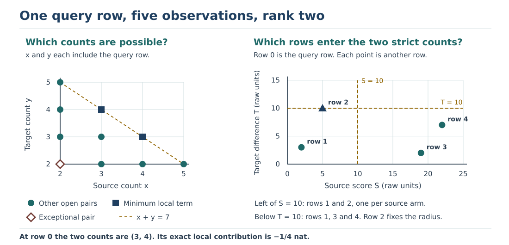

# Which strict neighbour counts can occur?

**Sepehr Mahmoudian · 25 November 2026**

Two sensor channels can each admit a different neighbour. Replacing their union by one channel, or counting the anchor twice, changes the result. Which integer counts can a correct implementation return? We answer this question for one observation at a time. We give the exact range, identify a boundary case with probability zero under a density, and derive sharp limits on one local term. A five-observation experiment checks both source channels in the public Rust report.

## Terms and quantities

A **sample** is an ordered list of observations, called rows. The **query row**, also called the **anchor**, is the row used as the distance origin. A **neighbour rank** gives a position in a list of distances sorted in increasing order. A **shell** contains the rows at a specified distance. A **strict** ball contains rows at a smaller distance. A **disjunction** accepts a row if either source test accepts it. A **nat** is the information unit for the natural logarithm. Counts and ranks are dimensionless.

The first object is the local sample contribution of the continuous shared-exclusions estimator of Ehrlich et al. It uses two real scalar sources and one real scalar target. Its source score is the smaller of two absolute source differences. It can be zero for distinct rows. The second object is estimator 1 for mutual information, due to Kraskov, Stögbauer and Grassberger (KSG). Here it has one real scalar source and one real scalar target. It uses their absolute differences. Fix the raw numerical scales and use identity preprocessing in both cases. The shared arithmetic below gives no identification of the two population quantities. [Ehrlich et al., Eq. 14 and Appendix H, arXiv:2311.06373v3](https://arxiv.org/html/2311.06373v3) · [KSG, Eq. 8, arXiv:cond-mat/0305641v1](https://arxiv.org/html/cond-mat/0305641v1)

Let $n\ge2$ be the number of rows and $1\le k<n$ the neighbour rank. For each row $j$ other than the anchor, write $S_j$ for its source score and $T_j$ for its absolute target difference. The joint distance is $J_j=\max(S_j,T_j)$. Let $R$ be the $k$th smallest $J_j$. For the first result, assume $R>0$, exactly $k-1$ rows below $R$, and exactly one row at $R$. The symbol $\#$ denotes the number of elements in a set. Define

$$
x=1+\#\{j:S_j<R\},\qquad y=1+\#\{j:T_j<R\}.
$$

Ehrlich includes the anchor inside both positive-radius balls. KSG excludes the anchor and adds one before the local calculation. The radius used here is $\epsilon(i)/2$ in the original KSG notation for anchor $i$. In their separate estimators these rules give the displayed integer arguments. This report uses the target-only strict count in Ehrlich Appendix H Algorithm 5. The repository records its reading of the inconsistent algorithm label in the caller. [Source-reading record](../../../audit/source-errata.json)

## Exact range at one anchor

A pair of integers is possible in either scalar construction **if and only if**

$$
k\le x\le n,\qquad k\le y\le n,\qquad x+y\le n+k.
$$

To see necessity, divide the $n-1$ other rows into four disjoint groups. A row is inside both balls precisely when $J_j<R$. The sizes of the groups follow.

| Strict tests passed | Number of rows | Reason |
|---|---:|---|
| Both | $k-1$ | The shell rank fixes the joint interior. |
| Source only | $p=x-k$ | Subtract the anchor and both-test rows from $x$. |
| Target only | $q=y-k$ | Subtract the anchor and both-test rows from $y$. |
| Neither | $d=n+k-x-y$ | Subtract the other three groups from $n-1$. |

Each size must be nonnegative. Conversely these inequalities specify valid sizes. Take the anchor at zero and set $R=1$. Choose $k-1$ rows strictly inside both balls. Fill the other three groups with their strict interior components below one and their exterior components greater than two. If $p>0$, change the target component of one source-only row to one. If $p=0$ and $q>0$, change the source component of one target-only row to one. If $p=q=0$, then $d=n-k>0$. Change both components of one of those rows to one. Exactly one row is now at joint distance one. For the two-source rule, choose one source difference equal to the desired score and the other strictly larger. Distinct full observations are possible throughout.

An **open set** here contains a small ordinary Euclidean ball in the space of all sample coordinates. Exactly the pairs in the triangle with $x+y\ge2k+1$ occur on such a set. If $p+q>0$, the selected shell row has one component strictly inside and the other on its boundary. All other decisive inequalities have positive gaps. Small changes to the coordinates preserve them while the radius follows the shell row. Whole-row coincidences, equal coordinates and ties between two different neighbours can also be avoided. Let $U$ and $V$ be signed coordinate differences, viewed as linear functions of the full sample. If $U$ and $V$ are not identically equal up to sign, $|U|=|V|$ requires $U-V=0$ or $U+V=0$. Each equation describes one proper hyperplane, a set defined by one nonzero linear equation. With two different neighbours at a fixed anchor, the signed functions are distinct up to sign. There are finitely many such equalities over all anchors. Their union cannot cover an open ball. Thus an open witness can also have positive, untied ranks at every anchor.

The only omitted pair is $(k,k)$. Its unique shell row must satisfy $S_j=T_j=R$. One of the absolute source-coordinate differences must then equal the absolute target difference. This equality is confined to finitely many proper affine hyperplanes. Its set has empty interior and zero ordinary volume. With only two observations and $k=1$, the pair $(1,1)$ is possible at exact component differences $(1,1)$. The other possibilities $(1,2)$ and $(2,1)$ persist under small changes. There is only one neighbour, so an equality between its own two components need not be a tie between neighbours.

## When a random sample can give each pair

If the full list of sample coordinates has a joint density with respect to ordinary volume, the exceptional pair and ties between different neighbours have probability zero. Dependence is permitted in this statement. A particular open region can still have probability zero under a dependent or nonidentically distributed sample.

If the rows are independent, identically distributed draws from **any common Lebesgue density**, every open pair has positive probability at the designated anchor. Write $D=2$ for the row dimension in scalar KSG, and $D=3$ for the two-source calculation. Choose a point $z$ where its density $f$ has a finite positive value and where the average of $|f-f(z)|$ over shrinking balls tends to zero. Such points exist by the differentiation theorem and $\int f=1$. Place a small ball around each row of an open witness. Translate and shrink the whole configuration toward $z$ by a factor $\lambda>0$. This transformation preserves the count pair. All the new row balls fit in a ball of radius $C\lambda$ about $z$, for one constant $C$. Each has volume $c_i\lambda^D$ with $c_i>0$. The integral of $|f-f(z)|$ over the containing ball is $o(\lambda^D)$, which means its ratio to $\lambda^D$ tends to zero. Thus the probability of row ball $i$ is at least $f(z)c_i\lambda^D-o(\lambda^D)>0$ for sufficiently small $\lambda$. Independence gives positive probability for all rows together. The bound need not be large. [Tao, *An Introduction to Measure Theory*, Theorem 1.6.19](https://terrytao.wordpress.com/wp-content/uploads/2012/12/gsm-126-tao5-measure-book.pdf)

Continuous one-coordinate marginals do not imply a joint density. For example, take independent draws of a real scalar variable with a density. Let the first source and target both equal this variable, and the second source equal twice the variable. For every neighbour $S_j=T_j$. Positive distinct joint distances occur almost surely, and each anchor then has $(k,k)$. This singular law does not meet the population-support declaration for the production estimator.

## Several rows on the shell

For this paragraph permit repeated observations and multiple shell rows. Let $h$ be the number below a positive $R$ and $c$ the number on it. Fix integers $0\le h<k\le h+c\le n-1$. The four group sizes must now be

$$
h,\qquad x-h-1,\qquad y-h-1,\qquad n+h+1-x-y.
$$

Their nonnegativity is sufficient. Fill the four groups. Designate $c$ of the noninterior rows as shell rows. On source-only or target-only shell rows, set the other component to $R$. On a shell row outside both strict tests, set both to $R$. Set an exterior component strictly above $R$ on all remaining noninterior rows. If every shell row must avoid $S_j=T_j$, the necessary and sufficient extra condition is $c\le x+y-2h-2$. Only the two one-test groups can then supply shell rows. This is an exact mathematical classification with unrestricted repeats. When full rows must all be distinct, the scalar KSG square has only four corners. In the two-source construction an unused continuous source coordinate can distinguish corner rows. Additional requirements on individual coordinate values give additional restrictions. Production estimators can refuse ambiguous positive radii and zero radii.

## Sharp local limits and the sample average

Let $H_0=0$ and $H_m=\sum_{i=1}^m1/i$ for every positive integer $m$. The local harmonic contribution in nats is

$$
L=H_{k-1}+H_{n-1}-H_{x-1}-H_{y-1}.
$$

Write $u=\lfloor(n+k)/2\rfloor$ and $v=\lceil(n+k)/2\rceil$, the greatest integer below or equal to the midpoint and the least one above or equal to it. The minimum of $L$ equals $H_{k-1}+H_{n-1}-H_{u-1}-H_{v-1}$. It occurs at $(u,v)$ and $(v,u)$, one pair when $u=v$. To minimize $L$, first make $x+y=n+k$ by increasing an available argument. If $y\ge x+2$, transferring one from $y$ to $x$ increases the two subtracted terms by $1/x-1/(y-1)>0$. Repetition leads to the midpoint. This minimum occurs on an open set at one anchor.

The literal maximum is $H_{n-1}-H_{k-1}$, attained only at $(k,k)$. Dropping that exceptional pair reduces the maximum by exactly $1/k$. It then occurs at $(k,k+1)$ or $(k+1,k)$. This follows directly from strictly increasing harmonic numbers and the support of the count pairs. At $n=2,k=1$, the exceptional row gives one nat and every other admissible row gives zero.

If every anchor obeys the stated assumptions, averaging its inequalities gives the same bounds on the whole sample mean. A joint density permits the smaller upper bound almost surely because there are finitely many anchors. Both upper bounds are sharp for the sample mean. In fact the following samples attain the respective upper bounds at every rank at once.

Choose $z_i=2^i$ for $i=0,\ldots,n-1$. From every anchor the absolute differences to the other $z_i$ are positive and distinct. Two equally distant neighbours on opposite sides would give three distinct powers of two in arithmetic progression. Their outer terms have a sum with two nonzero binary digits, whereas twice the middle term has one. For the literal upper bound set the first source and target equal to $z_i$. For the two-source rule also set the second source to $2z_i$. Each row then has $S_j=T_j$ at every anchor. Each rank gives $(k,k)$, so the whole mean achieves $H_{n-1}-H_{k-1}$.

To attain the smaller upper bound on an open set, keep the sources and instead set the target to $(1+\varepsilon)z_i$. Take $0<\varepsilon<1$. At each anchor order the scalar distances as $d_1<\cdots<d_{n-1}$. Choose $\varepsilon$ smaller than every ratio $d_{j+1}/d_j-1$ over all these finite lists. For $n=2$ there is no ratio constraint. The explicit value $\varepsilon=2^{-n}$ works for all $n$. Every nonzero gap between these integer distances is at least one and $\varepsilon d_j<1$. At rank $k$ the radius is $(1+\varepsilon)d_k$. Exactly $k-1$ target distances and exactly $k$ source scores are below this radius. For $k<n-1$ the next source distance exceeds it. For $k=n-1$ every nonanchor source is inside. Thus $(x,y)=(k+1,k)$ for all anchors and ranks. The strict gaps persist on an open set of complete observations. Under any common independent row density, a translated, rescaled open witness has positive probability as shown above. The two-source construction here can keep the second arm farther away. The worked test below makes both arms contribute.

At $k=n-1$, the lower and nonexceptional upper limits coincide at zero. Thus the exact sample mean is zero almost surely under a joint density. For $k<n-1$, the general question of attaining the sharp *lower* one-anchor limit at every anchor requires separate analysis. The constructions above do not give the sharp sample-mean minimum for all $n,k$.

## The smallest sample with a negative mean

For three rows and first neighbours, $n=3,k=1$, the sharp sample-mean minimum is $-1/3$ nat. The only negative local value is $-1/2$, at $(x,y)=(2,2)$. The other pairs give zero, $1/2$ or $3/2$. At a negative anchor there are two other rows and neither passes both strict tests. Its counts require exactly one source-only and one target-only neighbour. Thus one edge incident to that anchor has $S<R\le T$ and the other has $T<R\le S$. This includes the non-shell edge, which must pass the strict test missed by the shell edge.

Distances are symmetric in their two endpoints. Mark an undirected edge when its source distance is strictly smaller than its target distance. Each negative vertex is an endpoint of exactly one marked edge. If all three vertices were negative, the total count of marked endpoints would be three. But each marked edge has two ends. Hence at most two vertices can be negative, giving a sum at least $-1$ and a mean at least $-1/3$.

To attain it, set the source and target coordinates of the three rows $A,B,C$ to $(0,0),(4,1),(1,7)$. For two sources use twice the first source as the second. Edges $AB,AC,BC$ have $(S,T)=(4,1),(1,7),(3,6)$. Their joint distances are $4,7,6$. At $A$ and $B$ the counts are $(2,2)$. At $C$ both source differences are below six and neither target difference is below six, giving $(3,1)$. The respective terms are $-1/2,-1/2,0$.

A second construction assigns source and target coordinates $(0,0),(10,1),(1,12)$ and second-source coordinates $0,100,200$. The joint edge distances in the same order are $10,12,11$. The same three pairs and the same mean follow. Both constructions persist on open sets of the full sample coordinates. Thus the sharp one-anchor minimum $-1/2$ cannot be the three-row sample-mean minimum. The general lower-extremum question for other ranks $k<n-1$ and sample sizes remains open here.

## A gap for an infinite family of sample sizes

Take first neighbours, $k=1$, and let $n=2m+1$ with $m$ a positive odd integer. These are the sample sizes $3,7,11,\ldots$. The only minimizing local count pair is $(m+1,m+1)$. Its local value is $L_0=H_{2m}-2H_m$. At such a row each of its $2m$ neighbours passes exactly one strict test. Exactly $m$ incident edges satisfy $S<T$, and the remaining $m$ satisfy $T<S$. If all observations attained $L_0$, marking the edges with $S<T$ would give exactly $m$ marked edges at each of $n$ vertices. The total number of marked edge ends would be $nm$, which is odd. Each edge has two ends. At least one observation must therefore have a different count pair.

To compute the smallest possible loss, write $a=x-1$ and $b=y-1$, so $a+b\le2m$. On $a+b=2m$ the best unbalanced pair is $(m-1,m+1)$ or its reverse. The subtracted harmonic sum then falls below $2H_m$ by $1/m-1/(m+1)=1/[m(m+1)]$. With $a+b\le2m-1$ the best sum of prefixes is $H_m+H_{m-1}$, a loss of $1/m$. Thus at least one term exceeds $L_0$ by $1/[m(m+1)]$ or more. For every admitted sample in either geometry the mean $\overline L$ satisfies

$$
\overline L\ \ge\ H_{n-1}-2H_{(n-1)/2}+\frac{4}{n(n^2-1)}.
$$

The correction is positive at every listed sample size and decreases to zero. At three rows it gives the sharp result $-1/3$ nat proved above. At seven rows it improves the lower bound from $-73/60$ to $-253/210$ nats. Simultaneous attainment of the improved bound for $n\ge7$ remains open here. When $n$ is one more than a multiple of four, the corresponding degree sum is even and this parity argument makes no decision. Higher ranks permit rows that pass both strict tests.

## A worked test with two source channels

The five rows below are fixed test inputs. Their columns are source one, source two and target in the raw common numerical scale. Remain at $k=2$. At row 0 the other rows have source scores $2,5,19,22$ and target differences $3,10,2,7$. Their joint distances are $3,10,19,22$. Source one alone admits row 1. Source two alone admits row 2. The target admits rows 1, 3 and 4. Thus $(x,y)=(3,4)$. The local term is $1+25/12-3/2-11/6=-1/4$ nat.

| Anchor | Raw input | Radius | $x$ | $y$ | Exact local nats |
|---:|---|---:|---:|---:|---:|
| 0 | $(0,0,0)$ | 10 | 3 | 4 | $-1/4$ |
| 1 | $(2,26,3)$ | 3 | 3 | 2 | $7/12$ |
| 2 | $(33,5,10)$ | 10 | 3 | 4 | $-1/4$ |
| 3 | $(19,27,2)$ | 5 | 2 | 3 | $7/12$ |
| 4 | $(41,22,7)$ | 5 | 2 | 3 | $7/12$ |

Adding the five exact terms gives $5/4$ nats and dividing by five gives $1/4$ nat. The actual public Rust report returned `0.25000000000000017` nats. Its diagnostics report summaries across rows. The first exact reader recovered the table and checked six quantiles for each of seven diagnostic series. The later reader checked all twelve series, or 72 quantiles, and both counts of undefined slopes. A run without a support declaration and a run with rank zero returned their designated errors. These observations test the stated example. They support no population estimate for a real sensor system. For an individual count error, the direct distance and event table suffices. Task loss or ablation requires a task, a model and genuinely held-out observations. [Actual Rust call](native/src/main.rs) · [Returned summaries](represented-report.json) · [Exact row calculation](two_arm.py)

## Formal statement and finite checks

The five named Lean results concern **lists of nonnegative integer distance triples** with a fixed anchor at zero. Lean proves both implications in the triangle classification for all $n,k,x,y$ with $0<k<n$. A constructive witness at radius two realizes every allowed pair, including $(k,k)$. The two-source score is the actual minimum of the two integer source distances. A general list lemma counts both of two Boolean tests and bounds the size of their union. Eight exact example predicates cover empty data, zero radius, one and two shell members, component equality, a wrong count, and the five-row example. The stock compiler also rejects the designated false assertion. The analytic argument supplies real coordinates, open sets, probability and harmonic optimization. The compiled formal model has no probability measure or floating-point arithmetic. The Lean axiom `propext` makes logically equivalent propositions equal. The axiom `Classical.choice` selects an element of a nonempty type. The axiom `Quot.sound` makes the quotient images of related representatives equal. [Model](lean/Model.lean) · [Five proofs](lean/Proof.lean) · [Exact controls](lean/Observer.lean) · [Trust and replay](EVIDENCE.md)

A separate exhaustive calculation puts each coordinate in $\{1,2,3\}$ and puts the anchor at zero and the test radius at two. It enumerates all 714 scalar KSG multisets and all 31,464 two-source multisets with two through five total observations. The observed sets agree with the four-group equations for all tested ranks and tie counts, both with and without same-row component equality on the shell. This finite grid checks the distinct geometries and does not cover every real sample. [Enumeration](finite.py) · [Exact output](finite-observations.json)

## Rust implementation and computational cost

The public Ehrlich entry point is `pid_core::experimental::continuous::isx_redundancy_report` under feature `experimental-continuous`. The KSG comparator is the stable `pid_core::ksg_mi_report`. Each needs the appropriate support declaration and numerical checks. For inference, the continuous estimator assumes independent samples, regular full-dimensional laws, a valid scale choice and a suitable rank. Coordinates are real numbers in the proof. The production calls use binary64, the 64-bit binary floating-point format. The five-row array has two scalar source columns, one scalar target column and five distinct joint observations. There is no fitted transform, training, resampling or held-out estimate here.

Given $R$, a single-anchor count uses $n-1$ distance evaluations. Sorting the scores to find the rank takes $O(n\log n)$ time and $O(n)$ space. A rank selection followed by counting can avoid a full sort. The Rust Ehrlich report scans all pairs. Its main coordinate work is $O(n^2D)$ in row dimension $D$, with up to $O(pn)$ working storage for $p$ simultaneous queries in addition to inputs and report data. The KSG implementation can prune its tree searches on suitable inputs, but its full stable report also scans the sample to check neighbour shells. Neither report needs a stored $n$ by $n$ distance matrix. The relevant report checks the supplied resource budget. Cancellation and available memory must be assessed for the chosen entry point and workload. No sensor latency or native estimator-only timing was measured. The serial proof validation took 8.24 seconds with a maximum sampled process-group memory of 153,206,784 bytes on one Apple arm64 host. That is a proof workload. [Engineering costs](../../../RUST_IMPLEMENTATION_AND_COST.md) · [Ehrlich implementation](../../../crates/pid-core/src/isx.rs) · [KSG implementation](../../../crates/pid-core/src/ksg.rs)

The twelve series contain the joint radius, the source-union and target counts, both source-arm counts, and the local information value. Four more series report the overlap count and the fraction of the source union in the overlap, each at the full and half radii. An empty union has overlap fraction zero. The last two report the change in the base-two logarithm of each arm's count when the radius doubles. The change is undefined if a required count is zero. The reader checks the number of undefined slopes for each arm. It requires exact agreement on all the fixed noninformation fields. It allows an absolute error of $10^{-12}$ nats on local information and the mean. It also checks the input shape, rank and error flags. All 18 specified altered reports were refused.

For a positive finite binary64 radius, the predecessor is the greatest representable value strictly below it. For a represented finite distance, comparing it to that predecessor with `≤` implements strict `<` at the radius. This includes the smallest positive representable radius. Input conversion, subtraction, quantization or a change of scale can change the order itself. The classification can detect an impossible count or a lost source arm. It gives no proof that the floating-point implementation refines the real calculation on arbitrary data, no guarantee of estimator calibration, and no ranking of sensor systems.

**Citation.** Sepehr Mahmoudian (2026), *Which strict neighbour counts can occur?* Include the exact repository commit or release used. The count classification and its formal model are project derivations. The continuous estimators retain their defining authors. No scientific priority or recorded human review is claimed. [Software citation](../../../CITATION.cff) · [Ehrlich et al., DOI version](https://doi.org/10.1103/PhysRevE.110.014115) · [Kraskov et al., DOI version](https://doi.org/10.1103/PhysRevE.69.066138)
