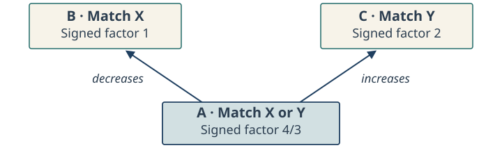

# When are all 18 local shared-exclusion calculations finite?

**Sepehr Mahmoudian · 22 November 2026**

A finite table contains three categorical sources and one target. For which reference states can we evaluate both shared-exclusion logarithms at every one of the 18 nodes? Every pair is finite exactly when the records with all four reference labels have positive total weight. This criterion also covers a zero-weight record whose labels occur elsewhere in the table. In an eight-trial example, every proper source event occurs, yet a complete response is missing.

## Terms and symbols

An **index** identifies a record. A **state** contains its three source labels and its target label. A **key** supplies the state at which we evaluate events. A **branch** selects source coordinates that must all match the key. A **family** accepts a match on any of its branches. A valid **antichain** is a nonempty family of nonempty branches, with no branch strictly containing another. Each valid family is a **node**. A **cumulative** is the shared information at one node. An **atom** is that node's contribution after subtracting contributions from lower nodes. We use the finite categorical shared-exclusions definition of Makkeh, Gutknecht and Wibral. A bit uses a base-two logarithm. A nat uses a natural logarithm. [Defining paper, Sections II and IV and Appendix A](https://arxiv.org/pdf/2002.03356v5) · [Journal record](https://doi.org/10.1103/PhysRevE.103.032149)

Let $I=\{1,2,3\}$ be the three positions. The Lean code numbers these positions $0,1,2$ in the same order. $K$ is a finite set of indices in a type $J$. The weight $w_j$ is a nonnegative integer. The map $s_j$ gives the three source labels and $t_j$ gives the target label. Write $f(j)=(s_j,t_j)$. For a key $k$ in $J$, put $z=f(k)$. The symbol $s_{ji}$ means the label at position $i$ of record $j$. The key can lie outside $K$. The letters $A,a,j$ designate a family, a branch in it and a record index. For a predicate $D$, its **mass** $m(D)$ is a count. An **empirical law** assigns each state its share of the total weight, when that total is positive. Its **support** consists of the states with positive total count. The indicator $\mathbf1_D$ is one on $D$ and zero elsewhere.

For a fixed key, let $G$ be the event that the target matches. Let $E_A$ be the source match. The predicates and counts are

$$
\begin{aligned}
G(j)&\iff t_j=t_k, &
E_A(j)&\iff \exists a\in A\;\forall i\in a,\ s_{ji}=s_{ki},\\
m(D)&=\sum_{j\in K}w_j\,\mathbf1_{D(j)}, &
N&=\sum_{j\in K}w_j,\\
U_A&=m(E_A), & V_A&=m(G\cap E_A), \qquad T=m(G).
\end{aligned}
$$

## The exact support condition

Collect all indices with the key's **complete** labels, including its target. Write $c(z)$ for their total weight. Let $A_*=\{I\}$ be the top node, the one branch containing all three sources. For every $K,w,s,t,k$ above, including $K=\emptyset$,

$$
 c(z)=\sum_{j\in K:\ f(j)=z}w_j
     =V_{A_*}
     =\min_{A\ {\rm valid}} V_A .
$$

**Proof.** At the top node, agreement on every source together with $G$ is exactly equality of complete states. At every valid node, a row with those complete labels matches the target and every branch. The nonempty family therefore accepts the row. Summing nonnegative weights gives $c(z)\le V_A$ at every node. The top node attains equality. The reasoning also applies to an empty table or to a table whose weights all vanish. In either case every count is zero and there is no empirical law to normalize.

Consequently all 18 joint counts are positive exactly when $c(z)>0$. Since $V_A\le U_A\le N$ and $V_A\le T\le N$, this is also the exact condition for all 18 pairs of finite component logarithms. [Original finite-row statements](https://github.com/sepahead/pid-rs/blob/add8134a0c3df6142dcf74b02d9cb14c797bd8ce/audit/research/three-source-alphabet-counts/lean/CountRaw.lean#L157)

The checked theorem `counts_positive` assumes a positive-weight key in $K$ and a nonempty family. The next table shows why this individual weight supplies a sufficient condition.

| Row index in $K$ | Source triple | Target | Weight |
|:--|:--|:--:|--:|
| 1 | $(0,0,0)$ | 0 | 2 |
| 2 | $(0,0,0)$ | 0 | 3 |
| 3 | $(0,0,0)$ | 0 | 0 |
| 4 | $(1,1,1)$ | 1 | 1 |

Use row 3 as the key. The minimum is $2+3+0=5$. An index outside $K$ with the same labels also has minimum $5$. A **single** positive joint count can occur at an absent state. With just the unit row $(0,0,0;0)$, the external key $(0,0,1;0)$ has joint count $1$ at $\{\{1\}\}$ and $0$ at the top. The empirical average evaluates only states of positive mass. These external keys distinguish the premises of an intermediate count calculation.

The support proof needs only containment of events, nonnegative weights and the full-source node. It applies even when the ambient label types are infinite, since only finitely many records contribute. No choice of sampling distribution enters the proof.

## Two ways to write the joint event

In *Introducing a differentiable measure of pointwise shared information*, Equation (4) takes the logical OR of individual source matches. It applies to a family of singleton branches. Equations (5) and (6) use AND inside each branch and OR across branches. Equations (7) and (8) take the base-two logarithm of the conditional target probability divided by the marginal target probability. Their displayed indicator subscript ends in $n$, although Equation (6) counts the branches with $m$. We use the $m$ supplied branches from Equation (6). This reading agrees with Equations (15a) and (15b). [Paper, pages 2, 3 and 5](https://arxiv.org/pdf/2002.03356v5)

Equation (15b) intersects $G$ with the source event. The unnumbered joint-event formula in Appendix A puts $G$ inside the intersection over the members of each branch. Call this predicate $D_A$. For every family allowed by the Lean type, the exact difference in counts is

$$
\begin{aligned}
D_A(j)&\iff \exists a\in A\;\forall i\in a,\
              \bigl(G(j)\land s_{ji}=s_{ki}\bigr),\\
m(D_A)-V_A&=\mathbf1_{\{\emptyset\in A\}}\,(N-T).
\end{aligned}
$$

**Proof.** In a nonempty branch, extracting the repeated target condition gives $G(j)$ and all source matches. If all branches are nonempty, their union gives $G\cap E_A$. This also covers an empty family, whose union is empty. If the family contains the empty branch, its empty conjunction is true at every record. Then $D_A$ and $E_A$ contain every record, while $G\cap E_A=G$. This proves the count identity. Both paper formulas agree at every admissible node. For a family that contains the empty branch, the counts also agree if and only if $N=T$. Zero-weight target mismatches cannot change that count. [Paper, Appendix A, page 13](https://arxiv.org/pdf/2002.03356v5) · [Lean joint count](https://github.com/sepahead/pid-rs/blob/add8134a0c3df6142dcf74b02d9cb14c797bd8ce/audit/research/three-source-alphabet-counts/lean/CountRaw.lean#L45)

For a finite check, use two unit-weight rows with different targets. Take the first as key and the family consisting of the empty branch. There are two rows in total and one target match. The external target test gives $V_A=1$. The distributed test counts both rows. Lean accepts this family as a value of its raw type. Its separate validity predicate excludes it from the scientific carrier. The following truth table makes the target mismatch visible. [Lean family and validity definitions](https://github.com/sepahead/pid-rs/blob/add8134a0c3df6142dcf74b02d9cb14c797bd8ce/audit/research/three-source-alphabet-counts/lean/Contract.lean#L9)

| Two-row example with one empty branch | Key row | Other row |
|:--|:--:|:--:|
| Target matches | Yes | No |
| External joint event | Yes | No |
| Distributed joint event | Yes | Yes |

## From counts to signed information

For $N>0$, the empirical probability of state $z$ is $c(z)/N$. Grouping the indices by $f(j)$ preserves $N,U_A,V_A,T$ because their predicates depend only on labels and the fixed key. For any real function $h$ on the observed states, grouping gives

$$
 \sum_{j\in K:\,w_j>0}w_j h(f(j))=\sum_{z:c(z)>0}c(z)h(z).
$$

Splitting a state count among several indices therefore preserves the law. The 22nd theorem compares weights and labels throughout the *same* finite index set. Finite rational probabilities admit natural weights by taking a common denominator. Finite laws with irrational probabilities require another representation. The algebra concerns the empirical law. Using frequencies to draw conclusions about a population requires separate sampling assumptions.

Fix $c(z)>0$. The probabilities of the source event, its intersection with the target, and the target are $U_A/N,V_A/N,T/N$. Equations (14a), (15a) and (15b) give these local factors $q$ and nats $i$. The superscripts identify the informative component, the misinformative component and their signed difference. Both component logarithms are nonnegative. The signed logarithm is zero exactly when $NV_A=U_AT$.

$$
 q^+_A(z)=N/U_A,\qquad q^-_A(z)=T/V_A,\qquad
 q^{\rm net}_A(z)=NV_A/(U_A T),\qquad i^u_A(z)=\ln q^u_A(z).
$$

Multiplying the paper's bit value by $\ln 2$ gives nats. Equation (17) weights each supported state by its complete joint probability. For $u\in\{+,-,\mathrm{net}\}$, its empirical cumulative is

$$
 C_A^u=\sum_{z:c(z)>0}\frac{c(z)}{N}\,i_A^u(z)
      =\frac1N\ln R_A^u,\qquad
 R_A^u=\prod_{z:c(z)>0}q_A^u(z)^{c(z)}.
$$

For example, a copied binary label has states $(0,0,0;0)$ and $(1,1,1;1)$ with counts 2 and 1. The top-node signed factors are $3/2$ and $3$. Their weighted product is $27/4$, giving $\ln(27/4)/3$ nats. Equal weights on the two keys would give $\ln(9/2)/2$. To check that these differ using only integers, square $27/4$ and cube $9/2$. The results are $729/16$ and $729/8$. [Paper, Equation (17), page 8](https://arxiv.org/pdf/2002.03356v5)

## A missing response in eight synthetic trials

Can every one- and two-channel response occur at each stimulus while a complete response is missing? Let each trial represent one fixed observation window. Each of three invented response indicators is 1 if its neuron fires in the window and 0 otherwise. The target is the binary stimulus label. At each stimulus, put one row in the table for each response triple $000,011,101,110$. These four triples have an even number of ones. The eight rows define the empirical law. They are synthetic.

Consider the unobserved key $(111;1)$. There are $N=8$ rows and $T=4$ rows with stimulus 1. The table shows four of the 18 source events. The count $U_A$ includes either stimulus. The count $V_A$ includes only stimulus 1.

| Match required at $111$ | $U_A$ | $V_A$ | Signed value (nats) |
|:--|--:|--:|:--|
| At least one response equals 1 | 6 | 3 | 0 |
| The first response equals 1 | 4 | 2 | 0 |
| The first two responses both equal 1 | 2 | 1 | 0 |
| All three responses equal 1 | 0 | 0 | Undefined |

For the first two channels, only $110$ matches both ones. Its two trials give informative and misinformative components of $\ln(8/2)=\ln 4$ and $\ln(4/1)=\ln 4$ nats. Their difference is zero. Any pair of binary channel values fixes the remaining bit by even parity, so every pair occurs once per stimulus. Each of the 17 proper nodes has a branch of one or two channels. The source event at each such node has $U_A=2V_A>0$ because each matching response occurs with both stimuli. Its signed ratio is one.

Only the full-source node requires $111$. Its counts give no finite real component logarithms, and the signed ratio has denominator zero. Looking up the count of $(111;1)$ therefore rules out a complete local profile before evaluating any logarithms. At the occupied key $(110;1)$ the full-source counts are $U_A=2$ and $V_A=1$. All 18 pairs are finite there. The empirical average uses the eight occupied keys. An empty cell in a recording means that its key was absent from those trials. Its population probability and the outcome of a future trial remain open.

Two integer calculations checked all 16 keys, all 18 nodes and all six source orders. Each order had eight missing and eight occupied keys. We used the categorical shared exclusions of Abdullah Makkeh, Aaron J. Gutknecht and Michael Wibral. Williams and Beer average, over target outcomes, the least specific information supplied by a source set. The continuous shared exclusions of Ehrlich and coauthors use densities. [Categorical definition](https://arxiv.org/pdf/2002.03356v5) · [Williams and Beer](https://arxiv.org/abs/1004.2515v1) · [Continuous definition](https://arxiv.org/abs/2311.06373v3) · [Exact counts](parity-results.json)

Ehrlich, Schneider, Priesemann, Wibral and Makkeh used categorical shared exclusions to study quantized neural-network activations and class labels. Their measure of **representational complexity** weights each atom by the size of its smallest source set and divides the sum by total mutual information. In the eight trials, the response distribution is the same at each stimulus. The stimulus and the complete response thus have zero mutual information. The normalized complexity in Equation (5) is undefined for this example. [Neural representations, Sections 3.1–3.2](https://arxiv.org/html/2209.10438v2#S3.E5)

## When the two components increase

For nodes $A,B$, write $A\preceq B$ when each branch of $B$ contains a branch of $A$. Then $E_B\subseteq E_A$. The checked `U_antitone` and `V_antitone` give $U_B\le U_A$ and $V_B\le V_A$. With positive denominators and a fixed key, each unsigned component increases weakly along this order, as in Theorem IV.2. The signed difference can go in either direction on the same empirical law. Let $X,Y$ be independent fair bits. The third source $X\mathbin{\mathrm{xor}}Y$ is one exactly when the first two bits differ. Take $Y$ as the target. Use one row for each of $(X,Y)=(0,0),(0,1),(1,0),(1,1)$. Each supported key gives the same three rows of counts below. [Paper, Section IV.A, pages 5–6](https://arxiv.org/pdf/2002.03356v5)

| Node | Counts $(N,U,V,T)$ | $q^+$ | $q^-$ | $q^{\mathrm{net}}$ |
|:--|:--|--:|--:|--:|
| $A=\{\{1\},\{2\}\}$ | $(4,3,2,2)$ | $4/3$ | $1$ | $4/3$ |
| $B=\{\{1\}\}$ | $(4,2,1,2)$ | $2$ | $2$ | $1$ |
| $C=\{\{2\}\}$ | $(4,2,2,2)$ | $2$ | $1$ | $2$ |

At key $(0,0,0;0)$, three rows match $X=0$ or $Y=0$. Two of those rows have target zero. This gives $4\cdot 2/(3\cdot2)=4/3$ at $A$. The same ratios occur at each supported key, so averaging preserves both directions.



## From cumulatives to atoms

For the atom at node $i$, let $M$ be the inverse of the incidence matrix $Z$ in any fixed listing of the nodes, where $Z_{ij}=1$ when node $j\preceq i$ and zero otherwise. This inverse implements **Möbius inversion**, which subtracts lower-node contributions. Given the correct integer $M$, Equation (13) and Appendix A give the atom product $\prod_j(R_j^u)^{M_{ij}}$ over all 18 nodes. Its log divided by $N$ is the averaged atom. A product below, equal to, or above one gives a negative, zero, or positive information value, respectively. The 22 Lean statements cover integer predicates, equalities and inequalities. Verification of the full chain requires separate statements for regrouping, normalized probabilities, logs, the oriented inverse, all 108 coordinate identities, interval containment and the compiled verifier. [Paper, Equations (13), (A1) and (A2)](https://arxiv.org/pdf/2002.03356v5) · [Certificate obligations](https://github.com/sepahead/pid-rs/blob/5628bb6e2b6f14619a72a045a0dbb3ab8cbf6186/claims/SX-CERTIFIED-AVERAGED-PID3-001/obligations.md)

## Checking the evidence

The companion ledger gives each of the 22 theorem names in the judge's order, its decision procedures, its source equation, its exact implication and its next proof obligation. The readback compares every printed theorem type with the separately named target, then checks the typed consumer and its direct proof reference. This review read the existing Lean 4.34.1 records at commit `add8134a0c3df6142dcf74b02d9cb14c797bd8ce`. Revision 1 stopped on unused equality instances. Revision 2 stopped on generated helper names. Revision 3 stopped on its file-backing requirement. Revision 4 supplied the accepted count records. The present paper adds handwritten propositions and finite execution evidence. [22-row ledger](LEDGER.md) · [Recorded declaration stream](https://github.com/sepahead/pid-rs/blob/add8134a0c3df6142dcf74b02d9cb14c797bd8ce/audit/research/three-source-alphabet-counts/declarations.txt) · [Hosted proof replay](https://github.com/sepahead/pid-rs/actions/runs/44447939145)

| Stock rows | Scope and additional assumptions |
|:--|:--|
| 1–4 | Event order, self-match, agreement of maps and evaluation on coordinate-equality bits. |
| 5–9 | Natural weights on a fixed finite set. Filtered sums need decidable event predicates. |
| 10–12 | Membership in event filters. These statements need neither weights nor decidable equality of row indices. |
| 13–19 | Four subset bounds, then bounds for an in-set key. The last two statements require positive weight on that individual key. |
| 20–22 | Order of both counts, then equality on the same finite set, including its zero-weight rows. |

Two finite calculations evaluated the predicates using Python sets and Ruby bit masks. Across 256 raw families, eight source-match patterns and two target truth values, 1,024 of 4,096 cases distinguished the two target placements. All 288 cases on the 18 valid nodes agreed. The calculations also tested every binary key on 513 fixed tables. These comprised the empty table and all one-state or two-state tables with each occupied count in $\{1,2\}$. Computing 147,744 joint counts gave 8,208 table–key comparisons. In each case the top-node count and the minimum joint count equaled the full state mass. These bounded checks complement the proofs above. The two programs share the mathematical interpretation, fixtures and host. Model-assisted review traced the source and declarations. The counters use complete label values for their keys. Equal labels at a zero-weight index and an outside index select the same counts. The handwritten proof supplies their index-level interpretation. Independent human adjudication remains open. [Python calculation](check_sets.py) · [Ruby calculation](check_masks.rb) · [Current claim decision](https://github.com/sepahead/pid-rs/blob/5628bb6e2b6f14619a72a045a0dbb3ab8cbf6186/claims/SX-CERTIFIED-AVERAGED-PID3-001/decision-v3.md)

The retrieved revision-5 PDF, source archive and TeX member matched the recorded byte hashes. The source record gives the hashes and immutable locators. The equation checks in this review use that arXiv revision. The publisher and DOI register identify the journal article. A comparison with the publisher's full text and an independent acquisition under separate custody remain open. Program A and the complete certificate retain their proposed/open status. [Versioned primary source](https://arxiv.org/abs/2002.03356v5) · [Publisher record](https://doi.org/10.1103/PhysRevE.103.032149) · [Source identities](sources.json)

## Rust implementation and computational cost

The stable categorical API `pid_core::stable::categorical::discrete_sxpid3_averaged` accepts four integer-coded matrices with a common row count and runs with default features. Each row contributes one empirical observation. Each source group and the target can contain more than one matrix column. Let $D$ be their combined width and $q$ the number of occupied complete states.

For $N$ expanded rows the four matrices hold $ND$ labels. Grouping and sorting the row states also depend on $D$. On a complete specialized pass, every occupied state triggers one target scan and two scans for each of the 18 nodes. Each scan visits $q$ table entries. This gives $37q^2$ event-table visits. Computing subset mutual information and inverting the lattice take additional work. Memory includes row labels, subset histograms, the occupied table and temporary atoms for one state. The averaged path omits retained pointwise outputs. With four fixed-width categorical groups the main stored label payload is of order $ND$. Distinct joint tuples contribute up to $qD$ stored labels.

The explicit budget caps planned allocations and operations. Cooperative cancellation or a budget or shape failure ends the call with an error. This is offline evaluation with no fitting, resampling or population inference. The Rust execution uses machine counts and binary64 logarithms. The exact count and product arguments above require separate compiled refinement and error bounds. The exact reference uses integer counts and rational factors. Its arithmetic cost also depends on the factors’ bit lengths. This study reports no elapsed time for the estimator or proof checker. [Rust implementation](https://github.com/sepahead/pid-rs/blob/5628bb6e2b6f14619a72a045a0dbb3ab8cbf6186/crates/pid-core/src/sxpid.rs#L2334) · [Source-derived cost reference](https://github.com/sepahead/pid-rs/blob/5628bb6e2b6f14619a72a045a0dbb3ab8cbf6186/RUST_IMPLEMENTATION_AND_COST.md)

## Recomputing the finite checks

Run these commands in this study's directory with Python 3.11 or later and Ruby. They recompute the integer and rational examples and compare the 22 ledger rows with the archived declaration and dependency streams. The two Python modes and Ruby must agree. The parity calculation compares every event count and the relabeled key and node in 1,728 records. The comparison reads the shipped Lean records and the four pinned source files. The original study gives its separate instructions for compiling the stock Lean proofs. To rebuild the PDF, also install Pandoc, LuaLaTeX with the repository fonts, Poppler and `rsvg-convert`. [Replay and required inputs](replay.py) · [Parity checker](check_parity.py) · [Literal Boolean tally](parity_rows.rb) · [Stock study](../three-source-alphabet-counts/README.md)

```text
python3 -ISB replay.py
python3 -OISB replay.py
python3 -ISB build_pdf.py --check
```

**Citation.** Sepehr Mahmoudian (2026), *When are all 18 local shared-exclusion calculations finite?* Include the exact repository commit or release. Cite Makkeh, Gutknecht and Wibral (2021) separately for categorical shared exclusions. [Software citation](../../../CITATION.cff) · [Defining article](https://doi.org/10.1103/PhysRevE.103.032149)
