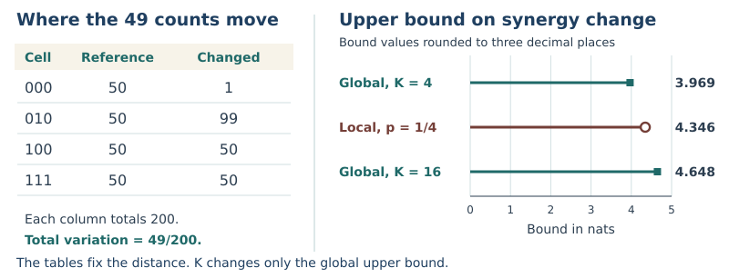

# How the support count changes a synergy bound

**Sepehr Mahmoudian · 2026**

Two formulas give upper bounds for the same pair of device tables. An upper bound gives a limit on the size of the change. A different upper bound on the number of occupied cells can change the answer.

## The two device tables

A **cell** lists two input bits and an output bit, in that order. The output is one exactly when both inputs are one. This rule is the Boolean AND function. In the reference distribution, the two inputs are independent and each bit has equal chances of zero and one.

The **support** is the set of cells with positive probability. Its union across two distributions includes every cell present in either distribution. $K$ is an integer upper bound on the size of that union. Here $p$ is the smallest positive reference probability.

**Total variation distance**, written $\eta$, is half the sum of the absolute probability changes. A **nat** is the information unit for natural logarithms. An **atom** is one term in a decomposition of information. Here the signed quantity is the synergy atom of the full two-source categorical shared-exclusions decomposition. [Defining paper](https://arxiv.org/abs/2002.03356v5)

| Cell | Reference count | Changed count |
|---|---:|---:|
| 000 | 50 | 1 |
| 010 | 50 | 99 |
| 100 | 50 | 50 |
| 111 | 50 | 50 |
| Total | 200 | 200 |

A count divided by 200 gives its probability. The table defines two complete distributions for this example. All other cells have probability zero in both distributions. The changed distribution keeps the AND rule.

Both distributions have the same four-cell support. Here $p=50/200=1/4$.

The first cell loses 49 counts and the second gains them. Thus $\eta=(49+49)/(2\times200)=49/200=0.245$.

For each cell, the signed value equals its informative part minus its misinformative part. Each distribution weights those values by its own probabilities. The result is its **signed averaged synergy**.

## Local and global bounds

Both formulas bound the absolute difference between the two averaged synergy values. The local bound uses the common support and requires $0<\eta<p$.

$$
A_p(\eta)=-\ln(1-\eta/p)-\eta+2\eta\ln(1/p).
$$

The two supports can differ for the global bound. Its formula requires $K\ge2$. The floor symbol rounds down to an integer.

$$
B_K(\eta)=\eta\,[12+\ln\lfloor K^2/4\rfloor-2\ln\eta].
$$

The number 12 includes 10 from the two-source synergy coefficients and 2 from the global distance bound. Both expressions take the value zero at zero distance. If the union contains one cell, both distributions give it probability one.



Here $1-\eta/p=1/50$. The local bound rounds to **4.346307242 nats**.

- With **$K=4$**, $\lfloor4^2/4\rfloor=4$. The global bound rounds to **3.968825682 nats**. It is below the local bound.
- With **$K=16$**, $\lfloor16^2/4\rfloor=64$. The global bound rounds to **4.648109919 nats**. It is above the local bound.

The second calculation uses a deliberately loose upper bound on the same four occupied cells. The complete binary alphabet has only eight possible cells. Throughout the comparison, the distributions and the local bound stay fixed.

The comparison uses the two formulas before any additional limit from the range of the atom. These are the **uncapped** bounds. The original local theorem permits a smaller averaging coefficient, $\ln((1+p)^2/(4p))$, in place of $\ln(1/p)$. [Local derivation, two-source synergy](../../../DEPENDENCY_COLORED_SXPID_CONCENTRATION.md) · [Global derivation, Theorem 4 and equations (34)–(38)](../../../SUPPORT_CHANGE_TOLERANT_AVERAGED_SXPID_CONTINUITY.md)

## Device measurements

Two device tables can describe the same categorical inputs and output under two settings. Their probabilities give the movement and the support count. A reader can then bound the change in averaged synergy without calculating the atom. A direct atom calculation answers a different question about the actual change.

Two tables of 200 counts can also be identical. Their distance is then zero. In the changed table above, the smallest positive probability is $1/200$. Table size alone determines neither the distance nor the smallest positive probability. For sampled device data, the calculation describes the empirical tables. A confidence statement about the device requires a sampling model.

---

## Conditions for each calculation

The comparison uses a movement between two previously identified crossings. This choice shows that the order can reverse. It gives no frequency for reversals in device data.

- A support limit of three fails because four cells have positive probability.
- Exchanging the reference and changed tables preserves the distance. The new reference minimum is $1/200$, so the local condition fails.
- If the actual change matters, direct calculation of the two atoms uses the full probability tables. The upper bounds alone cannot give that value.
- If only the distribution changes matter, total variation already answers the question. It needs no decomposition into atoms.

The two bounds are project derivations for the published shared-exclusions measure. The arithmetic check uses the exact example counts. AI assistance helped prepare the explanation and its checks. The source reports describe the mathematical and formal review for each underlying result.

## Rust implementation and computational cost

The stable Rust function `pid_core::stable::categorical::discrete_sxpid2_averaged` computes averaged atoms from aligned categorical rows. It requires no experimental feature.

The worked comparison reads four count pairs and evaluates two formulas. It calls no estimator and fits no model. With aligned counts for $m$ listed cells, the count scan uses $O(m)$ operations. The supplied program keeps $O(m)$ counts and uses fixed precision for the displayed numbers. No timing is reported. [Rust source](../../../crates/pid-core/src/sxpid.rs) · [Engineering cost reference](../../../RUST_IMPLEMENTATION_AND_COST.md)

## Reproduce the example

The count file fixes the variable order and all four cells. The programs use Python 3.11 or later and its standard library. In the study directory, enter the two commands in this order.

```sh
python3 -I -S -B example.py --check
python3 -I -S -B verify_numbers.py
```

Place `-O` before `-I` to repeat both commands with the optimized interpreter. The option `--write` regenerates the SVG. The second program compares rational upper and lower limits for each logarithm. These limits establish both strict inequalities and all three displayed values. The program also tests the zero-distance case and rejects an invalid support limit. [Counts](counts.json) · [Drawing and decimal arithmetic](example.py) · [Rational check](verify_numbers.py)

The optional PDF build uses the repository's shared publication styles, Pandoc, LuaLaTeX and librsvg. The command `python3 -I -S -B build_pdf.py --output reader.pdf` makes a new copy. The option `--check` compares a fresh build with the shipped PDF. The option `--check-committed` inspects the saved sources, PDF and links without typesetting. The publication profile in `publication.json` binds the source files, shared styles, figure, PDF and link targets.

**Citation.** Mahmoudian, Sepehr (2026). *How the support count changes a synergy bound*. Include the exact pid-rs commit or release. [Software citation](../../../CITATION.cff)
